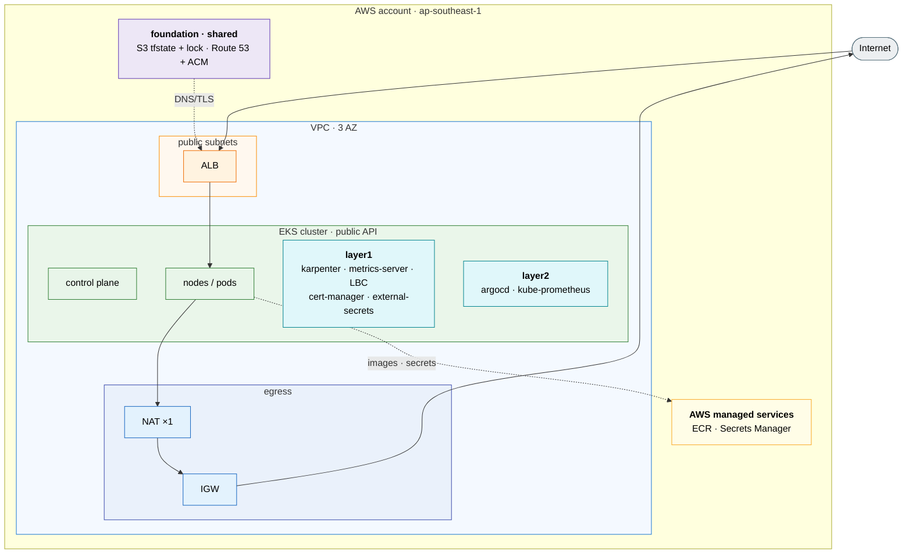
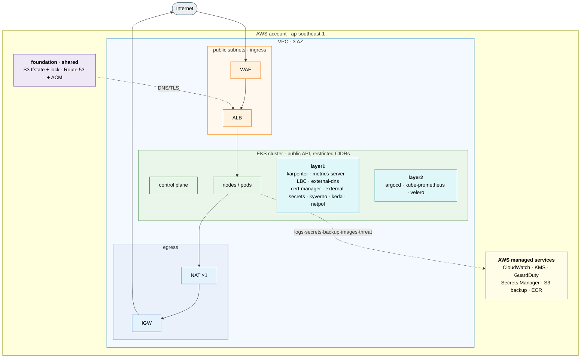
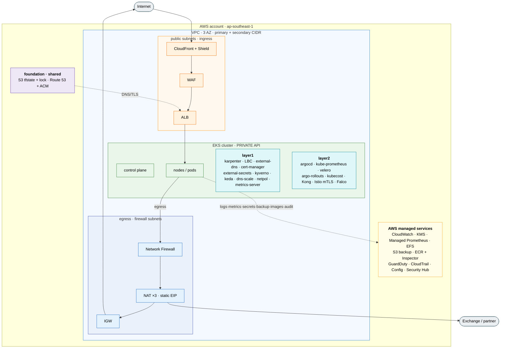

# Architecture per size

Each size builds on the previous. `foundation` (S3 state + Route 53/ACM) is shared
by all. Diagrams are Mermaid — GitHub renders them inline.

**Colour legend:** 🟣 foundation · 🟠 edge/ingress · 🟢 EKS · 🟦 add-ons · 🔵 network (NAT/firewall/IGW) · 🟡 AWS managed services · ⚪ external.

Notes that apply to every size:
- Image pulls (ECR) and secret reads (Secrets Manager) go through **VPC interface
  endpoints** — private, skipping the NAT — not shown to keep the diagrams clean.
- Add-ons in the `layer1`/`layer2` boxes are Helm releases running as pods.

---

## Small (dev/lab)

Cluster + core add-ons, public API, single NAT, nothing paid.

---

## Medium (staging)

Small **plus**: WAF at the edge, control-plane logging, secret encryption, network
policy, GuardDuty, backup, image scanning, and DNS/policy/event-scaling add-ons.

---

## Large (prod / regulated)

Medium **plus**: CloudFront/Shield, private API, per-AZ NAT, **egress Network
Firewall** (dedicated subnets + app-egress redirect), secondary pod CIDR, EFS,
Managed Prometheus, full security baseline, service mesh, API gateway, progressive
delivery, runtime security.

> Egress path (large): pod → Network Firewall (domain allowlist) → NAT (static EIP)
> → IGW → internet / partner. The static EIP is what exchanges allowlist.
