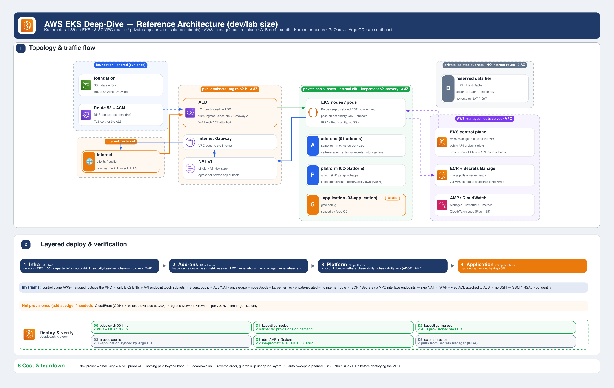
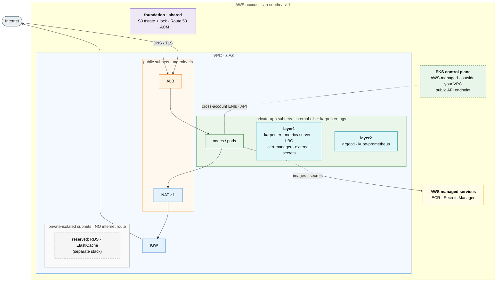
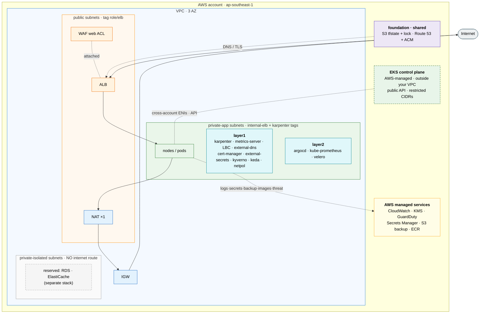
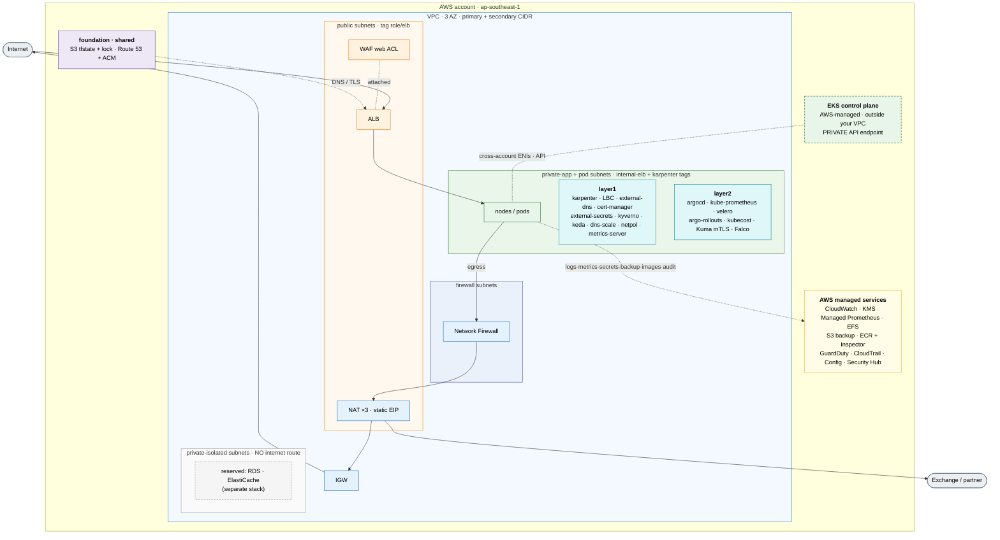

# Architecture per size

Each size builds on the previous. `foundation` (S3 state + Route 53/ACM) is shared
by all. Diagrams are Mermaid — GitHub renders them inline.

## Reference infographic (dev/lab)

> Diagram-as-code: `architecture.py` (Python [`diagrams`](https://diagrams.mingrammer.com/), one-shot
> infographic — topology + layered deploy + verify + cost). Regenerate:
> `uv run --native-tls --with diagrams python architecture.py` (needs graphviz: `brew install graphviz`;
> `--native-tls` so uv trusts the corporate CA). The Mermaid diagrams below are the per-size breakdown.

**Colour legend:** 🟣 foundation · 🟩 EKS control plane (AWS-managed) · 🟠 public subnets/edge · 🟢 private-app subnets · ⬜ private-isolated subnets · 🔵 network (NAT/firewall/IGW) · 🟦 add-ons · 🟡 AWS managed services · ⚪ external.

Accuracy notes (apply to every size):
- **Subnet tiers** (per AZ, built by `00-network`): **public** (tag `role/elb` — ALB, NAT),
  **private-app** (tags `internal-elb` + `karpenter.sh/discovery` — nodes/pods, plus
  the secondary-CIDR pod subnets), **private-isolated** (**no internet route** —
  reserved for RDS/ElastiCache, deployed by a separate stack). Large adds dedicated
  **firewall subnets**.
- The **EKS control plane is AWS-managed and runs outside your VPC**. Only the
  cross-account **EKS ENIs** and the **API endpoint** (public or private) touch your
  subnets — not the control-plane compute.
- **WAF** is a web ACL *attached* to the ALB (regional scope), not an inline hop.
- Image pulls (ECR) and secret reads (Secrets Manager) go through **VPC interface
  endpoints** — private, skipping the NAT.
- **CloudFront + Shield Advanced are not provisioned by this IaC** — add them at the
  edge if you need a CDN / DDoS tier.

---

## Small (dev/lab)

Cluster + core add-ons, public API, single NAT, nothing paid.

---

## Medium (staging)

Small **plus**: WAF on the ALB, control-plane logging, secret encryption, network
policy, GuardDuty, backup, image scanning, DNS/policy/event-scaling add-ons.

---

## Large (prod / regulated)

Medium **plus**: private API, per-AZ NAT, **egress Network Firewall** (dedicated
subnets + app-egress redirect), secondary pod CIDR, EFS, Managed Prometheus, full
security baseline, service mesh, API gateway, progressive delivery, runtime security.

> Egress path (large): pod → Network Firewall (domain allowlist) → NAT (static EIP)
> → IGW → internet / partner. The static EIP is what exchanges allowlist.
