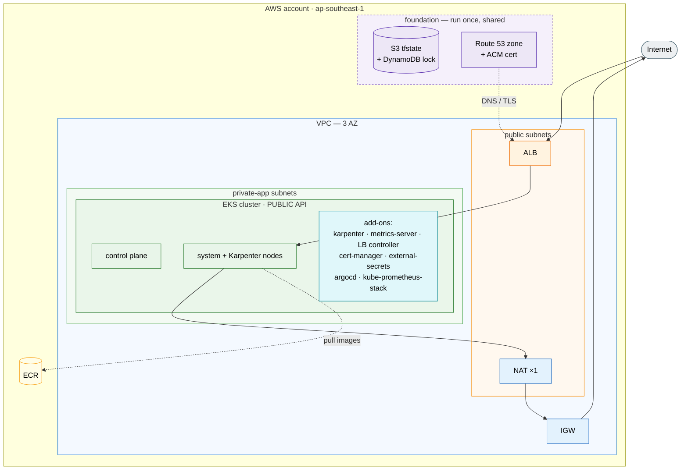
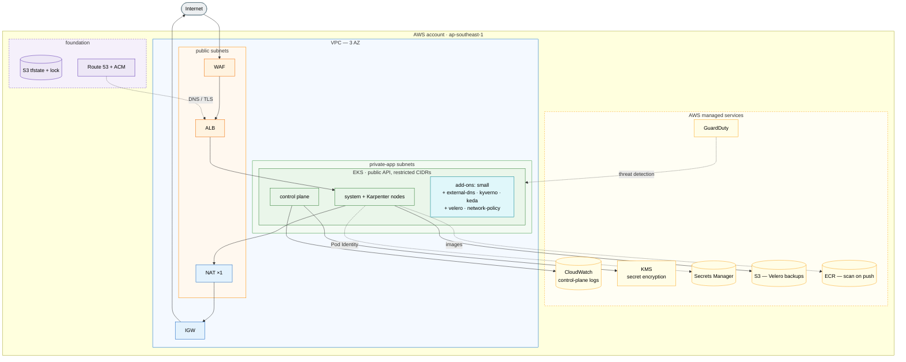
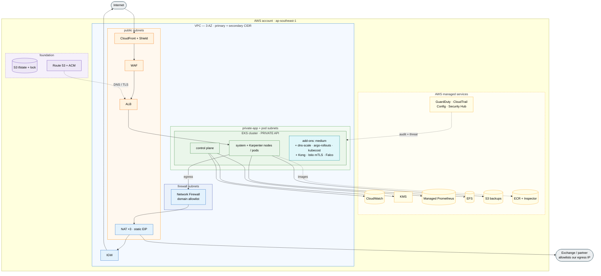

# Architecture per size

Each size builds on the previous. `foundation` (S3 state + Route 53/ACM) is shared
by all. Diagrams are Mermaid — GitHub renders them inline.

**Colour legend:** 🟣 foundation · 🔵 network/VPC · 🟠 edge (ingress) · 🟢 EKS · 🟦 add-ons · 🟡 AWS managed services · ⚪ external.

---

## Small (dev/lab)

Cluster + core add-ons, public API, single NAT, nothing paid.

---

## Medium (staging)

Small **plus**: audit logging, secret encryption, network policy, image scanning,
WAF at the edge, GuardDuty, backup, DNS/policy/event-scaling add-ons.

---

## Large (prod / regulated)

Medium **plus**: private API, per-AZ NAT, **egress Network Firewall** (dedicated
subnets + app-egress redirect), secondary pod CIDR, EFS, full security baseline,
Managed Prometheus, service mesh, API gateway, progressive delivery, runtime security.

> Egress path (large): pod → Network Firewall (allowlist) → NAT (static EIP) → IGW
> → internet / partner. The static EIP is what exchanges allowlist.
