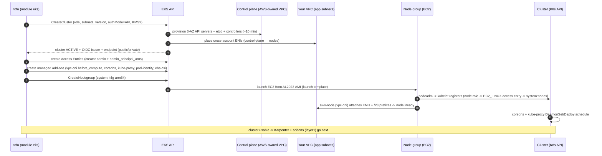
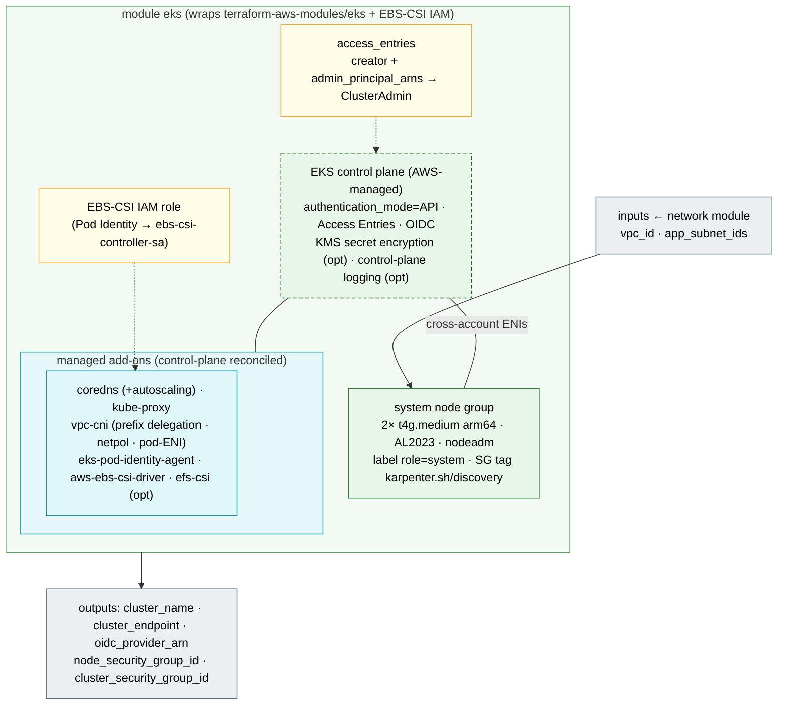
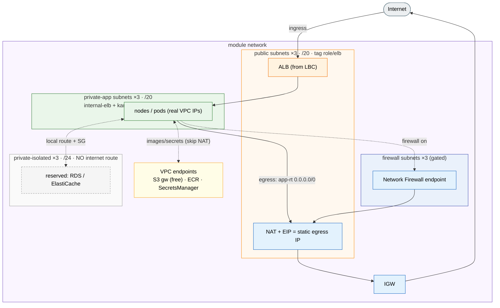

# EKS internals — what actually happens

Expert view of what `tofu apply` on `modules/eks` provisions, **what happens when the
cluster is created**, and **how each component runs at runtime**. For per-size cluster
composition see `ARCHITECTURE.md`; for plain inputs/outputs see `../modules/README.md`;
for symptom→fix see [`TROUBLESHOOTING.md`](TROUBLESHOOTING.md).

---

## 0. EKS is an orchestrator of other AWS services

EKS is **not self-contained** — the managed control plane is small; the cluster only
works because EKS drives ~20 other AWS services on your behalf. Knowing *which service
does what, and when it's called* is the difference between "I run kubectl" and "I can
debug it". Map of everything a running cluster touches:

| Service | Role in the cluster | When it's called |
|---|---|---|
| **IAM** | 5 role types (see below) — the identity behind every action | every API call, node boot, pod cred fetch |
| **STS** | issues short-lived creds; `AssumeRole`, `GetCallerIdentity` | `aws eks get-token` (your kubectl auth), IRSA |
| **EKS Auth API** | `AssumeRoleForPodIdentity` — pod creds without OIDC | every Pod Identity credential fetch |
| **EC2** | worker instances, **ENIs** (pod IPs + control-plane), **EBS** root/data vols, **security groups**, EIP | node launch, pod scheduling, PVC bind |
| **EC2 Auto Scaling** | ASG behind each managed node group | MNG desired-size changes |
| **EC2 Fleet / Spot** | Karpenter launches instances directly (no ASG) | just-in-time scale-up |
| **Launch Templates** | node config (AMI, SG, user-data/nodeadm) | every node launch |
| **SSM Parameter Store** | resolves the **AL2023 EKS-optimized AMI** ID | node group / Karpenter AMI lookup |
| **VPC** | subnets, route tables, IGW, **NAT+EIP**, endpoints | all cluster networking |
| **ELB (ALB/NLB)** | created by AWS LB Controller from Ingress/Service | ingress provisioning |
| **Route 53** | private hosted zone (private endpoint) + external-dns records | private API resolve, DNS records |
| **ACM** | TLS certs for ALB/NLB | HTTPS ingress |
| **KMS** | envelope-encrypts etcd Secrets + EBS volumes | secret write, volume create |
| **ECR** | container image registry | every image pull |
| **S3** | tofu state, Velero backups, Loki chunks; **gateway endpoint** for ECR layers | state ops, backup, image pull |
| **SQS** | Karpenter **interruption queue** | spot reclaim / rebalance |
| **EventBridge** | routes EC2 spot-interruption / rebalance / health events → SQS | node interruption |
| **CloudWatch** | control-plane logs, Container Insights metrics/logs | logging enabled |
| **Amazon Managed Prometheus / Grafana** | metrics store + dashboards (alt to self-host) | observability-aws layer |
| **Secrets Manager** | source of truth for External Secrets Operator | secret sync |
| **GuardDuty / CloudTrail / Config / Security Hub / Inspector** | audit, runtime threat detection, compliance, image CVE scan | security-baseline layer |
| **Systems Manager (Session Manager)** | shell into nodes with no SSH/bastion | node debugging |

### The 5 IAM roles (who assumes what — the part people get wrong)

```
1. Cluster service role   trust: eks.amazonaws.com
   → AmazonEKSClusterPolicy. Lets the CONTROL PLANE manage ENIs, ELBs, SGs in your VPC.

2. Node IAM role          trust: ec2.amazonaws.com   (kubelet uses instance creds)
   → AmazonEKSWorkerNodePolicy + AmazonEC2ContainerRegistryReadOnly (+ CNI policy)
   → mapped to K8s group system:nodes via the auto EC2_LINUX access entry.

3. Karpenter node role    = same shape as (2); JIT nodes assume it via instance profile.

4. Karpenter controller role   trust: pods.eks.amazonaws.com  (Pod Identity)
   → ec2:RunInstances/CreateFleet/TerminateInstances + sqs:* on the interruption queue.

5. Pod Identity / IRSA roles (per add-on)   trust: pods.eks.amazonaws.com
   → LBC, ESO, external-dns, cert-manager, EBS-CSI, KEDA, kubecost — least-priv per controller.
```

Two auth planes must both agree: **IAM says who you are**, **K8s RBAC (via Access
Entries) says what you can do**. A valid IAM principal with no access entry = authenticated
but `Unauthorized`.

### Three ways to create — one API

Console wizard, `eksctl`, `aws eks create-cluster`, and this Terraform module all funnel
into the **same `CreateCluster` API call** — they differ only in how much they pre-create
for you. This module is explicit: `modules/network` makes the VPC first, then the EKS
call references it. `eksctl` hides a CloudFormation stack that does both. The console
makes you pick pre-existing pieces. **`CreateCluster` is asynchronous** — it returns
immediately with status `CREATING`; the ~10-minute provisioning happens server-side and
tofu polls `DescribeCluster` until `ACTIVE`. Everything in §1 below is that poll loop.

---

## `modules/eks`

### 1. Creation sequence — what `apply` triggers



Why the order matters: **vpc-cni is `before_compute`** so its config (prefix delegation)
is in place *before* the first node boots — otherwise nodes come up in the wrong IP mode
and must be recycled. CoreDNS/kube-proxy can only become healthy **after** the node group
exists (they need nodes to run on), so a fresh cluster shows those add-ons "Degraded"
until step 8–9.

### 2. Control plane anatomy (invisible, AWS-managed)
CreateCluster provisions, in an **AWS-owned account/VPC**, a highly-available control
plane: **≥2–3 API servers across AZs behind an NLB**, a **3-node etcd** (encrypted, auto
backed-up), plus controller-manager / scheduler / cloud-controller-manager. AWS patches
and scales it. You never see these hosts — you get an **endpoint + a bill**.

The **only** control-plane presence in *your* VPC is a set of **cross-account ENIs** that
EKS drops into the subnets you passed (`app_subnet_ids`). They carry: API→kubelet
(`kubectl logs/exec/port-forward`), admission **webhook** calls, and control-plane↔node
traffic. Endpoint modes:
- **public** — AWS-managed public NLB reachable from the internet (still authenticated).
- **private** — a Route 53 **private hosted zone** in your VPC resolves the endpoint to
  those ENI IPs; only reachable in-VPC (prod uses this).

### 3. How a node joins (bootstrap)
1. The managed node group's **launch template** boots EC2 from the **AL2023 EKS-optimized AMI**.
2. cloud-init runs **`nodeadm`** (AL2023's bootstrapper; AL2 used `bootstrap.sh`) — it reads
   the cluster **endpoint + CA cert + service CIDR**, writes kubelet config, starts kubelet.
3. kubelet authenticates using the **node IAM role**. In API auth mode EKS has an
   **auto-created `EC2_LINUX` access entry** mapping that role → K8s groups
   `system:nodes` / `system:bootstrappers` → the node registers (NotReady until CNI).
4. **aws-node** (vpc-cni DaemonSet) sets up ENIs/IPs → node goes **Ready**.
5. **kube-proxy** programs Service networking; **CoreDNS** answers cluster DNS.

### 4. Pod networking — VPC CNI (the deep part)
`aws-node` runs **IPAMD** on every node. At startup it attaches ENIs and, with **prefix
delegation on**, allocates **/28 prefixes (16 IPs each)** into a warm pool
(`WARM_PREFIX_TARGET=1` keeps one spare prefix ready).
- Pod scheduled → the CNI plugin takes a free **real VPC IP** from a prefix, wires the
  pod veth + host routes → the pod is a **first-class VPC citizen**: routable,
  **security-groupable**, flow-loggable. No overlay/encapsulation.
- **max-pods** = f(ENIs × IPs per instance). Prefix delegation lifts an `m5.large` from
  ~29 → ~110 pods. IPs are consumed from the **app subnet `/20`** (or the secondary
  `/18` if custom networking) — size subnets for peak pods.
- Traffic: same-node pod↔pod via the local bridge; cross-node/cross-AZ via the **VPC
  local route** (plain VPC routing). **Security Groups / NetworkPolicy** are the gate.

### 5. Auth — IAM ↔ Kubernetes (two planes must agree)
```
kubectl → `aws eks get-token` → presigned STS GetCallerIdentity URL (bearer token)
        → API server authenticator validates the IAM ARN
        → looks up the Access Entry for that principal
        → grants an EKS access policy (e.g. AmazonEKSClusterAdminPolicy) OR maps to RBAC groups
        → K8s RBAC authorizes the request
```
- **`authentication_mode=API`** → **no `aws-auth` ConfigMap**; mapping lives in **Access
  Entries** (IaC-friendly, no lock-yourself-out ConfigMap edit).
- Node auth = the `EC2_LINUX` access entry (auto for MNG).
- Console **"Unauthorized"** = your console principal has no access entry → add its ARN to
  `admin_principal_arns` (SSO permission-set role, **not** `:root`).

### 6. Pod Identity — how a pod gets AWS creds
`eks-pod-identity-agent` runs as a DaemonSet exposing a **link-local creds endpoint**
(`169.254.170.23`). A pod whose ServiceAccount has a **Pod Identity association** gets
`AWS_CONTAINER_CREDENTIALS_FULL_URI` injected → the AWS SDK calls the agent → the agent
calls EKS Auth **`AssumeRoleForPodIdentity`** → returns **short-lived role credentials**.
No OIDC token-file/annotation juggling (the IRSA way). Used here by **EBS-CSI** and by
every layer1 add-on (LBC, ESO, external-dns, KEDA…).

### 7. Add-on reconciliation
**Managed add-ons** (coredns, kube-proxy, vpc-cni, pod-identity-agent, ebs-csi, efs-csi):
the EKS control plane **reconciles** them to the version + `configuration_values` you set
and self-heals drift (`resolveConflicts`). Everything else is **Helm** (you own it,
layer1/2). Don't manage the same component both ways.

### 8. Encryption & logging
- **KMS secret encryption** (opt-in): etcd Secrets are **envelope-encrypted** (a DEK per
  secret, DEK wrapped by the KMS CMK). **Set at create** — changing later is disruptive.
- **Control-plane logging** (opt-in): api/audit/authenticator/controllerManager/scheduler
  → CloudWatch (the audit trail auditors want).

### Runtime component view



**Gotchas:** control plane is outside your VPC (only ENIs+endpoint inside) · private
endpoint ⇒ apply/kubectl only from in-VPC · arm64 nodes ⇒ arm64/multi-arch images ·
access-entry principal must be a role/user (not `:root`) · encryption is set-once.

---

## `modules/network` — packet paths

**Creates:** VPC · IGW · 3 subnet tiers ×3 AZ (public `/20`, app `/20`, isolated `/24`,
CIDRs via `cidrsubnet(vpc_cidr,…)`) · NAT (1 or per-AZ) + EIP · route tables + routes ·
VPC endpoints (S3 gateway + ECR api/dkr + Secrets Manager interface) · *(gated)* secondary
CIDR pod subnets · *(gated)* Network Firewall.



**Packet paths** (route table = longest-prefix match; the `local` VPC route always wins for in-VPC):
- **Ingress:** internet → ALB (public subnet, provisioned by LB Controller) → **pod IP**
  directly (target-type `ip`, thanks to VPC CNI real IPs).
- **Egress:** pod → app-rt `0.0.0.0/0` → **NAT** (public subnet) → IGW → internet. The
  source IP the internet sees = the **NAT EIP** (what partners allowlist). Firewall on:
  pod → **firewall endpoint** → NAT → IGW.
- **Intra-VPC (e.g. app→RDS):** any subnet ↔ any subnet via the **local route**; a
  **Security Group** decides if it's actually allowed. Isolated tier has no internet route
  but is still reachable this way.
- **AWS services:** S3/ECR layers via the **S3 gateway endpoint** (route by prefix-list,
  free); ECR-API / Secrets Manager via **interface endpoints** (private DNS → ENI in app
  subnet) — image pulls & secret reads **skip the NAT** entirely.
- **Pod IP supply:** pods consume real IPs from the **app `/20`** (or secondary `/18`);
  prefix delegation reserves `/28` chunks — undersized subnets = `ContainerCreating` /
  IP-exhaustion outages.

**Gotchas:** VPC CIDR can't resize post-create · secondary CIDR needs an in-cluster
`ENIConfig` to be used · isolated ≠ unreachable (SG is the real gate) · Network Firewall
relies on the swapped app route (return traffic uses NAT state).
