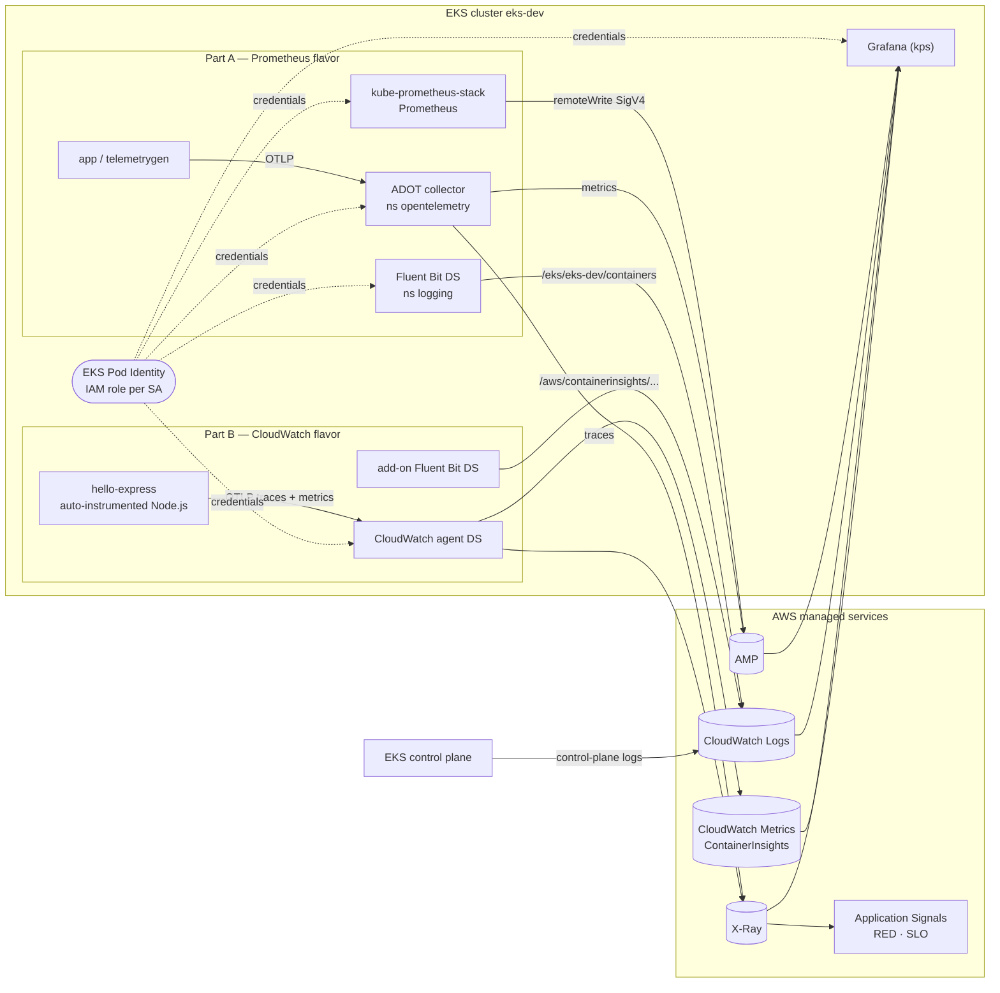

# Test — observability, AWS-native (metrics · logs · traces)

All three pillars on AWS managed services, viewed in the **Grafana already shipped by
kube-prometheus-stack** (`02-platform/01-observability`, `grafana.trongnv.space`) — no
AMG (it needs IAM Identity Center, which pulls in Organizations).

AWS-native comes in **two flavors** that overlap; this test runs both, one after the other:

| | **Part A — Prometheus flavor** | **Part B — CloudWatch flavor** |
|---|---|---|
| Metrics | Prometheus `remoteWrite` + ADOT → **AMP** (PromQL) | **Container Insights** → CloudWatch Metrics |
| Logs | **Fluent Bit** → CloudWatch Logs | add-on's Fluent Bit → CloudWatch Logs |
| Traces | ADOT → **X-Ray** | **Application Signals** (auto-instrumentation → X-Ray) |
| Control plane | EKS control-plane logs → CloudWatch Logs (shared by A and B) | ← same |
| Portability | high — same collector/PromQL as the Grafana stack (test 05) | low — CloudWatch-only formats |

> 💸 AMP, CloudWatch Logs, Container Insights and X-Ray all bill per volume. Run each part
> and its cleanup **the same day**.

## 0. The service map

| Layer | Service | Role |
|---|---|---|
| Collect | **ADOT** (OTel Collector, contrib image) | receives OTLP from apps → AMP + X-Ray |
| | **Fluent Bit** | DaemonSet tailing `/var/log/containers` → CloudWatch Logs |
| | **CloudWatch Observability add-on** | CloudWatch agent + Fluent Bit + OTel operator, one EKS add-on |
| | kube-state-metrics · node-exporter | k8s object + node metrics (already in kube-prometheus-stack) |
| Metrics | **AMP** | Prometheus-compatible storage, PromQL |
| | **CloudWatch Metrics / Container Insights** | prebuilt cluster/node/pod metrics |
| Logs | **CloudWatch Logs** + Logs Insights | app logs + EKS control-plane logs |
| Traces | **X-Ray** | trace storage + service map |
| | **Application Signals** | APM on top: per-service RED metrics, SLOs, trace↔log links |
| View | Grafana (existing) | datasources: AMP · CloudWatch · X-Ray |
| Alert | AMP rules / CloudWatch Alarms → **SNS** | (stretch — not in this test) |
| Auth | **EKS Pod Identity** | one IAM role per collector ServiceAccount |



## 1. Prereqs (both parts)
```bash
cd ~/src/github/trongnvv/aws-iac/eks     # every command below runs from the repo root
envs/dev/deploy.sh                        # cluster + 02-platform (kps, argocd)
kubectl -n monitoring get pods                                  # kps healthy
```
hello-express deployed per `hands-on/DEPLOY-HELLO-EXPRESS.md` (Part B needs a Node.js app).

### 1.1 Control-plane logs (shared)
In `envs/dev/00-infra/01-eks/main.tf`, `module "eks"` block: `enable_control_plane_logging = true`.
```bash
( cd envs/dev/00-infra/01-eks && tofu apply )
aws logs describe-log-groups --log-group-name-prefix /aws/eks/eks-dev
```
✅ `/aws/eks/eks-dev/cluster` exists; streams `kube-apiserver-audit-*` fill within minutes.

---

# Part A — Prometheus flavor

## A1. IAM — extend `modules/observability-aws`
The module has the AMP workspace + `<cluster>-amp-write` role (SA `opentelemetry/adot-collector`).
Add to `2-amp.tf` (all `count = var.enable_amp ? 1 : 0`):

```hcl
# ADOT also ships traces → X-Ray.
resource "aws_iam_role_policy_attachment" "adot_xray" {
  count      = var.enable_amp ? 1 : 0
  role       = aws_iam_role.amp_write[0].name
  policy_arn = "arn:aws:iam::aws:policy/AWSXrayWriteOnlyAccess"
}

# kube-prometheus-stack Prometheus remote-writes to AMP with the same role.
resource "aws_eks_pod_identity_association" "prometheus" {
  count           = var.enable_amp ? 1 : 0
  cluster_name    = var.cluster_name
  namespace       = "monitoring"
  service_account = "kube-prometheus-stack-prometheus"
  role_arn        = aws_iam_role.amp_write[0].arn
}
```
Add `3-logs.tf` (Fluent Bit write) and `4-grafana.tf` (Grafana read):
```hcl
locals {
  pod_trust = jsonencode({
    Version = "2012-10-17"
    Statement = [{
      Effect    = "Allow"
      Principal = { Service = "pods.eks.amazonaws.com" }
      Action    = ["sts:AssumeRole", "sts:TagSession"]
    }]
  })
}

resource "aws_iam_role" "fluent_bit" {
  count              = var.enable_amp ? 1 : 0
  name               = "${var.cluster_name}-fluent-bit"
  assume_role_policy = local.pod_trust
}

resource "aws_iam_role_policy" "fluent_bit" {
  count = var.enable_amp ? 1 : 0
  name  = "cloudwatch-logs-write"
  role  = aws_iam_role.fluent_bit[0].id
  policy = jsonencode({
    Version = "2012-10-17"
    Statement = [{
      Effect = "Allow"
      Action = ["logs:CreateLogGroup", "logs:CreateLogStream", "logs:PutLogEvents",
                "logs:DescribeLogStreams", "logs:PutRetentionPolicy"]
      Resource = "*"
    }]
  })
}

resource "aws_eks_pod_identity_association" "fluent_bit" {
  count           = var.enable_amp ? 1 : 0
  cluster_name    = var.cluster_name
  namespace       = "logging"
  service_account = "aws-for-fluent-bit"
  role_arn        = aws_iam_role.fluent_bit[0].arn
}
```
```hcl
# Grafana (kps) reads AMP + CloudWatch + X-Ray. Kept on for Part B too.
resource "aws_iam_role" "grafana" {
  count              = var.enable_amp ? 1 : 0
  name               = "${var.cluster_name}-grafana-read"
  assume_role_policy = local.pod_trust
}

resource "aws_iam_role_policy_attachment" "grafana" {
  for_each = var.enable_amp ? toset([
    "arn:aws:iam::aws:policy/AmazonPrometheusQueryAccess",
    "arn:aws:iam::aws:policy/CloudWatchReadOnlyAccess",
    "arn:aws:iam::aws:policy/AWSXrayReadOnlyAccess",
  ]) : toset([])
  role       = aws_iam_role.grafana[0].name
  policy_arn = each.value
}

resource "aws_eks_pod_identity_association" "grafana" {
  count           = var.enable_amp ? 1 : 0
  cluster_name    = var.cluster_name
  namespace       = "monitoring"
  service_account = "kube-prometheus-stack-grafana"
  role_arn        = aws_iam_role.grafana[0].arn
}
```
```bash
cd envs/dev/00-infra/05-observability-aws
tofu apply -var enable_amp=true
AMP_URL=$(tofu output -raw amp_remote_write_url)           # .../workspaces/ws-xxx/api/v1/remote_write
AMP_ENDPOINT=${AMP_URL%api/v1/remote_write}                # .../workspaces/ws-xxx/
aws eks list-pod-identity-associations --cluster-name eks-dev \
  --query 'associations[].[namespace,serviceAccount]' --output table
cd -
```
✅ 4 new associations: `opentelemetry/adot-collector` · `monitoring/kube-prometheus-stack-prometheus`
· `logging/aws-for-fluent-bit` · `monitoring/kube-prometheus-stack-grafana`.

> ⚠️ The env root doesn't pass `enable_amp`, so a later plain `tofu apply` turns it all off
> again — that's the cleanup path (§A7).

## A2. Metrics — infra: Prometheus `remoteWrite` → AMP
Infra metrics (kube-state-metrics, node-exporter, kubelet/cAdvisor) are already scraped by
kps Prometheus, so forward them instead of scraping twice. In
`envs/dev/02-platform/01-observability/values.yaml`, add under the existing `prometheus:` key:
```yaml
prometheus:
  prometheusSpec:
    remoteWrite:
      - url: <AMP_URL>            # paste the value from A1 (values are hardcoded YAML)
        sigv4:
          region: ap-southeast-1
```
Grafana side (merge into the existing `grafana:` key; `<AMP_ENDPOINT>` from A1):
```yaml
grafana:
  grafana.ini:
    auth:
      sigv4_auth_enabled: true
  plugins:
    - grafana-x-ray-datasource
  additionalDataSources:
    - name: AMP
      type: prometheus
      url: <AMP_ENDPOINT>
      jsonData:
        httpMethod: POST
        sigV4Auth: true
        sigV4AuthType: default        # AWS SDK chain → Pod Identity
        sigV4Region: ap-southeast-1
    - name: CloudWatch
      type: cloudwatch
      jsonData:
        authType: default
        defaultRegion: ap-southeast-1
    - name: X-Ray
      type: grafana-x-ray-datasource
      jsonData:
        authType: default
        defaultRegion: ap-southeast-1
```
```bash
( cd envs/dev/02-platform/01-observability && helmfile apply )
kubectl -n monitoring rollout restart deploy/kube-prometheus-stack-grafana   # pick up Pod Identity creds
kubectl -n monitoring logs prometheus-kube-prometheus-stack-prometheus-0 -c prometheus | grep -i remote
```
✅ No `403`/`401` in Prometheus logs. Grafana → Explore → **AMP** → `up` returns the same
targets as the in-cluster Prometheus.

## A3. Metrics (app) + traces — ADOT → AMP + X-Ray
```bash
kubectl create namespace opentelemetry
kubectl -n opentelemetry create serviceaccount adot-collector

cat > /tmp/adot-values.yaml <<EOF
mode: deployment
image:
  repository: otel/opentelemetry-collector-contrib   # sigv4auth + awsxray live in contrib
serviceAccount:
  create: false
  name: adot-collector
config:
  extensions:
    sigv4auth:
      region: ap-southeast-1
      service: aps
  exporters:
    prometheusremotewrite:
      endpoint: ${AMP_URL}
      auth:
        authenticator: sigv4auth
      resource_to_telemetry_conversion:
        enabled: true                 # service.name etc. become metric labels
    awsxray:
      region: ap-southeast-1
  service:
    extensions: [health_check, sigv4auth]   # keep health_check — probes hit it
    pipelines:
      metrics:
        exporters: [prometheusremotewrite]
      traces:
        exporters: [awsxray]
EOF
grep endpoint /tmp/adot-values.yaml          # AMP_URL must be expanded

helm repo add open-telemetry https://open-telemetry.github.io/opentelemetry-helm-charts
helm install adot open-telemetry/opentelemetry-collector -n opentelemetry -f /tmp/adot-values.yaml
kubectl -n opentelemetry get pods,svc
```
Generate telemetry (no app code needed — `telemetrygen` speaks OTLP):
```bash
TG=ghcr.io/open-telemetry/opentelemetry-collector-contrib/telemetrygen:latest
OTLP=adot-opentelemetry-collector.opentelemetry:4317   # confirm the svc name from `get svc`
kubectl run tg-traces  --rm -it --restart=Never --image=$TG -- \
  traces  --otlp-endpoint=$OTLP --otlp-insecure --duration=60s --rate=5 --service=demo-checkout
kubectl run tg-metrics --rm -it --restart=Never --image=$TG -- \
  metrics --otlp-endpoint=$OTLP --otlp-insecure --duration=60s --service=demo-checkout
```
✅ Checks:
```bash
kubectl -n opentelemetry logs deploy/adot-opentelemetry-collector | grep -iE "error|denied"   # empty
aws xray get-trace-summaries --start-time $(date -d '-10 min' +%s) --end-time $(date +%s) \
  --query 'length(TraceSummaries)'                                                          # > 0
```
Grafana → Explore → **AMP** → `{service_name="demo-checkout"}`; → **X-Ray** → Trace List /
Service Map shows `demo-checkout`.

## A4. Logs — Fluent Bit → CloudWatch Logs

> ⏭️ **Optional.** The log path is the same mechanism in both parts (Fluent Bit DaemonSet
> tailing `/var/log/containers` → CloudWatch Logs); only the packaging differs (config
> ownership, log groups, retention). A and B really differ on **metrics** (AMP/PromQL vs
> CloudWatch Metrics) and **traces** (manual OTLP vs auto-instrumentation). Short on time →
> skip A4 and look at logs only in Part B (B3).
```bash
helm repo add eks https://aws.github.io/eks-charts
kubectl create namespace logging
cat > /tmp/fluent-bit-values.yaml <<'EOF'
serviceAccount:
  create: true
  name: aws-for-fluent-bit          # must match the A1 association
cloudWatchLogs:
  enabled: true
  region: ap-southeast-1
  logGroupName: /eks/eks-dev/containers
  autoCreateGroup: true
  logRetentionDays: 3
firehose:      { enabled: false }
kinesis:       { enabled: false }
elasticsearch: { enabled: false }
EOF
helm install aws-for-fluent-bit eks/aws-for-fluent-bit -n logging -f /tmp/fluent-bit-values.yaml
```
(Key names drift between chart versions — `helm show values eks/aws-for-fluent-bit | less` if one is ignored.)

```bash
kubectl run logger --image=busybox --restart=Never -- \
  sh -c 'i=0; while true; do echo "order=$i status=ok"; i=$((i+1)); sleep 2; done'
aws logs tail /eks/eks-dev/containers --since 5m --filter-pattern order | head
```
✅ `order=N status=ok` lines in CloudWatch. Grafana → Explore → **CloudWatch** → *Logs* →
log group `/eks/eks-dev/containers`, Logs Insights query:
`fields @timestamp, log | filter log like /order=/ | sort @timestamp desc | limit 20`.
Same panel, log group `/aws/eks/eks-dev/cluster` → the control-plane audit log from §1.1.

## A5. One dashboard, three pillars
Build a Grafana dashboard with:
1. **AMP** — `sum by (namespace) (rate(container_cpu_usage_seconds_total[5m]))`
2. **CloudWatch Logs** — the Logs Insights query from A4
3. **X-Ray** — Service Map for `demo-checkout`

Gap to notice: nothing links a log line to its trace — the app must write `trace_id` into its
logs and the datasources must be told about it. Part B shows AWS doing that for you; test 05
shows doing it yourself with Loki ↔ Tempo.

## A6. Questions to answer
- Why does Pod Identity need the exact `namespace/serviceAccount`? What happens with a typo?
- Why `remoteWrite` from Prometheus for infra but ADOT for app telemetry?
- What does `resource_to_telemetry_conversion` change in the stored series?
- AMP vs self-hosted Prometheus/Mimir: cost model, retention, who's on call?

## A6b. Stretch — hello-express through Part A (same real app as B4)
Part A uses telemetrygen; Part B uses a real, auto-instrumented app. To compare both on
**the same app**, inject the OTel Node.js agent into hello-express with the community
**OpenTelemetry Operator** and point it at the A3 ADOT collector. (Alternative: add the OTel
SDK to hello-express's code — a code change, not covered here.)

> ⚠️ Run this **before Part B**. The CloudWatch add-on ships its own operator that reacts to
> the same `instrumentation.opentelemetry.io/inject-nodejs` annotation — two operators =
> two mutating webhooks fighting over the same pods.

Needs ADOT from A3 still running and cert-manager (`01-addons/04-cert-manager`) for the
operator's webhook certificate.
```bash
helm install otel-operator open-telemetry/opentelemetry-operator \
  -n opentelemetry-operator-system --create-namespace \
  --set manager.collectorImage.repository=otel/opentelemetry-collector-contrib
kubectl -n opentelemetry-operator-system rollout status deploy/otel-operator-opentelemetry-operator

kubectl apply -f - <<'EOF'
apiVersion: opentelemetry.io/v1alpha1
kind: Instrumentation
metadata:
  name: to-adot
  namespace: dev
spec:
  exporter:
    endpoint: http://adot-opentelemetry-collector.opentelemetry:4318   # Node.js agent speaks OTLP/HTTP
  propagators: [tracecontext, baggage]
  sampler:
    type: parentbased_traceidratio
    argument: "1"                                                       # sample everything (lab)
EOF

# Namespace annotation — hello-express is Argo CD-managed (selfHeal) and its chart has no podAnnotations.
kubectl annotate ns dev instrumentation.opentelemetry.io/inject-nodejs="true"
kubectl -n dev rollout restart deploy
kubectl -n dev get pods -o custom-columns='POD:.metadata.name,INIT:.spec.initContainers[*].name' | grep hello
```
✅ An `opentelemetry-auto-instrumentation-nodejs` init container on the hello-express pods.

Generate traffic (same loop as B4), then:
- Grafana → **X-Ray** → Service Map shows `hello-express` (real HTTP server spans, not
  telemetrygen's fake ones).
- Grafana → **AMP** → `{service_name="hello-express"}` — the agent's HTTP metrics.

Compare with B4 later on the same app: what Application Signals gives on top (RED per
operation, SLOs, trace ↔ log links) vs what you'd have to build in Grafana yourself here.

## A7. Cleanup Part A
```bash
# A6b (if run) — remove first so Part B's add-on doesn't meet a second operator
kubectl annotate ns dev instrumentation.opentelemetry.io/inject-nodejs- 2>/dev/null
kubectl -n dev delete instrumentation to-adot 2>/dev/null
helm uninstall otel-operator -n opentelemetry-operator-system 2>/dev/null && \
  kubectl delete ns opentelemetry-operator-system
kubectl -n dev rollout restart deploy                                  # drop the injected agent
kubectl delete pod logger
helm uninstall adot -n opentelemetry && kubectl delete ns opentelemetry
helm uninstall aws-for-fluent-bit -n logging && kubectl delete ns logging
aws logs delete-log-group --log-group-name /eks/eks-dev/containers
git -C ~/src/github/trongnvv/aws-iac checkout -- eks/envs/dev/02-platform/01-observability/values.yaml
( cd envs/dev/02-platform/01-observability && helmfile apply )        # drop remoteWrite + AWS datasources
# Keep A1 IAM applied if going straight to Part B (Grafana read role is reused); otherwise:
( cd envs/dev/00-infra/05-observability-aws && tofu apply )            # enable_amp → false
```

---

# Part B — CloudWatch flavor (Container Insights + Application Signals)

Run after A7 — the add-on ships its own Fluent Bit; running both doubles log cost.

## B1. IAM for the CloudWatch agent
Add to `modules/observability-aws` (new var `enable_container_insights`, default `false`):
```hcl
resource "aws_iam_role" "cloudwatch_agent" {
  count              = var.enable_container_insights ? 1 : 0
  name               = "${var.cluster_name}-cloudwatch-agent"
  assume_role_policy = local.pod_trust
}

resource "aws_iam_role_policy_attachment" "cloudwatch_agent" {
  for_each = var.enable_container_insights ? toset([
    "arn:aws:iam::aws:policy/CloudWatchAgentServerPolicy",
    "arn:aws:iam::aws:policy/AWSXrayWriteOnlyAccess",
  ]) : toset([])
  role       = aws_iam_role.cloudwatch_agent[0].name
  policy_arn = each.value
}

output "cloudwatch_agent_role_arn" {
  value = var.enable_container_insights ? aws_iam_role.cloudwatch_agent[0].arn : null
}
```
(Re-export the output from the env root.) No association here — the add-on creates it (B2);
declaring both conflicts. `pod_trust` local lives in `3-logs.tf` from A1.
```bash
cd envs/dev/00-infra/05-observability-aws
tofu apply -var enable_amp=true -var enable_container_insights=true   # enable_amp keeps the Grafana read role
CW_ROLE=$(tofu output -raw cloudwatch_agent_role_arn)
cd -
```

## B2. Install the add-on + turn on Application Signals
```bash
aws application-signals start-discovery            # one-time per account/region (service-linked role)
aws eks create-addon --cluster-name eks-dev --addon-name amazon-cloudwatch-observability \
  --pod-identity-associations serviceAccount=cloudwatch-agent,roleArn=$CW_ROLE
aws eks wait addon-active --cluster-name eks-dev --addon-name amazon-cloudwatch-observability
kubectl -n amazon-cloudwatch get pods
```
✅ `cloudwatch-agent-*` + `fluent-bit-*` DaemonSet pods and the operator are `Running`.

## B3. Container Insights (metrics + logs)
```bash
aws cloudwatch list-metrics --namespace ContainerInsights \
  --dimensions Name=ClusterName,Value=eks-dev --query 'length(Metrics)'
aws logs describe-log-groups --log-group-name-prefix /aws/containerinsights/eks-dev \
  --query 'logGroups[].logGroupName'
```
✅ Metrics count > 0 (takes ~5 min); log groups `application` · `dataplane` · `host` · `performance`.
Console: CloudWatch → **Container Insights** → cluster `eks-dev` → drill into a pod.
Grafana → Explore → **CloudWatch** → namespace `ContainerInsights`, metric `pod_cpu_utilization`.

## B4. Application Signals (traces + APM) on hello-express
The add-on's operator injects the OTel Node.js agent when a pod carries
`instrumentation.opentelemetry.io/inject-nodejs: "true"`. hello-express is owned by
Argo CD (`selfHeal: true`) and its chart has no `podAnnotations`, so annotate the
**namespace** (not managed by Argo) and restart:
```bash
kubectl annotate ns dev instrumentation.opentelemetry.io/inject-nodejs="true"
kubectl -n dev rollout restart deploy
kubectl -n dev get pods -o custom-columns='POD:.metadata.name,INIT:.spec.initContainers[*].name' | grep hello
```
✅ An `opentelemetry-auto-instrumentation-nodejs` init container is present. (If not, the
namespace annotation isn't honored by this add-on version → add `podAnnotations` to
`helm-chart-template/app` and set it in `apps/hello-express/dev/values.yaml` instead.)

Generate traffic, then look:
```bash
HOST=$(kubectl -n dev get ingress -o jsonpath='{.items[0].spec.rules[0].host}')
for i in $(seq 200); do curl -s -o /dev/null https://$HOST/; done
```
Console: CloudWatch → **Application Signals → Services** → `hello-express`: latency / error /
volume, operations, dependencies; open a trace → **related logs** (correlated automatically).
Create an SLO: *latency p99 < 300 ms, 99% over 1 day* — the AWS-native version of the
SLO/error-budget idea.

## B5. Compare with Part A
| | Part A (Prometheus) | Part B (CloudWatch) |
|---|---|---|
| Setup effort | IAM ×4, 2 charts, values edits | 1 IAM role + 1 add-on + 1 annotation |
| Query language | PromQL (portable) | CloudWatch metrics math / Logs Insights |
| App instrumentation | you add OTel SDK (or telemetrygen) | auto-injected (Java/Python/.NET/Node.js) |
| Trace ↔ log | DIY | built in (App Signals) |
| Lock-in | low | high |

## B6. Cleanup Part B
```bash
kubectl annotate ns dev instrumentation.opentelemetry.io/inject-nodejs-
kubectl -n dev rollout restart deploy
aws eks delete-addon --cluster-name eks-dev --addon-name amazon-cloudwatch-observability
for g in application dataplane host performance; do
  aws logs delete-log-group --log-group-name /aws/containerinsights/eks-dev/$g; done
( cd envs/dev/00-infra/05-observability-aws && tofu apply )   # both flags → false
```
Control-plane logs (§1.1): set `enable_control_plane_logging = false` back, `tofu apply` in
`01-eks`, and delete `/aws/eks/eks-dev/cluster` if not needed.
