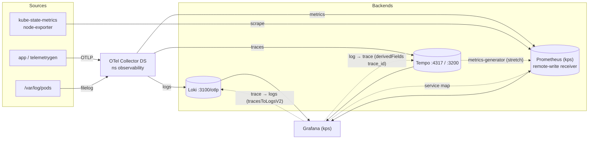

# Test — observability, Grafana stack (self-hosted · metrics · logs · traces)

The self-hosted counterpart of test 03. `envs/<env>/02-platform/01-observability` already
ships **kube-prometheus-stack** (Prometheus + Grafana + Alertmanager + kube-state-metrics +
node-exporter) — metrics only. This test adds **Loki** (logs), **Tempo** (traces) and an
**OTel Collector** (one agent for all three), then wires trace ↔ log ↔ metric correlation in
the existing Grafana.

| Pillar | AWS-native (test 03 A) | Grafana stack (this test) |
|---|---|---|
| Collector | ADOT + Fluent Bit | **OTel Collector** (same chart as 03 A — only exporters change) |
| Metrics | AMP | **Prometheus** (kps) — Mimir for long-term/HA (stretch) |
| Logs | CloudWatch Logs | **Loki** |
| Traces | X-Ray | **Tempo** |
| UI | Grafana + AWS datasources | same Grafana + Loki/Tempo datasources |
| Alerts | AMP rules / CW Alarms → SNS | **Alertmanager** (already in kps) |
| Storage | AWS-managed | gp3 PVCs here; S3 in production |



Everything lands in namespace `observability`, except kps (`monitoring`). Commands run
from the repo root (`~/src/github/trongnvv/aws-iac/eks`).

## 0. Prereqs
Cluster up, `02-platform/00-argocd` + `02-platform/01-observability` applied
(`envs/dev/deploy.sh` does both). `gp3` StorageClass from `01-addons/00-storageclass`.

## 1. Metrics — confirm kps works
```bash
kubectl -n monitoring get pods
kubectl -n monitoring get prometheus,alertmanager
kubectl -n monitoring port-forward svc/kube-prometheus-stack-prometheus 9090:9090 &
```
`http://localhost:9090/targets` — everything `UP` (a `DOWN` target is usually a
`ServiceMonitor`/`PodMonitor` label mismatch). Grafana: `https://grafana.trongnv.space`
(admin password in `values.yaml`) → **Kubernetes / Compute Resources** dashboards populate.

Load to see it move (REST demo from `01-TEST-INGRESS-GATEWAY-API.md` §1, or any service):
```bash
kubectl run load --image=williamyeh/hey --restart=Never --rm -it -- \
  -z 60s -c 20 http://whoami.default.svc.cluster.local
```

## 2. Metrics durability (REVIEW.md #2) + remote-write receiver
```bash
kubectl -n monitoring delete pod -l app.kubernetes.io/name=prometheus
```
Prometheus comes back with an **empty TSDB** — the chart defaults to `emptyDir`. Fix in
`envs/dev/02-platform/01-observability/values.yaml`, under the existing `prometheus:` key:
```yaml
prometheus:
  prometheusSpec:
    retention: 15d
    storageSpec:
      volumeClaimTemplate:
        spec:
          storageClassName: gp3
          resources: { requests: { storage: 50Gi } }
    enableRemoteWriteReceiver: true    # lets the OTel Collector (§5) and Tempo (§8) push metrics in
```
```bash
( cd envs/dev/02-platform/01-observability && helmfile apply )
```
✅ Repeat the pod-delete — data survives (PVC persists).

## 3. Logs backend — Loki (single binary, filesystem)
```bash
helm repo add grafana https://grafana.github.io/helm-charts && helm repo update
kubectl create namespace observability
cat > /tmp/loki-values.yaml <<'EOF'
deploymentMode: SingleBinary
loki:
  auth_enabled: false                   # single tenant for the lab
  commonConfig: { replication_factor: 1 }
  storage: { type: filesystem }         # production: S3 + IRSA/Pod Identity
  schemaConfig:
    configs:
      - from: "2024-01-01"
        store: tsdb
        object_store: filesystem
        schema: v13
        index: { prefix: index_, period: 24h }
  limits_config:
    allow_structured_metadata: true     # OTLP attributes (trace_id…) stored as structured metadata
singleBinary:
  replicas: 1
  persistence: { storageClass: gp3, size: 10Gi }
read:    { replicas: 0 }
write:   { replicas: 0 }
backend: { replicas: 0 }
chunksCache:  { enabled: false }
resultsCache: { enabled: false }
gateway:      { enabled: false }
lokiCanary:   { enabled: false }
test:         { enabled: false }
EOF
helm install loki grafana/loki -n observability -f /tmp/loki-values.yaml
kubectl -n observability get pods,svc -l app.kubernetes.io/name=loki
```
✅ `loki-0` `Running`; service `loki` on `3100`.

## 4. Traces backend — Tempo (monolithic, local storage)
```bash
cat > /tmp/tempo-values.yaml <<'EOF'
tempo:
  storage:
    trace: { backend: local }           # production: S3
  receivers:
    otlp:
      protocols:
        grpc: { endpoint: 0.0.0.0:4317 }
        http: { endpoint: 0.0.0.0:4318 }
persistence:
  enabled: true
  storageClassName: gp3
  size: 10Gi
EOF
helm install tempo grafana/tempo -n observability -f /tmp/tempo-values.yaml
kubectl -n observability get svc tempo
```
✅ Service `tempo` exposes `4317` (OTLP gRPC) and `3200` (query API).

## 5. Collector — OTel Collector DaemonSet (logs + traces + app metrics)
Same chart as test 03 A; the point is that **only `exporters` change** between AWS and
self-hosted backends — apps don't notice.
```bash
cat > /tmp/otel-values.yaml <<'EOF'
mode: daemonset
image:
  repository: otel/opentelemetry-collector-contrib
service:
  enabled: true                         # OTLP endpoint for apps
presets:
  logsCollection:
    enabled: true                       # filelog receiver on /var/log/pods → logs pipeline
  kubernetesAttributes:
    enabled: true                       # k8s.namespace.name, k8s.pod.name… on every signal
config:
  exporters:
    otlphttp/loki:
      endpoint: http://loki.observability:3100/otlp
    otlp/tempo:
      endpoint: tempo.observability:4317
      tls: { insecure: true }
    prometheusremotewrite:
      endpoint: http://kube-prometheus-stack-prometheus.monitoring:9090/api/v1/write
      resource_to_telemetry_conversion: { enabled: true }
  service:
    pipelines:
      logs:    { exporters: [otlphttp/loki] }
      traces:  { exporters: [otlp/tempo] }
      metrics: { exporters: [prometheusremotewrite] }
EOF
helm install otel open-telemetry/opentelemetry-collector -n observability -f /tmp/otel-values.yaml
kubectl -n observability get ds,svc | grep otel
kubectl -n observability logs ds/otel-opentelemetry-collector-agent | grep -iE "error|refused"
```
✅ One collector pod per node; no export errors.

## 6. Grafana datasources (existing Grafana)
Merge into the existing `grafana:` key in `envs/dev/02-platform/01-observability/values.yaml`.
kps provisions its Prometheus datasource with `uid: prometheus`; fixed uids let the
datasources link to each other:
```yaml
grafana:
  additionalDataSources:
    - name: Loki
      uid: loki
      type: loki
      url: http://loki.observability:3100
      jsonData:
        derivedFields:                    # log → trace
          - name: TraceID
            matcherType: label            # trace_id is OTLP structured metadata
            matcherRegex: trace_id
            datasourceUid: tempo
            url: '$${__value.raw}'        # $$ escapes provisioning env expansion
    - name: Tempo
      uid: tempo
      type: tempo
      url: http://tempo.observability:3200
      jsonData:
        tracesToLogsV2:                   # trace → logs
          datasourceUid: loki
          filterByTraceId: true
          spanStartTimeShift: -5m
          spanEndTimeShift: 5m
        serviceMap:
          datasourceUid: prometheus
        nodeGraph: { enabled: true }
```
```bash
( cd envs/dev/02-platform/01-observability && helmfile apply )
```
✅ Grafana → Connections → Data sources: Loki and Tempo both **Save & test** green.

## 7. Three pillars + correlation
**Logs (container stdout via filelog):**
```bash
kubectl run logger --image=busybox --restart=Never -- \
  sh -c 'i=0; while true; do echo "order=$i status=ok"; i=$((i+1)); sleep 2; done'
```
Grafana → Explore → **Loki** → `{k8s_pod_name="logger"}` (OTLP labels use `_`; check the
label browser if the name differs).

**Traces + logs sharing one trace ID (via OTLP):**
```bash
TG=ghcr.io/open-telemetry/opentelemetry-collector-contrib/telemetrygen:latest
OTLP=otel-opentelemetry-collector.observability:4317    # confirm from `get svc`
kubectl run tg-traces --rm -it --restart=Never --image=$TG -- \
  traces --otlp-endpoint=$OTLP --otlp-insecure --traces=20 --service=demo-checkout
```
telemetrygen can't choose span IDs, so take a real one: Grafana → Explore → **Tempo** →
Search → service `demo-checkout` → open a trace, copy its **Trace ID** and the root
**Span ID**. Then send logs that carry them:
```bash
TID=<trace id>; SID=<span id>
kubectl run tg-logs --rm -it --restart=Never --image=$TG -- \
  logs --otlp-endpoint=$OTLP --otlp-insecure --logs=5 --service=demo-checkout \
  --trace-id=$TID --span-id=$SID --body="payment failed for order 42"
```
(`telemetrygen logs --help` if a flag name differs in the pulled version.) Real apps get the
log ↔ span link for free from the OTel SDK's log bridge; telemetrygen fakes it.

✅ Checks:
- **Tempo** → Search → service `demo-checkout` → traces listed; open one → **Logs for this
  span** on that trace jumps to the 5 Loki lines.
- **Loki** → `{service_name="demo-checkout"}` → expand a line → `trace_id` field has a
  **Tempo** link → opens the same trace.
- **Prometheus** → `{service_name="demo-checkout"}` — app metrics arrived via remote write
  (run `telemetrygen metrics …` the same way to populate).

## 8. Stretch
- **Tempo metrics-generator** — RED metrics + service graph from spans, written into
  Prometheus (needs §2 `enableRemoteWriteReceiver`): set
  `tempo.metricsGenerator.enabled: true` and
  `tempo.metricsGenerator.remoteWriteUrl: http://kube-prometheus-stack-prometheus.monitoring:9090/api/v1/write`;
  then Tempo → **Service Graph** tab populates.
- **Exemplars** (metric → trace): `prometheusSpec.enableFeatures: [exemplar-storage]` + an app
  that emits exemplars.
- **Mimir** instead of single Prometheus for long-term/HA metrics on S3 — already built in
  GitLab `aws-iac/centralize-simple/helmfile/`.
- **Promote** Loki/Tempo/OTel from ad-hoc `helm install` to releases in
  `02-platform/01-observability/helmfile.yaml` (the header comment there already lists
  them as follow-ups), with S3 storage + Pod Identity.

## 9. Questions to answer
- Why does Loki index only labels, not log content? What does high label cardinality break?
- Why store `trace_id` as structured metadata instead of a label?
- Tempo has no index either — how does it find a trace by ID, and why is search by
  attribute slower?
- Same collector config as 03 A with different exporters — what does that buy a platform team?
- Self-hosted vs AWS-native: storage cost, retention, who's on call, lock-in.

## 10. Cleanup
```bash
pkill -f 'port-forward svc/kube-prometheus-stack'
kubectl delete pod logger load 2>/dev/null || true
helm uninstall otel tempo loki -n observability
kubectl delete pvc -n observability --all && kubectl delete ns observability
```
Keep the §2 PVC/retention change (it fixes REVIEW.md #2). Drop the §6 datasources
(`git checkout` the values file, or remove the Loki/Tempo entries) and `helmfile apply`, or
leave them if Loki/Tempo will be promoted into the helmfile.
