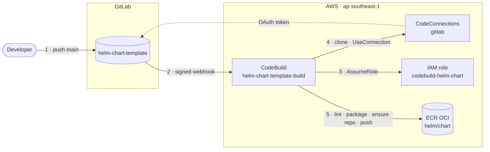

# foundation/03-cicd — Helm chart pipeline (CodeBuild → ECR)

CodeBuild builds the charts in GitLab `trongnvv-platform/helm-chart-template` and pushes them
to ECR as OCI artifacts (`helm/<chart>`). This module owns the IAM role, the GitLab
connection, and the CodeBuild project + webhook. ECR repos are **not** declared here — the
pipeline self-provisions `helm/<chart>` on first push.

| File | Resources |
|---|---|
| `2-codebuild-helm-chart.tf` | IAM role `codebuild-helm-chart` + ECR/logs policy |
| `3-codebuild-project.tf` | connection, source credential, project, webhook, `UseConnection` policy |

## Architecture

`tofu apply` (via `foundation/apply.sh`) creates, in order: the IAM role + policies → the
CodeConnections connection → the source credential → the CodeBuild project → the webhook.
Then each push flows through them:



## 1. Step by step

### Setup (one run, one pause)
`foundation/apply.sh` creates the connection, pauses for the one-time OAuth approval, then
applies the rest — the webhook can only register once the connection is authorized:

1. `./apply.sh` runs, then stops at the authorize prompt.
2. Authorize: Console → Developer Tools → **Connections** → `gitlab` → *Update pending connection*.
3. Press **ENTER** — it applies the project + webhook and finishes.

### On each push
```
push main → GitLab signed webhook → AWS verifies secret + ref=main → StartBuild
CodeBuild AssumeRole → clone via connection → for each chart folder:
  lint → template → ensure ECR repo helm/<chart> → skip if version exists → package → push
```

Release a new version = bump `version` in the chart's `Chart.yaml`, then push.

## 2. Explanation

### Auth — who trusts whom
Two credentials cross the GitLab ↔ AWS boundary, one per direction:

| Credential | Issued by | Held by | Used for | Verified by |
|---|---|---|---|---|
| OAuth token | **GitLab** | AWS (CodeConnections) | clone source, create webhook | GitLab |
| Webhook secret `S` | **AWS** | AWS + GitLab | sign the webhook payload | AWS |

Lifecycle:
- **A — connection (once).** `apply` creates it `PENDING`; a human authorizes → GitLab issues
  an OAuth token that CodeConnections stores and auto-rotates → `AVAILABLE`.
- **B — webhook.** AWS calls the GitLab API *with that token* to create the webhook (+ secret
  `S`). Needs the connection already authorized — hence the pause in setup.
- **C — each push.** GitLab POSTs signed with `S`; AWS verifies → `StartBuild`; CodeBuild
  clones with the token.

So **GitLab grants AWS** (you authorize once); AWS holds and rotates the token. It is *not*
"AWS trusts GitLab" — that direction would be OIDC federation, which we don't use. Inside AWS,
CodeBuild → ECR is pure role trust (`AssumeRole`), no secret.

### source_credential vs UseConnection — why both
- `aws_codebuild_source_credential` = **wiring**: maps "GITLAB source → this connection".
  Missing → the project's GitLab source has no credential → source resolution fails.
- `aws_iam_role_policy` UseConnection = **permission**: lets the role actually use the
  connection. Missing → `AccessDenied` on UseConnection when cloning.

One says *which* connection, the other *allows* using it — both required.

### Design decisions
- **CodeConnections, not a PAT** — AWS owns and rotates the token; nothing to store.
- **IAM role, not static keys or OIDC** — CodeBuild runs inside AWS, so it uses its own
  identity. OIDC is only for CI *outside* AWS (e.g. a GitLab runner).
- **Standalone CodeBuild + webhook, not CodePipeline** — one build step needs no
  orchestration, so no second role and no S3 artifact bucket.
- **ECR self-provisioned, scoped to `helm/*`** — the buildspec creates `helm/<chart>`; the
  role cannot touch the shared image repos in `02-ecr`.

> **Gotcha — `ecr:BatchGetImage` is part of the push grant.** `helm push` HEADs the manifest
> to check existence first; the Docker registry-v2 API routes that to `ecr:BatchGetImage`, not
> to `ecr:DescribeImages` (which only serves the management API). Omit it and the push fails
> with `403 Forbidden` on the manifest HEAD, even though every upload/put action is allowed.
