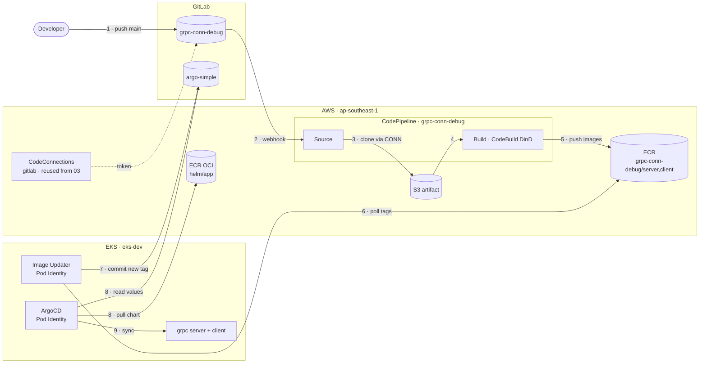

# foundation/04-app-cicd — app pipeline (CodePipeline → ECR) + Pod Identity

AWS-native CI for `trongnvv-platform/applications/grpc-conn-debug`: CodePipeline builds the
server + client images and pushes them to ECR. CD is **not** here — ArgoCD + Image Updater
own it (pull-based), see `gitops/argo-simple`. This module also grants the ArgoCD pods ECR
access via Pod Identity (no static keys).

| File | Resources |
|---|---|
| `2-codebuild.tf` | CodeBuild role + project (DinD, privilegedMode) |
| `3-codepipeline.tf` | S3 artifact bucket, pipeline role, CodePipeline (Source→Build) |
| `4-pod-identity.tf` | ECR-read roles + Pod Identity associations for `argocd-repo-server` and `argocd-image-updater` |

Reuses the GitLab connection from `03-cicd` (already authorized) via remote state. ECR image
repos `grpc-conn-debug/{server,client}` come from `02-ecr`.

## Architecture

`tofu apply` creates the CI side (CodeBuild role + project, S3 artifact bucket, CodePipeline
role + pipeline) and the Pod Identity roles + associations for ArgoCD. CD (ArgoCD + Image
Updater) is pull-based and lives in `gitops/argo-simple`. End to end:



## 1. Step by step

### Setup
1. `foundation/apply.sh` (or `cd 04-app-cicd && tofu init && tofu apply`) — creates the
   pipeline, CodeBuild project, and Pod Identity roles/associations.
2. No OAuth step: the `gitlab` connection is reused from `03-cicd`.
3. Cluster-side (secrets, Image Updater, OCI-repo refresh) lives in `gitops/argo-simple` —
   see its README.

### On each push to the app repo
```
push main → CodePipeline
  Source: CodeConnections (GitLab) → S3 artifact
  Build:  CodeBuild (DinD) builds server+client → push ECR grpc-conn-debug/{server,client}:d-<sha>
(no Deploy stage — ArgoCD Image Updater detects the tag and deploys)
```

## 2. Explanation

### Why CodePipeline stops at Build
CodeDeploy can't target EKS (only EC2/Lambda/ECS), so there is no AWS-native deploy stage for
Kubernetes. CD is delegated to ArgoCD (GitOps). CodePipeline here orchestrates CI only:
Source → Build. The deploy path is fully decoupled.

### Two roles, two jobs (CodePipeline mode)
- **CodePipeline role** holds the GitLab connection (`UseConnection`) and clones to S3; it
  also `StartBuild`s CodeBuild. The Source stage is the only thing that talks to GitLab.
- **CodeBuild role** reads the source from S3 (not GitLab) and pushes images to ECR — so it
  needs no GitLab access, only ECR push + the artifact bucket. (`ecr:BatchGetImage` is included
  — a push HEADs the manifest, same gotcha as `03-cicd`.)

### Pod Identity, not static keys
ArgoCD pods reach ECR through IAM roles bound to their ServiceAccounts (`pods.eks.amazonaws.com`
trust). `argocd-repo-server` gets read on `helm/*` (pull the chart); `argocd-image-updater`
gets read on `grpc-conn-debug/*` (poll tags). No access keys anywhere. Requires the
`eks-pod-identity-agent` addon on the cluster.
