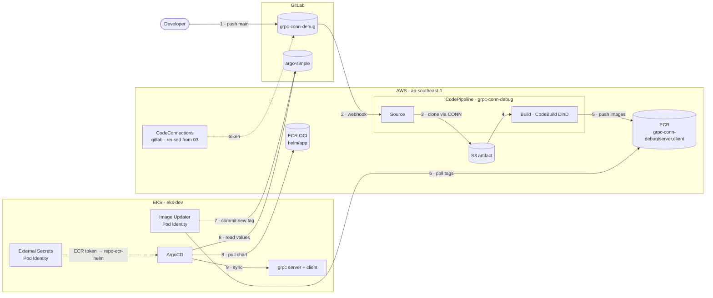

# foundation/04-app-cicd — app CI pipeline (CodePipeline → ECR)

AWS-native CI for `trongnvv-platform/applications/grpc-conn-debug`: CodePipeline builds the
server + client images and pushes them to ECR. CD is **not** here — ArgoCD + Image Updater
own it (pull-based), see `gitops/argo-simple`. This module is **account-level CI only** — no
cluster coupling; ArgoCD/Image Updater Pod Identity lives in the eks env (`modules/addon-iam`).

| File | Resources |
|---|---|
| `2-codebuild.tf` | CodeBuild role + project (DinD, privilegedMode) |
| `3-codepipeline.tf` | S3 artifact bucket, pipeline role, CodePipeline (Source→Build on `main`) |
| `4-promote.tf` | CodeBuild `promote` + webhook: git tag `rc-*`/semver → retag `d-<sha>` → `rc-1.1.1`/`1.1.1` |

Reuses the GitLab connection from `03-cicd` (already authorized) via remote state. ECR image
repos are **self-provisioned** by the buildspec on first push (`grpc-conn-debug/*`, IMMUTABLE,
scan-on-push) — no dependency on `02-ecr`, same model as the helm chart pipeline.

**Build once → promote → deploy (3 env):** `main` builds `d-<sha>` (dev). A git tag `rc-1.1.1`
or `1.1.1` triggers the **promote** CodeBuild, which `aws ecr put-image` retags the commit's
`d-<sha>` manifest to the release tag — **same digest, no rebuild**. Both projects share one
`buildspec.yml` (it detects promote mode from the tag trigger). CD (ArgoCD ApplicationSets +
Image Updater per env) then deploys dev/stg auto,
prod via manual Sync — see `gitlab argo-simple` and `eks/docs/hands-on/DEPLOY-GRPC-CONN-DEBUG.md`.

## Architecture

`tofu apply` creates the CI side only (CodeBuild role + project, S3 artifact bucket, CodePipeline
role + pipeline). CD is pull-based (ArgoCD + Image Updater); ArgoCD pulls the chart via an
ESO-minted repo secret. End to end:



## 1. Step by step

### Setup
1. `foundation/apply.sh` (or `cd 04-app-cicd && tofu init && tofu apply`) — creates the
   pipeline + CodeBuild project (account-level CI; no cluster resources).
2. No OAuth step: the `gitlab` connection is reused from `03-cicd`.
3. Cluster-side: git token secret + apps in `gitops/argo-simple`; Argo CD + Image Updater +
   the ESO-minted `repo-ecr-helm` secret in `eks 02-platform`.

### On each push to the app repo
```
push main → CodePipeline
  Source: CodeConnections (GitLab) → S3 artifact
  Build:  CodeBuild (DinD) builds server+client → push ECR grpc-conn-debug/{server,client}:d-<sha>
(no Deploy stage — ArgoCD Image Updater detects the tag and deploys)
```

## 2. Explanation

### Why CodePipeline stops at Build
CodeDeploy can't target EKS (only EC2/Lambda/ECS), so there is no AWS-native deploy stage for
Kubernetes. CD is delegated to ArgoCD (GitOps). CodePipeline here orchestrates CI only:
Source → Build. The deploy path is fully decoupled.

### Two roles, two jobs (CodePipeline mode)
- **CodePipeline role** holds the GitLab connection (`UseConnection`) and clones to S3; it
  also `StartBuild`s CodeBuild. The Source stage is the only thing that talks to GitLab.
- **CodeBuild role** reads the source from S3 (not GitLab), self-provisions the
  `grpc-conn-debug/*` ECR repos and pushes images — so it needs no GitLab access, only ECR
  create+push + the artifact bucket. (`ecr:BatchGetImage` is included — a push HEADs the
  manifest, same gotcha as `03-cicd`.)

### No cluster coupling here
This module creates **no** Pod Identity — all cluster-scoped IAM for ArgoCD lives in the eks env
(`modules/addon-iam`, exposed via `00-infra/03-addon-iam`): `argocd-image-updater`'s ECR-read role
polls tags, and the chart pull is handled by the **ESO** role (the ESO-minted token is used under
ESO's identity, so that role carries the `helm/*` read perms — see `modules/addon-iam/3-eso.tf`).
So destroying the dev cluster leaves no dangling associations in foundation. This module is pure
account-level CI (pipeline + build), reusing only the shared `03-cicd` GitLab connection.
