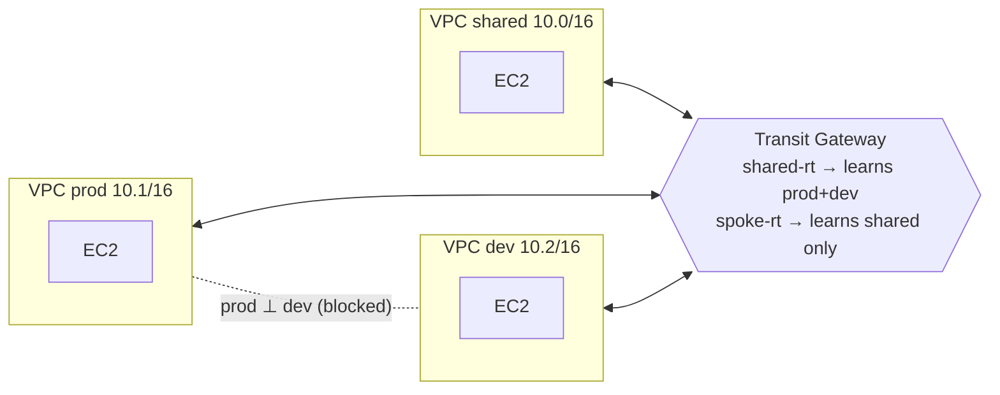

# Lab 1 — Transit Gateway hub + segmentation

Test plan: `../README.md` (lab 1). Concept: workbook `01_Knowledge/Network/Cloud-Connectivity/`.

Wires **3 VPCs** — `shared` (hub), `prod`, `dev` (spokes) — through a TGW and proves segmentation with
**two TGW route tables**: `shared` reaches both spokes; `prod` and `dev` reach `shared` but **not each
other** (`prod ⊥ dev`).

## Architecture


## Structure (layered — each folder is its own state, like the eks env layers)
| Layer | Builds | Depends on |
|---|---|---|
| `1-vpc/` | 3 VPCs + public subnet + IGW + RT + SG; **shared also gets a dedicated TGW subnet** (egress-ready) | — |
| `2-tgw/` | TGW + attachments (shared in its TGW subnet) + 2 route tables + cross-VPC routes (`10/8 → TGW`) | 1-vpc |
| `3-ssm/` | IAM role + instance profile (Session Manager) | — |
| `4-ec2/` | 3 test hosts (`t4g.micro`, AL2023, SSM, no SSH) | 1-vpc, 3-ssm |
| `5-egress/` | **optional** (`enable_egress=true`) — central NAT in shared + spoke private subnets → one egress for all | 1-vpc, 2-tgw, 3-ssm |

> **Optional centralized egress** (folded in, off by default): `(cd 5-egress && tofu apply -var enable_egress=true)`.
> Spokes reach the internet via one NAT in shared through the TGW. Verify/teardown: see `../README.md` (Lab 1 · optional).

## Run
Prereq (once per account): create the state bucket via foundation — `(cd ../../foundation/00-tf-backend && tofu init && tofu apply)`
provisions **`network-iac-tfstate`** (alongside `eks-iac-tfstate`). State lives there, one key per layer.
```bash
cd ~/src/github/trongnvv/aws-iac/network/01-tgw-hub
./deploy.sh                       # applies 1-vpc → 2-tgw → 3-ssm → 4-ec2, prints instance IPs
# or per layer:  (cd 1-vpc && tofu init && tofu apply)  … then 2-tgw, 3-ssm, 4-ec2
```

## Test scenario (proves the segmentation)
Test hosts are SSM-managed (wait ~1–2 min after apply for the agent to register). Grab the private IPs
from `./deploy.sh` output (or `cd 4-ec2 && tofu output instances`), then:

| From (SSM into) | Ping `shared` | Ping `prod` | Ping `dev` | Means |
|---|---|---|---|---|
| **shared** | — | ✅ reply | ✅ reply | hub reaches both spokes |
| **prod** | ✅ reply | — | ❌ timeout | spoke→hub OK, **prod ⊥ dev** |
| **dev** | ✅ reply | ❌ timeout | — | spoke→hub OK, **dev ⊥ prod** |

```bash
aws ssm start-session --target <prod-instance-id>
  ping -c2 <shared-private-ip>   # ✅ OK
  ping -c2 <dev-private-ip>      # ❌ times out  ← segmentation working
```
Cross-check in console: VPC → Transit Gateway route tables → the `spoke` RT has **only** the shared
CIDR; the `shared` RT has prod + dev.

## Troubleshooting
| Symptom | Check |
|---|---|
| `start-session` fails / instance not in SSM | Agent needs ~1–2 min; instance must have public IP + IGW route (`1-vpc`) and the `AmazonSSMManagedInstanceCore` profile (`3-ssm`, `4-ec2`). `aws ssm describe-instance-information`. |
| **All** pings time out (even shared→prod) | 1) SG allows ICMP from `10.0.0.0/8`? 2) VPC route table has `10/8 → TGW` (`2-tgw` `aws_route.tgw`)? 3) attachments `available`? |
| shared→spoke fails but spoke→shared OK (or vice-versa) | TGW **propagation** missing — `shared` RT must have prod+dev propagated; `spoke` RT must have shared propagated. |
| prod→dev **works** (should not) | `spoke` RT wrongly has a prod/dev route — check it only learns shared; default assoc/propagation must be **disabled** on the TGW. |
| `2-tgw` apply: remote state empty | run `1-vpc` first (`./deploy.sh` does the order). |

## Test EC2 recipe (reused by every lab)
Small, cheap, no SSH: `t4g.micro` + Amazon Linux 2023 (arm64) + `AmazonSSMManagedInstanceCore` role in
a **public** subnet (public IP + IGW) so the SSM agent reaches AWS without a NAT/endpoints. Reach it
with `aws ssm start-session`. Cross-VPC traffic still goes **private** via the TGW; the public IP is
management-only. See `3-ssm/` + `4-ec2/`.

## Teardown
```bash
./teardown.sh                     # destroys 4-ec2 → 3-ssm → 2-tgw → 1-vpc
# cost-save mid-lab: (cd 4-ec2 && tofu destroy)  # drop the EC2s, keep TGW/VPC
```

## Cost (while running)
TGW ≈ $0.05/attachment-hour × 3 + data · 3× `t4g.micro` ≈ $0.025/h · 3× public IPv4 ≈ $0.015/h →
**~$0.19/hour**. Billed hourly even idle → **destroy when done**.
