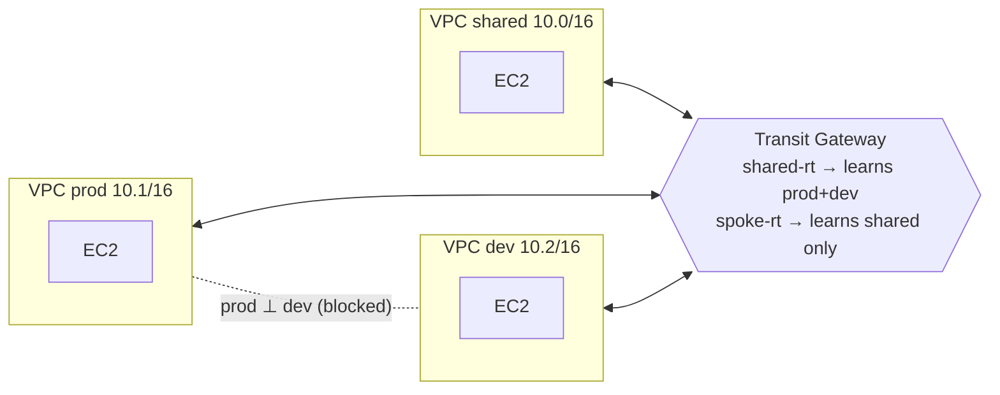

# Lab 1 — Transit Gateway hub + segmentation

Test plan: `../README.md` (lab 1). Concept: workbook `01_Knowledge/Network/Cloud-Connectivity/`.

Wires **3 VPCs** — `shared` (hub), `prod`, `dev` (spokes) — through a TGW and proves segmentation with
**two TGW route tables**: `shared` reaches both spokes; `prod` and `dev` reach `shared` but **not each
other** (`prod ⊥ dev`).

## Architecture


## Structure (layered — each folder is its own state, like the eks env layers)
| Layer | Builds | Depends on |
|---|---|---|
| `1-vpc/` | 3 VPCs + public subnet + IGW + RT + SG; **shared also gets a dedicated TGW subnet** (egress-ready) | — |
| `2-tgw/` | TGW + attachments (shared in its TGW subnet) + 2 route tables + cross-VPC routes (`10/8 → TGW`) | 1-vpc |
| `3-ssm/` | IAM role + instance profile (Session Manager) | — |
| `4-ec2/` | 3 test hosts (`t4g.micro`, AL2023, SSM, no SSH) | 1-vpc, 3-ssm |
| `5-egress/` | **optional** (`enable_egress=true`) — central NAT in shared + spoke private subnets → one egress for all | 1-vpc, 2-tgw, 3-ssm |

> **Optional centralized egress** (folded in, off by default): `(cd 5-egress && tofu apply -var enable_egress=true)`.
> Spokes reach the internet via one NAT in shared through the TGW. Verify/teardown: see `../README.md` (Lab 1 · optional).

## Run
Prereq (once per account): create the state bucket via foundation — `(cd ../../foundation/00-tf-backend && tofu init && tofu apply)`
provisions **`network-iac-tfstate`** (alongside `eks-iac-tfstate`). State lives there, one key per layer.
```bash
cd ~/src/github/trongnvv/aws-iac/network/01-tgw-hub
./deploy.sh                       # applies 1-vpc → 2-tgw → 3-ssm → 4-ec2, prints instance IPs
# or per layer:  (cd 1-vpc && tofu init && tofu apply)  … then 2-tgw, 3-ssm, 4-ec2
```

## Test checklist (pass/fail)
Run top to bottom. Each check = one step + its PASS/FAIL. Tick the box when PASS. A FAIL points to the
Troubleshooting row below. First auto-export the IDs + private IPs from the tofu output (no manual fill):
```bash
eval "$(cd 4-ec2 && tofu output -json instances | python3 -c '
import json,sys
d=json.load(sys.stdin)
for k,p in {"shared":"SH","prod":"PR","dev":"DV"}.items():
    v=d[k]; print(p+"_ID="+v["id"]+"; "+p+"_IP="+v["private_ip"])
')"
echo "shared=$SH_ID/$SH_IP  prod=$PR_ID/$PR_IP  dev=$DV_ID/$DV_IP"   # sanity-check
```

- [ ] **T0 — all 3 hosts registered in SSM** (wait ~1–2 min after apply)
  ```bash
  aws ssm describe-instance-information \
    --query "InstanceInformationList[].{id:InstanceId,ping:PingStatus}" --output table
  ```
  **PASS:** 3 instances, `PingStatus = Online`. **FAIL:** fewer than 3 / not Online → TS "SSM".

- [ ] **T1 — hub → both spokes reachable** (shared can reach prod AND dev)
  ```bash
  aws ssm start-session --target "$SH_ID"
    ping -c3 $PR_IP        # expect replies
    ping -c3 $DV_IP        # expect replies
    exit
  ```
  **PASS:** both `0% packet loss`. **FAIL:** any timeout → TS "all pings fail".

- [ ] **T2 — spoke → hub reachable** (prod→shared and dev→shared)
  ```bash
  aws ssm start-session --target "$PR_ID"
    ping -c3 $SH_IP        # expect replies
    exit
  aws ssm start-session --target "$DV_ID"
    ping -c3 $SH_IP        # expect replies
    exit
  ```
  **PASS:** both `0% loss`. **FAIL:** one-way only → TS "propagation".

- [ ] **T3 — spoke ⊥ spoke BLOCKED (the segmentation proof)** — prod must NOT reach dev
  ```bash
  aws ssm start-session --target "$PR_ID"
    ping -c3 -W2 $DV_IP    # expect 100% loss / timeout
    exit
  ```
  **PASS:** `100% packet loss` (times out). **FAIL:** gets replies → TS "prod→dev works".

- [ ] **T4 — segmentation is symmetric** — dev must NOT reach prod either
  ```bash
  aws ssm start-session --target "$DV_ID"
    ping -c3 -W2 $PR_IP    # expect 100% loss
    exit
  ```
  **PASS:** `100% packet loss`. **FAIL:** replies → TS "prod→dev works".

- [ ] **T5 — route tables confirm the design** (cross-check, console or CLI)
  ```bash
  TGW=$(cd 2-tgw && tofu output -raw tgw_id)
  # spoke RT should have ONLY the shared CIDR; shared RT should have prod + dev
  aws ec2 search-transit-gateway-routes --transit-gateway-route-table-id <spoke-rt-id> \
    --filters Name=state,Values=active --query 'Routes[].DestinationCidrBlock'
  ```
  **PASS:** spoke RT = `[10.0.0.0/16]` only; shared RT = prod + dev. **FAIL:** extra route in spoke RT → TS "prod→dev works".

- [ ] **T6 (optional, egress on) — spoke reaches internet via the shared NAT**
  ```bash
  # after (cd 5-egress && tofu apply -var enable_egress=true); use the PRIVATE host id:
  PRIV_ID=$(cd 5-egress && tofu output -json private_instances | python3 -c 'import json,sys;print(json.load(sys.stdin)["prod"]["id"])')
  NAT_IP=$(cd 5-egress && tofu output -raw nat_public_ip)
  aws ssm start-session --target "$PRIV_ID"
    curl -s https://checkip.amazonaws.com    # expect it to equal $NAT_IP
    exit
  ```
  **PASS:** returned IP == `$NAT_IP` (egress goes through the shared NAT). **FAIL:** no output / different IP → TS "egress".

**Result:** all boxes ticked = lab passes (hub-and-spoke works, spokes isolated, optional central egress works).

## Troubleshooting — debug flow
*Written in Simplified Technical English (ASD-STE100): one instruction per sentence, active voice, present tense.*

A check can fail. Do not guess. First use VPC Reachability Analyzer. It finds the hop that blocks the path.
Then go to the flow for that hop. For the general method, read the vault file
`01_Knowledge/Network/Cloud-Connectivity/Debug-Strategy.md`.

### Step 0 — find the hop that blocks (you do not need SSH or ping)
Use VPC Reachability Analyzer. It reads the live config and names the hop that blocks the path.
The `analyze()` helper is in the vault file (see above). Run it between two instances:
```bash
analyze "$SH_ID" "$PR_ID"
```
`Reachable` shows `True` or `False`. `Blocked` gives the hop (for example `ENI_SG_RULES_MISMATCH`,
`NO_ROUTE_TO_DESTINATION`, `TGW_ROUTE_TABLE_...`). Go to the flow for that hop.

### Flow A — a ping must work but it fails (T1/T2); the analyzer shows `Reachable=False`
Check the hops in this order. Stop at the first hop that is wrong.
1. **SG** — the SG must permit ICMP from `10.0.0.0/8`. If it does not, edit `1-vpc/security.tf`.
2. **VPC route** — the VPC route table must contain `10.0.0.0/8 → tgw-…`. If the route is absent, apply `2-tgw` (`aws_route.tgw`).
3. **TGW attachment** — each attachment must be `available`.
4. **TGW propagation** — go to Flow C. (One direction works and the other fails = one-sided propagation.)

Standalone check for one hop:
```bash
aws ec2 describe-route-tables --route-table-ids <rt> --query 'RouteTables[0].Routes'
```

### Flow B — prod reaches dev but it must not (T3/T4); the segmentation leaks
Read the spoke TGW route table. It must contain only `10.0.0.0/16` (shared). A `10.1/16` or `10.2/16` route is
wrong: the spoke table learned a peer. The cause is a stray propagation, or the TGW default-route-table
propagation is on. To correct it, edit `2-tgw/tgw.tf`. Set `default_route_table_propagation = "disable"`. Keep
only the `spokes_learn_shared` propagation on the spoke table.
```bash
aws ec2 search-transit-gateway-routes --transit-gateway-route-table-id $(cd 2-tgw && tofu output -raw spoke_route_table_id) \
  --filters Name=state,Values=active --query 'Routes[].DestinationCidrBlock' --output text
```

### Flow C — the path works in one direction only; the TGW propagation is asymmetric
The `shared` table must have **prod + dev** propagated. The `spoke` table must have **shared** propagated.
Read each table (`shared_route_table_id`, `spoke_route_table_id`) and compare:
```bash
aws ec2 search-transit-gateway-routes --transit-gateway-route-table-id <rt> \
  --filters Name=state,Values=active --query 'Routes[].[DestinationCidrBlock,Type]' --output text
```

### Flow D — egress (T6): curl returns nothing, or the wrong IP
Check the return path, one hop per step:
1. Apply `5-egress` with `-var enable_egress=true`.
2. The spoke **private** table must have `0/0 → TGW`.
3. The TGW spoke table must have `0/0 → shared attachment`.
4. The shared TGW-subnet table must have `0/0 → NAT`.
5. Put the NAT in a **public** subnet with `0/0 → IGW`.
6. Use the **private** host id, not the public one.

### Quick table (symptom → first action)
| Symptom | First action |
|---|---|
| `start-session` fails, or the host is not in SSM | Wait 1–2 minutes. Run `aws ssm describe-instance-information`. The host must show `PingStatus=Online`. If not, check the IGW route and the `AmazonSSMManagedInstanceCore` profile. If the plugin is absent, run `brew install --cask session-manager-plugin`. |
| A ping that must work fails | Go to Flow A (analyzer → SG → route → attachment → propagation). |
| prod reaches dev but it must not | Go to Flow B (the spoke table has a stray peer route). |
| The path works in one direction only | Go to Flow C (asymmetric propagation). |
| egress curl returns nothing or the wrong IP | Go to Flow D. |
| `2-tgw` apply: remote state empty | run `1-vpc` first (`./deploy.sh` does the order) |

## Test EC2 recipe (reused by every lab)
Small, cheap, no SSH: `t4g.micro` + Amazon Linux 2023 (arm64) + `AmazonSSMManagedInstanceCore` role in
a **public** subnet (public IP + IGW) so the SSM agent reaches AWS without a NAT/endpoints. Reach it
with `aws ssm start-session`. Cross-VPC traffic still goes **private** via the TGW; the public IP is
management-only. See `3-ssm/` + `4-ec2/`.

## Teardown
```bash
./teardown.sh                     # destroys 4-ec2 → 3-ssm → 2-tgw → 1-vpc
# cost-save mid-lab: (cd 4-ec2 && tofu destroy)  # drop the EC2s, keep TGW/VPC
```

## Cost (while running)
TGW ≈ $0.05/attachment-hour × 3 + data · 3× `t4g.micro` ≈ $0.025/h · 3× public IPv4 ≈ $0.015/h →
**~$0.19/hour**. Billed hourly even idle → **destroy when done**.
