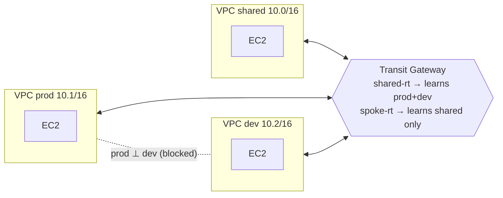

# Lab 1 — Transit Gateway hub + segmentation

Test plan: `../README.md` (lab 1). Concept: workbook `01_Knowledge/Network/Cloud-Connectivity/`.

Wires **3 VPCs** — `shared` (hub), `prod`, `dev` (spokes) — through a TGW and proves segmentation with
**two TGW route tables**: `shared` reaches both spokes; `prod` and `dev` reach `shared` but **not each
other** (`prod ⊥ dev`).

## Architecture


## Structure (layered — each folder is its own state, like the eks env layers)
| Layer | Builds | Depends on |
|---|---|---|
| `1-vpc/` | 3 VPCs + public subnet + IGW + RT + SG; **shared also gets a dedicated TGW subnet** (egress-ready) | — |
| `2-tgw/` | TGW + attachments (shared in its TGW subnet) + 2 route tables + cross-VPC routes (`10/8 → TGW`) | 1-vpc |
| `3-ssm/` | IAM role + instance profile (Session Manager) | — |
| `4-ec2/` | 3 test hosts (`t4g.micro`, AL2023, SSM, no SSH) | 1-vpc, 3-ssm |
| `5-egress/` | **optional** (`enable_egress=true`) — central NAT in shared + spoke private subnets → one egress for all | 1-vpc, 2-tgw, 3-ssm |

> **Optional centralized egress** (folded in, off by default): `(cd 5-egress && tofu apply -var enable_egress=true)`.
> Spokes reach the internet via one NAT in shared through the TGW. Verify/teardown: see `../README.md` (Lab 1 · optional).

## Run
Prereq (once per account): create the state bucket via foundation — `(cd ../../foundation/00-tf-backend && tofu init && tofu apply)`
provisions **`network-iac-tfstate`** (alongside `eks-iac-tfstate`). State lives there, one key per layer.
```bash
cd ~/src/github/trongnvv/aws-iac/network/01-tgw-hub
./deploy.sh                       # applies 1-vpc → 2-tgw → 3-ssm → 4-ec2, prints instance IPs
# or per layer:  (cd 1-vpc && tofu init && tofu apply)  … then 2-tgw, 3-ssm, 4-ec2
```

## Test checklist (pass/fail)
Run top to bottom. Each check = one step + its PASS/FAIL. Tick the box when PASS. A FAIL points to the
Troubleshooting row below. First grab the IDs + private IPs:
```bash
cd 4-ec2 && tofu output instances      # {shared,prod,dev} → {id, private_ip}
# export for the commands below (fill from the output):
SH_ID=i-shared… ; PR_ID=i-prod… ; DV_ID=i-dev…
SH_IP=10.0.0.x ; PR_IP=10.1.0.x ; DV_IP=10.2.0.x
```

- [ ] **T0 — all 3 hosts registered in SSM** (wait ~1–2 min after apply)
  ```bash
  aws ssm describe-instance-information \
    --query "InstanceInformationList[].{id:InstanceId,ping:PingStatus}" --output table
  ```
  **PASS:** 3 instances, `PingStatus = Online`. **FAIL:** fewer than 3 / not Online → TS "SSM".

- [ ] **T1 — hub → both spokes reachable** (shared can reach prod AND dev)
  ```bash
  aws ssm start-session --target "$SH_ID"
    ping -c3 $PR_IP        # expect replies
    ping -c3 $DV_IP        # expect replies
    exit
  ```
  **PASS:** both `0% packet loss`. **FAIL:** any timeout → TS "all pings fail".

- [ ] **T2 — spoke → hub reachable** (prod→shared and dev→shared)
  ```bash
  aws ssm start-session --target "$PR_ID"
    ping -c3 $SH_IP        # expect replies
    exit
  aws ssm start-session --target "$DV_ID"
    ping -c3 $SH_IP        # expect replies
    exit
  ```
  **PASS:** both `0% loss`. **FAIL:** one-way only → TS "propagation".

- [ ] **T3 — spoke ⊥ spoke BLOCKED (the segmentation proof)** — prod must NOT reach dev
  ```bash
  aws ssm start-session --target "$PR_ID"
    ping -c3 -W2 $DV_IP    # expect 100% loss / timeout
    exit
  ```
  **PASS:** `100% packet loss` (times out). **FAIL:** gets replies → TS "prod→dev works".

- [ ] **T4 — segmentation is symmetric** — dev must NOT reach prod either
  ```bash
  aws ssm start-session --target "$DV_ID"
    ping -c3 -W2 $PR_IP    # expect 100% loss
    exit
  ```
  **PASS:** `100% packet loss`. **FAIL:** replies → TS "prod→dev works".

- [ ] **T5 — route tables confirm the design** (cross-check, console or CLI)
  ```bash
  TGW=$(cd 2-tgw && tofu output -raw tgw_id)
  # spoke RT should have ONLY the shared CIDR; shared RT should have prod + dev
  aws ec2 search-transit-gateway-routes --transit-gateway-route-table-id <spoke-rt-id> \
    --filters Name=state,Values=active --query 'Routes[].DestinationCidrBlock'
  ```
  **PASS:** spoke RT = `[10.0.0.0/16]` only; shared RT = prod + dev. **FAIL:** extra route in spoke RT → TS "prod→dev works".

- [ ] **T6 (optional, egress on) — spoke reaches internet via the shared NAT**
  ```bash
  # after (cd 5-egress && tofu apply -var enable_egress=true); use the PRIVATE host id:
  PRIV_ID=$(cd 5-egress && tofu output -json private_instances | python3 -c 'import json,sys;print(json.load(sys.stdin)["prod"]["id"])')
  NAT_IP=$(cd 5-egress && tofu output -raw nat_public_ip)
  aws ssm start-session --target "$PRIV_ID"
    curl -s https://checkip.amazonaws.com    # expect it to equal $NAT_IP
    exit
  ```
  **PASS:** returned IP == `$NAT_IP` (egress goes through the shared NAT). **FAIL:** no output / different IP → TS "egress".

**Result:** all boxes ticked = lab passes (hub-and-spoke works, spokes isolated, optional central egress works).

## Troubleshooting
| Symptom | Check |
|---|---|
| `start-session` fails / instance not in SSM | Agent needs ~1–2 min; instance must have public IP + IGW route (`1-vpc`) and the `AmazonSSMManagedInstanceCore` profile (`3-ssm`, `4-ec2`). `aws ssm describe-instance-information`. |
| **All** pings time out (even shared→prod) | 1) SG allows ICMP from `10.0.0.0/8`? 2) VPC route table has `10/8 → TGW` (`2-tgw` `aws_route.tgw`)? 3) attachments `available`? |
| shared→spoke fails but spoke→shared OK (or vice-versa) | TGW **propagation** missing — `shared` RT must have prod+dev propagated; `spoke` RT must have shared propagated. |
| prod→dev **works** (should not) | `spoke` RT wrongly has a prod/dev route — check it only learns shared; default assoc/propagation must be **disabled** on the TGW. |
| `2-tgw` apply: remote state empty | run `1-vpc` first (`./deploy.sh` does the order). |
| **egress**: curl returns nothing / wrong IP | 1) `5-egress` applied with `-var enable_egress=true`? 2) spoke private RT has `0/0 → TGW`? 3) TGW spoke RT has `0/0 → shared attachment`? 4) shared TGW-subnet RT has `0/0 → NAT`? 5) using the **private** host id (not the public one)? |

## Test EC2 recipe (reused by every lab)
Small, cheap, no SSH: `t4g.micro` + Amazon Linux 2023 (arm64) + `AmazonSSMManagedInstanceCore` role in
a **public** subnet (public IP + IGW) so the SSM agent reaches AWS without a NAT/endpoints. Reach it
with `aws ssm start-session`. Cross-VPC traffic still goes **private** via the TGW; the public IP is
management-only. See `3-ssm/` + `4-ec2/`.

## Teardown
```bash
./teardown.sh                     # destroys 4-ec2 → 3-ssm → 2-tgw → 1-vpc
# cost-save mid-lab: (cd 4-ec2 && tofu destroy)  # drop the EC2s, keep TGW/VPC
```

## Cost (while running)
TGW ≈ $0.05/attachment-hour × 3 + data · 3× `t4g.micro` ≈ $0.025/h · 3× public IPv4 ≈ $0.015/h →
**~$0.19/hour**. Billed hourly even idle → **destroy when done**.
