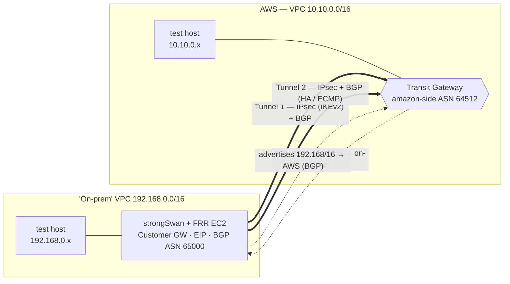

# Lab 2 — Site-to-Site VPN → Transit Gateway (hybrid over IPsec + BGP)

Test plan: `../README.md` (lab 2). Concept: workbook `01_Knowledge/Network/Cloud-Connectivity/`.

Connects a **simulated on-prem data center** to an AWS VPC over an **IPsec Site-to-Site VPN** that
terminates on a **Transit Gateway**, with **BGP** exchanging routes (2 tunnels for HA). The on-prem
side is a VPC (`192.168.0.0/16`) whose **strongSwan + FRR** EC2 plays the Customer Gateway. Once the
tunnels are UP and BGP is established you can SSM into either side and ping across — self-contained,
independent of lab 1 (its own TGW + VPCs).

## Architecture


## Structure (layered — each folder is its own state, like the eks env layers)
| Layer | Builds | Depends on |
|---|---|---|
| `1-vpc/` | 2 VPCs (`aws` 10.10/16 + `onprem` 192.168/16) + public subnet + IGW + RT + SGs (ICMP both sides; a strongSwan SG opening IKE/NAT-T/ESP) | — |
| `2-tgw/` | Transit Gateway (amazon ASN 64512, ECMP on) + aws VPC attachment + 1 route table + route `aws → 192.168/16 → TGW` | 1-vpc |
| `3-vpn/` | EIP for the appliance + `aws_customer_gateway` (BGP ASN 65000) + `aws_vpn_connection` to the TGW (2 tunnels, dynamic/BGP) + TGW RT assoc/propagation for the VPN attachment | 1-vpc, 2-tgw |
| `4-strongswan/` | the on-prem CGW appliance (`t4g.micro` AL2023, `source_dest_check=false`) running **strongSwan** (2 IPsec tunnels via VTI + fwmark) + **FRR** (BGP) from templated user_data; SSM IAM role/profile (`net-lab-vpn-ssm`); EIP assoc; route `onprem → 10.10/16 → strongSwan ENI` | 1-vpc, 3-vpn |
| `5-ec2/` | 2 test hosts (`t4g.micro`, AL2023, SSM, no SSH) — one in each VPC | 1-vpc, 4-strongswan |

> The IPsec/BGP config in `4-strongswan/user_data.sh.tftpl` is templated from the `aws_vpn_connection`
> attributes (tunnel outside/inside addresses, PSKs, both BGP ASNs). It was **built blind** — see the
> **⚠️ Verify live** section before trusting it end-to-end.

## Run
Prereq (once per account): create the state bucket via foundation — `(cd ../../foundation/00-tf-backend && tofu init && tofu apply)`
provisions **`network-iac-tfstate`**. State lives there, one key per layer (`02-vpn/<layer>/…`).
```bash
cd ~/src/github/trongnvv/aws-iac/network/02-vpn
./deploy.sh                       # applies 1-vpc → 2-tgw → 3-vpn → 4-strongswan → 5-ec2, prints IPs
# or per layer:  (cd 1-vpc && tofu init && tofu apply)  … then 2-tgw, 3-vpn, 4-strongswan, 5-ec2
```

## Test checklist (pass/fail)
Run top to bottom. Each check = one step + its PASS/FAIL. Tick the box when PASS. A FAIL points to the
Troubleshooting row below. Tunnels take ~1–2 min to come UP and BGP ~30s more to establish. First grab
the IDs + private IPs and the VPN id:
```bash
cd 5-ec2 && tofu output instances       # {aws,onprem} → {id, private_ip}
# export for the commands below (fill from the output):
AWS_ID=i-aws…    ; ON_ID=i-onprem…
AWS_IP=10.10.0.x ; ON_IP=192.168.0.x
# the strongSwan appliance + the VPN connection:
SS_ID=$(cd 4-strongswan && tofu output -raw strongswan_instance_id)
VPN_ID=$(cd 3-vpn && tofu output -raw vpn_connection_id)
TGW_RT=$(cd 2-tgw && tofu output -raw tgw_route_table_id)
```

- [ ] **T0 — all 3 hosts registered in SSM** (aws test host + onprem test host + strongSwan; wait ~1–2 min after apply)
  ```bash
  aws ssm describe-instance-information \
    --query "InstanceInformationList[].{id:InstanceId,ping:PingStatus}" --output table
  ```
  **PASS:** all 3 instances present, `PingStatus = Online`. **FAIL:** fewer than 3 / not Online → TS "SSM not registering".

- [ ] **T1 — VPN tunnels UP** (at least 1, ideally both)
  ```bash
  aws ec2 describe-vpn-connections --vpn-connection-ids "$VPN_ID" \
    --query 'VpnConnections[].VgwTelemetry[].{outside:OutsideIpAddress,status:Status,routes:AcceptedRouteCount}' \
    --output table
  # want: Status=UP, AcceptedRouteCount >= 1 (BGP learned 192.168/16)
  ```
  **PASS:** ≥1 tunnel `Status=UP` (ideally both), `AcceptedRouteCount >= 1`. **FAIL:** all DOWN → TS "Tunnel DOWN".

- [ ] **T2 — BGP established on the strongSwan appliance** *(needs the built-blind appliance config — see ⚠️ Verify live)*
  ```bash
  aws ssm start-session --target "$SS_ID"
    sudo swanctl --list-sas                  # both children INSTALLED (IPsec up first)
    sudo vtysh -c 'show bgp summary'         # each neighbor State/PfxRcd = a number (Established), not Active/Connect
    sudo vtysh -c 'show ip route bgp'        # learned 10.10.0.0/16 via the vgw inside addrs
    exit
  ```
  **PASS:** neighbors show a numeric `PfxRcd` (Established) and received prefixes `> 0` (10.10/16 learned). **FAIL:** neighbor stuck `Active`/`Connect`, PfxRcd=0 → TS "BGP not established".

- [ ] **T3 — aws → on-prem reachable** (cloud → on-prem over the VPN)
  ```bash
  aws ssm start-session --target "$AWS_ID"
    ping -c3 $ON_IP        # expect replies from 192.168.0.x
    exit
  ```
  **PASS:** `0% packet loss`. **FAIL:** timeout → if the reverse (T4) works it's one-way → TS "ping one-way"; if both fail → TS "ping fails (tunnels+BGP UP)".

- [ ] **T4 — on-prem → aws reachable** (on-prem → cloud via strongSwan ENI → tunnel)
  ```bash
  aws ssm start-session --target "$ON_ID"
    ping -c3 $AWS_IP       # expect replies from 10.10.0.x
    exit
  ```
  **PASS:** `0% packet loss`. **FAIL:** timeout → if T3 works it's one-way → TS "ping one-way"; else → TS "ping fails (tunnels+BGP UP)".

- [ ] **T5 — on-prem CIDR learned via BGP on the TGW** (route propagated, not static)
  ```bash
  aws ec2 search-transit-gateway-routes --transit-gateway-route-table-id "$TGW_RT" \
    --filters Name=state,Values=active \
    --query 'Routes[].{cidr:DestinationCidrBlock,type:Type,state:State}' --output table
  # want: 192.168.0.0/16 present, Type=propagated (from the VPN attachment via BGP)
  ```
  **PASS:** `192.168.0.0/16` present with `Type=propagated`. **FAIL:** missing / only static → TS "on-prem CIDR not propagated".

**Result:** all boxes ticked = lab passes (IPsec tunnels UP, BGP established, bidirectional reachability on-prem ↔ cloud, on-prem route learned over BGP).

## Troubleshooting
| Symptom | Check |
|---|---|
| Tunnel **DOWN** (`VgwTelemetry Status=DOWN`) | 1) strongSwan SG allows UDP 500/4500 + ESP from AWS's two outside IPs (`1-vpc` `aws_security_group.strongswan`)? 2) PSK mismatch — `sudo swanctl --list-conns`, compare secret with `3-vpn` `tofu output tunnel1_psk`. 3) `sudo journalctl -u strongswan`; `ping` the tunnel outside IP. 4) EIP actually associated (`4-strongswan` `aws_eip_association`)? The CGW IP in `3-vpn` must equal the appliance's public IP. |
| **BGP not established** (`show ip bgp summary` = Active/Connect) | 1) VTIs up with the inside /30? `ip addr show vti1`. 2) FRR neighbor = the **vgw** inside addr (not cgw). 3) `no bgp ebgp-requires-policy` present (FRR 9 needs it or it filters all). 4) IPsec must be UP first — BGP rides inside the tunnel. |
| **ping fails (tunnels+BGP UP)** — both directions time out | 1) `source_dest_check=false` on the appliance (`4-strongswan`)? 2) onprem RT has `10.10/16 → strongSwan ENI`; aws RT has `192.168/16 → TGW`. 3) TGW RT: VPN attachment **propagated** (192.168/16) + aws attachment propagated (10.10/16). 4) SGs allow ICMP from `10/8` **and** `192.168/16`. 5) `net.ipv4.ip_forward=1` on the appliance. |
| **ping one-way** — one direction replies, the reverse times out | Return path missing. aws→onprem OK but onprem→aws fails: onprem RT lacks `10.10/16 → strongSwan ENI`, or aws SG blocks ICMP from `192.168/16`, or TGW RT missing the aws attachment propagation. Reverse case (onprem→aws OK, aws→onprem fails): aws RT lacks `192.168/16 → TGW`, or onprem SG blocks ICMP from `10/8`, or the VPN attachment's `192.168/16` isn't propagated (T5). Also check BGP advertised **both** prefixes (`show bgp` on each side). |
| **on-prem CIDR not propagated** (`192.168/16` absent / only static in the TGW RT) | 1) VPN attachment **associated + propagated** to the TGW RT (`3-vpn` route-table assoc/propagation)? 2) BGP must be Established first (T2) — the route is learned over BGP, not static; if T2 fails fix that first. 3) FRR actually advertises `192.168/16` out (`network 192.168.0.0/16` in the bgp config). 4) `vpn_connection` is **dynamic** (BGP), not static-routes-only. |
| **SSM not registering** (`start-session` fails) | Agent needs ~1–2 min; host needs public IP + IGW route (`1-vpc`) + the `AmazonSSMManagedInstanceCore` profile (`net-lab-vpn-ssm`, created in `4-strongswan`). `aws ssm describe-instance-information`. |
| ping works small, **fails/stalls on large** payloads | MSS/MTU: VPN path ≈ 1500 but IPsec overhead cuts the effective MSS to ~1379. VTI MTU is set to 1419 in user_data; add **MSS clamping** (`iptables -t mangle -A FORWARD -p tcp --tcp-flags SYN,RST SYN -j TCPMSS --clamp-mss-to-pmtu`) and re-test with `ping -M do -s <size>`. |
| `3-vpn`/`4-strongswan` apply: remote state empty | run the earlier layer first (`./deploy.sh` does the order). |

## Test EC2 recipe (reused by every lab)
Small, cheap, no SSH: `t4g.micro` + Amazon Linux 2023 (arm64) + `AmazonSSMManagedInstanceCore` role
(here `net-lab-vpn-ssm`, created in `4-strongswan`) in a **public** subnet (public IP + IGW) so the
SSM agent reaches AWS without a NAT/endpoints. Reach it with `aws ssm start-session`. Cross-site
traffic goes **private** over the VPN/TGW; the public IP is management-only. See `4-strongswan/` +
`5-ec2/`. The strongSwan appliance uses the same base image + profile, plus `source_dest_check=false`
and strongSwan/FRR from the AL2023 repos.

## Teardown
```bash
./teardown.sh                     # destroys 5-ec2 → 4-strongswan → 3-vpn → 2-tgw → 1-vpc
# cost-save mid-lab: (cd 5-ec2 && tofu destroy) + (cd 4-strongswan && tofu destroy)
#   drops the EC2s; the VPN connection itself still bills until 3-vpn is destroyed.
```

## Cost (while running)
VPN connection ≈ **$0.05/hour** + TGW attachments ≈ $0.05/attachment-hour × 2 (aws VPC + VPN) + data ·
2× `t4g.micro` test + 1× strongSwan ≈ $0.025/h × 3 · EIP (strongSwan) + 3× public IPv4 ≈ $0.005/h × 4 →
**~$0.25/hour**. Billed hourly even idle → **destroy when done**.

## ⚠️ Verify live (built blind)
This lab's AWS resource wiring (VPC/TGW/CGW/VPN/routes/EC2) is standard and `tofu validate`-clean, but
the **appliance config is best-effort and WILL likely need live tuning**. The VPN won't come up purely
from `tofu apply` until these are confirmed on a real deploy:

- **strongSwan swanctl.conf** — AL2023 ships strongSwan 5.9 with the swanctl/vici backend (not legacy
  `ipsec.conf`). Verify the service unit name (`strongswan` vs `strongswan-swanctl`), that
  `swanctl --load-all` actually loads both connections, and that the **PSK `id-aws`** matching (keyed
  by the tunnel outside IP) is accepted by AWS. Proposals (`aes128-sha1-modp1024`) match AWS defaults
  but AWS now offers stronger — confirm the negotiated proposal in `swanctl --list-sas`.
- **Route-based VTI + fwmark** — the `ip link add … type vti key N` + `mark_in/mark_out=N` pairing is
  the crux. If encrypted traffic doesn't flow, check `ip -s xfrm state`, the fwmark on the VTI, and
  `disable_policy`. This is the single most likely thing to need hand-tuning.
- **BGP established** — FRR 9 syntax (`no bgp ebgp-requires-policy`, `timers 10 30`); confirm neighbors
  reach **Established** and that `192.168/16` is advertised out and `10.10/16` learned in.
- **ping both ways** — the end-to-end proof; depends on forwarding + `source_dest_check=false` + the
  two VPC routes + TGW propagation all being correct together.
- **MSS/MTU & PMTUD** — VTI MTU is pre-set to 1419 and MSS clamping is noted but **not applied** in
  user_data; apply + measure with `ping -M do -s <size>` on a live tunnel.

### Stretch (from the plan — do after Core passes live)
- [ ] **BGP failover/convergence:** drop tunnel 1 (`sudo swanctl --terminate --child aws-tunnel1`) →
      measure time for traffic to fail over to tunnel 2 (BGP timers `10 30` + DPD `10s` set to keep it fast).
- [ ] **ECMP:** TGW has `vpn_ecmp_support=enable`; on FRR drop the `T2-BACKUP` local-pref route-map and
      add `maximum-paths 2` so both tunnels load-balance → confirm flows spread across tunnel1+tunnel2.
- [ ] **MTU / PMTUD:** find the working MSS with the DF bit, add MSS clamping, confirm no fragmentation
      (VPN path ≈ 1500 → effective MSS ≈ 1379).
