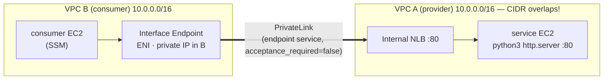

# Lab 3 — PrivateLink (share one service across VPCs, overlapping CIDR still works)

Test plan: `../README.md` (lab 3). Concept: workbook `01_Knowledge/Network/Cloud-Connectivity/`.

Exposes **one** service in VPC **A** (provider) behind an **internal NLB** via a **VPC Endpoint Service
(PrivateLink)**, and reaches it from VPC **B** (consumer) through an **interface VPC endpoint** — even
though **A and B use the SAME CIDR (`10.0.0.0/16`)**. It works because the consumer talks to the
endpoint **ENI** (a private IP inside B's own subnet); PrivateLink tunnels that to the NLB in A. No
route between the two `10.0.0.0/16` blocks is ever consulted, so the overlap is irrelevant — the exact
thing TGW/peering can't do.

## Architecture


## Structure (layered — each folder is its own state, like the eks env layers)
| Layer | Builds | Depends on |
|---|---|---|
| `1-vpc/` | VPC A + VPC B with **identical `10.0.0.0/16`**; one public subnet + IGW + RT each; provider-service SG + consumer-host SG | — |
| `2-provider/` | service EC2 (tiny HTTP via systemd) + internal **NLB** (TG + listener :80) + `aws_vpc_endpoint_service`; also the `net-lab-pl-ssm` IAM role/profile | 1-vpc |
| `3-consumer/` | **interface** `aws_vpc_endpoint` (`service_name` from 2-provider, `private_dns_enabled=false`) + its SG (80/443 from VPC B) | 1-vpc, 2-provider |
| `4-ec2/` | consumer test host in VPC B (`t4g.micro`, AL2023, SSM, no SSH) — curls the endpoint DNS name | 1-vpc, 2-provider, 3-consumer |

> The SSM IAM role/instance-profile (`net-lab-pl-ssm`) lives in `2-provider/` (its service EC2 is the
> first host that needs it) and is reused by the `4-ec2/` consumer host via remote state — one profile
> for the whole lab.

## Run
Prereq (once per account): create the state bucket via foundation — `(cd ../../foundation/00-tf-backend && tofu init && tofu apply)`
provisions **`network-iac-tfstate`** (alongside `eks-iac-tfstate`). State lives there, one key per layer
(`03-privatelink/<layer>/terraform.tfstate`).
```bash
cd ~/src/github/trongnvv/aws-iac/network/03-privatelink
./deploy.sh                       # applies 1-vpc → 2-provider → 3-consumer → 4-ec2, prints the test cmd
# or per layer:  (cd 1-vpc && tofu init && tofu apply)  … then 2-provider, 3-consumer, 4-ec2
```

## Test checklist (pass/fail)
Run top to bottom. Each check = one step + its PASS/FAIL. Tick the box when PASS. A FAIL points to the
Troubleshooting row below. First grab the IDs + DNS name from the layer outputs:
```bash
SVC_NAME=$(cd 2-provider && tofu output -raw endpoint_service_name)   # com.amazonaws.vpce.<region>.vpce-svc-xxxx
SVC_ID=$(cd 2-provider && tofu output -raw service_instance_id)       # provider EC2 (VPC A), for T4
EP_ID=$(cd 3-consumer && tofu output -raw endpoint_id)                # the interface endpoint (vpce-…)
EP_DNS=$(cd 3-consumer && tofu output -raw endpoint_dns_name)         # vpce-xxxx.vpce-svc-yyyy.<region>.vpce.amazonaws.com
CON_ID=$(cd 4-ec2 && tofu output -raw consumer_instance_id)          # consumer test host (VPC B)
# provider's private IP in VPC A — used in T4 to show L3 to it fails:
SVC_IP=$(aws ec2 describe-instances --instance-ids "$SVC_ID" \
  --query 'Reservations[].Instances[].PrivateIpAddress' --output text)
echo "service name=$SVC_NAME  endpoint=$EP_ID  dns=$EP_DNS  consumer=$CON_ID  provider_ip=$SVC_IP"
```

- [ ] **T0 — consumer test host registered in SSM** (wait ~1–2 min after apply)
  ```bash
  aws ssm describe-instance-information \
    --query "InstanceInformationList[?InstanceId=='$CON_ID'].{id:InstanceId,ping:PingStatus}" --output table
  ```
  **PASS:** one row, `PingStatus = Online`. **FAIL:** empty / not Online → TS "SSM".

- [ ] **T1 — endpoint service exists & Available on the provider side**
  ```bash
  aws ec2 describe-vpc-endpoint-service-configurations \
    --query "ServiceConfigurations[?ServiceName=='$SVC_NAME'].{name:ServiceName,state:ServiceState,accept:AcceptanceRequired}" \
    --output table
  ```
  **PASS:** one row, `ServiceState = Available` (and `AcceptanceRequired = false`). **FAIL:** empty / `Pending` → TS "endpoint service not Available".

- [ ] **T2 — interface endpoint is Available on the consumer side**
  ```bash
  aws ec2 describe-vpc-endpoints --vpc-endpoint-ids "$EP_ID" \
    --query 'VpcEndpoints[0].State' --output text          # expect: available
  ```
  **PASS:** prints `available`. **FAIL:** `pending` / `pendingAcceptance` / `failed` → TS "endpoint not Available".

- [ ] **T3 — service reachable ACROSS the overlap (the key PASS)** — consumer in `10.0.0.0/16` reaches the service in the other `10.0.0.0/16`
  ```bash
  aws ssm start-session --target "$CON_ID"
    curl -s http://$EP_DNS           # paste the $EP_DNS value; vpce-…vpce.amazonaws.com
    # → "hello from PrivateLink provider (VPC A) ip-10-0-0-x"
    exit
  ```
  **PASS:** returns the provider's proof page (`hello from PrivateLink provider (VPC A) …`) — works despite **both VPCs being `10.0.0.0/16`**. **FAIL:** hangs / empty / connection refused → TS "curl hangs" or "service not reachable".

- [ ] **T4 — prove it's NOT L3 routing** — the ONLY path is the endpoint; there is no route between the two VPCs, and a direct hit on the provider's private IP must fail while T3's endpoint curl succeeds
  ```bash
  # 4a) there is no peering / TGW between A and B (none should exist for this lab):
  aws ec2 describe-vpc-peering-connections \
    --query 'VpcPeeringConnections[].VpcPeeringConnectionId' --output text   # expect: empty
  # 4b) from the consumer, the provider's own private IP is unreachable (no route to VPC A):
  aws ssm start-session --target "$CON_ID"
    curl -s -m5 http://$SVC_IP || echo "UNREACHABLE (expected)"   # paste $SVC_IP; direct L3 must fail
    curl -s http://$EP_DNS                                        # paste $EP_DNS; endpoint still works
    exit
  ```
  **PASS:** 4a empty (no peering); 4b direct `http://$SVC_IP` times out → `UNREACHABLE (expected)`, yet the `$EP_DNS` curl still returns the proof page. Only the endpoint reaches the service — PrivateLink never consults a route between the overlapping CIDRs. **FAIL:** direct IP curl succeeds (means there's an L3 path, not isolated overlap) → TS "service not reachable" / review peering & routes.

**Result:** all boxes ticked = lab passes (PrivateLink reaches a service across identical `10.0.0.0/16` CIDRs via the interface endpoint, with no L3 route between the VPCs).

## Troubleshooting — debug flow
When a check fails, don't guess — **walk the PrivateLink path one hop at a time** from the side the
symptom points to, then jump to the matching fix (`.tf` file named at each step). The path is:
`consumer host → endpoint SG → endpoint ENI  ══PrivateLink══  NLB listener :80 → target group → service SG → service EC2 (labhttp)`.
General method: vault `01_Knowledge/Network/Cloud-Connectivity/Debug-Strategy.md`.

Re-export the IDs first if you opened a fresh shell (same block as the test checklist), and derive the
target-group ARN once (no `tofu output` for it):
```bash
TG_ARN=$(aws elbv2 describe-target-groups --names net-lab-pl-tg \
  --query 'TargetGroups[0].TargetGroupArn' --output text)
```

### Step 0 — VPC Reachability Analyzer (confirm the consumer→ENI leg)
PrivateLink is *not* L3, so the analyzer can't trace end-to-end through the tunnel. What it **can** prove
is the leg that trips most often: **consumer host → endpoint ENI** (does SG/route/NACL let the host reach
the endpoint's private IP in VPC B?). If this leg is clean, the fault is past the ENI — on the provider
side (Flows for T3/T1). Run it against the endpoint ENI:
```bash
analyze() {  # analyze <src-instance-id> <dst-eni-id>  → prints Reachable + the blocking component
  pid=$(aws ec2 create-network-insights-path --source "$1" --destination "$2" \
        --protocol tcp --destination-port 80 \
        --query NetworkInsightsPath.NetworkInsightsPathId --output text)
  aid=$(aws ec2 start-network-insights-analysis --network-insights-path-id "$pid" \
        --query NetworkInsightsAnalysis.NetworkInsightsAnalysisId --output text)
  aws ec2 wait network-insights-analysis-available --network-insights-analysis-ids "$aid" 2>/dev/null
  aws ec2 describe-network-insights-analyses --network-insights-analysis-ids "$aid" \
    --query 'NetworkInsightsAnalyses[0].{Reachable:NetworkPathFound,Blocked:Explanations[0].ExplanationCode}' --output table
  aws ec2 delete-network-insights-path --network-insights-path-id "$pid" >/dev/null 2>&1   # cleanup ($0.10/analysis)
}
# resolve the endpoint ENI id, then analyze consumer host → ENI:
EP_ENI=$(aws ec2 describe-vpc-endpoints --vpc-endpoint-ids "$EP_ID" \
  --query 'VpcEndpoints[0].NetworkInterfaceIds[0]' --output text)
analyze "$CON_ID" "$EP_ENI"
```
`Reachable=False` with `ENI_SG_RULES_MISMATCH` → endpoint SG (Flow: curl hangs, step 1). `Reachable=True`
but T3 still hangs → the block is **past** the ENI → Flow: curl hangs, steps 2–3 (provider side).

### Flow: endpoint not Available (T2 ≠ `available`)
```bash
aws ec2 describe-vpc-endpoints --vpc-endpoint-ids "$EP_ID" \
  --query 'VpcEndpoints[0].{State:State,DNS:DnsEntries}' --output json
```
- **`pendingAcceptance`** → the endpoint **service** has `acceptance_required=true` but nobody accepted —
  a mismatch with this lab's design (`2-provider` sets it `false`). Either fix the service back to
  `acceptance_required=false` in `2-provider/provider.tf`, or accept the connection:
  `aws ec2 accept-vpc-endpoint-connections --service-id <vpce-svc-id> --vpc-endpoint-ids "$EP_ID"`.
- **`failed`** → subnet or SG problem on the endpoint itself: the `service_name` wired into `3-consumer`
  doesn't match T1's `$SVC_NAME`, or the chosen subnet/SG is invalid. Re-check `3-consumer` `aws_vpc_endpoint.service`
  (`service_name`, `subnet_ids`) and its SG `aws_security_group.endpoint` (`3-consumer`).
- **`pending`** → still provisioning; wait ~1 min and re-run.

### Flow: curl hangs / no response (T3 — the key path)
Walk provider-side from the ENI outward. Each step has a concrete check + where to fix.
1. **Endpoint SG lets the host in?** — must allow TCP 80/443 from VPC B:
   ```bash
   aws ec2 describe-security-groups --group-ids "$(cd 3-consumer && tofu output -raw endpoint_sg_id)" \
     --query 'SecurityGroups[0].IpPermissions[].{proto:IpProtocol,from:FromPort,cidr:IpRanges[].CidrIp}'
   ```
   No 80 (or 443) from `10.0.0.0/16` → fix `3-consumer` `aws_security_group.endpoint`. (Step 0 flags this as `ENI_SG_RULES_MISMATCH`.)
2. **NLB target healthy?** — the single most common cause of a hang:
   ```bash
   aws elbv2 describe-target-health --target-group-arn "$TG_ARN" \
     --query 'TargetHealthDescriptions[].{target:Target.Id,health:TargetHealth.State,why:TargetHealth.Reason}' --output table
   ```
   - `healthy` → the target is fine; the fault is the listener or the SG path (steps 3–1), not the service.
   - `unhealthy` / `unused` → the **service** isn't answering the health check. Causes:
     - **service SG** doesn't allow :80 from the NLB subnet / VPC A CIDR → fix `1-vpc` `aws_security_group.provider_svc`.
     - **http server not running** — SSM into the provider host and check the unit:
       ```bash
       aws ssm start-session --target "$SVC_ID"
         systemctl status labhttp        # expect active (running); if dead: journalctl -u labhttp
         curl -s localhost:80            # local proof the server serves
         exit
       ```
       Dead/absent → user_data hasn't finished (give it ~1 min) or the unit failed; the unit lives in `2-provider/provider.tf`.
3. **Listener exists on :80?** — NLB must have a TCP :80 listener forwarding to the TG:
   ```bash
   NLB_ARN=$(aws elbv2 describe-load-balancers --names net-lab-pl-nlb --query 'LoadBalancers[0].LoadBalancerArn' --output text)
   aws elbv2 describe-listeners --load-balancer-arn "$NLB_ARN" \
     --query 'Listeners[].{port:Port,proto:Protocol}' --output table
   ```
   No `80/TCP` row → fix `2-provider` `aws_lb_listener.service`.
4. **Confirm the consumer→ENI leg with the analyzer** (Step 0) — isolates "is it the consumer side or the
   provider side?". `Reachable=True` to the ENI but curl still hangs → the problem is steps 2–3 (provider),
   not the consumer. (The analyzer stops at the ENI — it does **not** trace through PrivateLink to the NLB.)

Also sanity-check you're curling **`$EP_DNS`** (the `vpce-…vpce.amazonaws.com` name), not the service's own
DNS — `private_dns_enabled=false` here, so only the endpoint name resolves to the ENI.

### Flow: endpoint service not found / not Available (T1 empty or `Pending`)
```bash
aws ec2 describe-vpc-endpoint-service-configurations \
  --query "ServiceConfigurations[?ServiceName=='$SVC_NAME'].{name:ServiceName,state:ServiceState,accept:AcceptanceRequired}" \
  --output table
```
- **empty** → `2-provider` not applied, or the NLB ARN isn't wired into `aws_vpc_endpoint_service.service`.
  Confirm the NLB exists: `aws elbv2 describe-load-balancers --names net-lab-pl-nlb`. If the NLB is missing,
  `2-provider` apply didn't complete — re-apply that layer.
- **`Pending`** → it provisions within ~1 min of apply; wait and re-run. Persisting `Pending` → check the NLB
  reached `active` (`... --query 'LoadBalancers[0].State.Code'`). Service config is `2-provider/provider.tf` `aws_vpc_endpoint_service.service`.

### Flow: T4 "prove it's not L3" gives an unexpected result
T4 expects the direct `curl http://$SVC_IP` (provider's **private** IP in VPC A) to **time out** — there is
no route between the two `10.0.0.0/16` VPCs. If that direct curl **succeeds**, an L3 path leaked in and the
overlap isn't actually being bypassed by PrivateLink. Hunt the stray route:
```bash
aws ec2 describe-vpc-peering-connections \
  --query 'VpcPeeringConnections[].{id:VpcPeeringConnectionId,state:Status.Code}' --output table   # expect: empty
# inspect both VPCs' route tables for a cross-VPC entry (a 10.0.0.0/16 → pcx-/tgw-… that shouldn't be there):
for vpc in $(cd 1-vpc && tofu output -json vpc_ids | python3 -c 'import json,sys;print(" ".join(json.load(sys.stdin).values()))'); do
  echo "== vpc $vpc =="
  aws ec2 describe-route-tables --filters Name=vpc-id,Values=$vpc \
    --query 'RouteTables[].Routes[].{dst:DestinationCidrBlock,gw:GatewayId,pcx:VpcPeeringConnectionId,tgw:TransitGatewayId}' --output table
done
```
Any peering row or a route targeting a `pcx-…`/`tgw-…` → remove it; this lab intentionally has **no**
peering/TGW between A and B. The only sanctioned reachability is the endpoint.

### Quick table (symptom → flow)
| Symptom | First move |
|---|---|
| endpoint not `available` (T2) | Flow: endpoint not Available — `pendingAcceptance` = acceptance mismatch, `failed` = subnet/SG/service_name |
| curl hangs / empty / refused (T3) | Flow: curl hangs — endpoint SG → **target health** → listener :80 → analyzer (consumer→ENI leg) |
| service name empty / Pending (T1) | Flow: endpoint service not found — `2-provider` applied? NLB `active`? ARN wired? |
| direct `$SVC_IP` curl unexpectedly works (T4) | Flow: T4 unexpected — `describe-vpc-peering-connections` empty? stray route in either VPC RT? |
| curl connects but target shows `unhealthy` | Flow: curl hangs, step 2 — service SG (`1-vpc`) + `systemctl status labhttp` on the provider host |
| `start-session` fails / host not in SSM (T0) | wait ~1–2 min; `aws ssm describe-instance-information` → PingStatus Online? Else public IP + IGW route (`1-vpc`) + `net-lab-pl-ssm` profile (`2-provider`/`4-ec2`). Plugin missing → `brew install --cask session-manager-plugin`. |

## Test EC2 recipe (reused by every lab)
Small, cheap, no SSH: `t4g.micro` + Amazon Linux 2023 (arm64) + the `net-lab-pl-ssm`
(`AmazonSSMManagedInstanceCore`) role in a **public** subnet (public IP + IGW) so the SSM agent reaches
AWS without a NAT/endpoints. Reach it with `aws ssm start-session`. The service traffic still goes
**private** via PrivateLink; the public IP is management-only. See `2-provider/ssm.tf` + `4-ec2/`.

## Teardown
```bash
./teardown.sh                     # destroys 4-ec2 → 3-consumer → 2-provider → 1-vpc
# cost-save mid-lab: (cd 4-ec2 && tofu destroy) && (cd 2-provider && tofu destroy)  # drop EC2 + NLB, keep VPCs
```

## Cost (while running)
Internal NLB ≈ $0.0225/hour + LCU · interface endpoint ≈ $0.01/AZ/hour (1 AZ) + data · 2× `t4g.micro`
≈ $0.017/hour · 2× public IPv4 ≈ $0.01/hour → **~$0.06/hour**. Billed hourly even idle → **destroy when
done**.

## Stretch (from `../README.md`)
- [ ] **Private DNS name:** flip `private_dns_enabled=true` on the interface endpoint (requires a
      verified domain on the endpoint service) → the endpoint resolver overrides the service's real
      domain to the endpoint's **private IP**, so the consumer curls the real service DNS name
      transparently instead of the generated `vpce-…` name.
- [ ] **Cross-zone LB:** put the consumer endpoint ENI in AZ-a and the service target in AZ-b, toggle
      NLB **cross-zone load balancing** on → a consumer in one AZ reaches a target in another; note the
      **cross-AZ data fee** that enabling cross-zone introduces.
