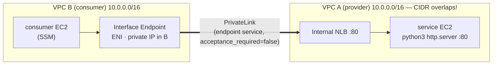

# Lab 3 — PrivateLink (share one service across VPCs, overlapping CIDR still works)

Test plan: `../README.md` (lab 3). Concept: workbook `01_Knowledge/Network/Cloud-Connectivity/`.

Exposes **one** service in VPC **A** (provider) behind an **internal NLB** via a **VPC Endpoint Service
(PrivateLink)**, and reaches it from VPC **B** (consumer) through an **interface VPC endpoint** — even
though **A and B use the SAME CIDR (`10.0.0.0/16`)**. It works because the consumer talks to the
endpoint **ENI** (a private IP inside B's own subnet); PrivateLink tunnels that to the NLB in A. No
route between the two `10.0.0.0/16` blocks is ever consulted, so the overlap is irrelevant — the exact
thing TGW/peering can't do.

## Architecture


## Structure (layered — each folder is its own state, like the eks env layers)
| Layer | Builds | Depends on |
|---|---|---|
| `1-vpc/` | VPC A + VPC B with **identical `10.0.0.0/16`**; one public subnet + IGW + RT each; provider-service SG + consumer-host SG | — |
| `2-provider/` | service EC2 (tiny HTTP via systemd) + internal **NLB** (TG + listener :80) + `aws_vpc_endpoint_service`; also the `net-lab-pl-ssm` IAM role/profile | 1-vpc |
| `3-consumer/` | **interface** `aws_vpc_endpoint` (`service_name` from 2-provider, `private_dns_enabled=false`) + its SG (80/443 from VPC B) | 1-vpc, 2-provider |
| `4-ec2/` | consumer test host in VPC B (`t4g.micro`, AL2023, SSM, no SSH) — curls the endpoint DNS name | 1-vpc, 2-provider, 3-consumer |

> The SSM IAM role/instance-profile (`net-lab-pl-ssm`) lives in `2-provider/` (its service EC2 is the
> first host that needs it) and is reused by the `4-ec2/` consumer host via remote state — one profile
> for the whole lab.

## Run
Prereq (once per account): create the state bucket via foundation — `(cd ../../foundation/00-tf-backend && tofu init && tofu apply)`
provisions **`network-iac-tfstate`** (alongside `eks-iac-tfstate`). State lives there, one key per layer
(`03-privatelink/<layer>/terraform.tfstate`).
```bash
cd ~/src/github/trongnvv/aws-iac/network/03-privatelink
./deploy.sh                       # applies 1-vpc → 2-provider → 3-consumer → 4-ec2, prints the test cmd
# or per layer:  (cd 1-vpc && tofu init && tofu apply)  … then 2-provider, 3-consumer, 4-ec2
```

## Test checklist (pass/fail)
Run top to bottom. Each check = one step + its PASS/FAIL. Tick the box when PASS. A FAIL points to the
Troubleshooting row below. First grab the IDs + DNS name from the layer outputs:
```bash
SVC_NAME=$(cd 2-provider && tofu output -raw endpoint_service_name)   # com.amazonaws.vpce.<region>.vpce-svc-xxxx
SVC_ID=$(cd 2-provider && tofu output -raw service_instance_id)       # provider EC2 (VPC A), for T4
EP_ID=$(cd 3-consumer && tofu output -raw endpoint_id)                # the interface endpoint (vpce-…)
EP_DNS=$(cd 3-consumer && tofu output -raw endpoint_dns_name)         # vpce-xxxx.vpce-svc-yyyy.<region>.vpce.amazonaws.com
CON_ID=$(cd 4-ec2 && tofu output -raw consumer_instance_id)          # consumer test host (VPC B)
# provider's private IP in VPC A — used in T4 to show L3 to it fails:
SVC_IP=$(aws ec2 describe-instances --instance-ids "$SVC_ID" \
  --query 'Reservations[].Instances[].PrivateIpAddress' --output text)
echo "service name=$SVC_NAME  endpoint=$EP_ID  dns=$EP_DNS  consumer=$CON_ID  provider_ip=$SVC_IP"
```

- [ ] **T0 — consumer test host registered in SSM** (wait ~1–2 min after apply)
  ```bash
  aws ssm describe-instance-information \
    --query "InstanceInformationList[?InstanceId=='$CON_ID'].{id:InstanceId,ping:PingStatus}" --output table
  ```
  **PASS:** one row, `PingStatus = Online`. **FAIL:** empty / not Online → TS "SSM".

- [ ] **T1 — endpoint service exists & Available on the provider side**
  ```bash
  aws ec2 describe-vpc-endpoint-service-configurations \
    --query "ServiceConfigurations[?ServiceName=='$SVC_NAME'].{name:ServiceName,state:ServiceState,accept:AcceptanceRequired}" \
    --output table
  ```
  **PASS:** one row, `ServiceState = Available` (and `AcceptanceRequired = false`). **FAIL:** empty / `Pending` → TS "endpoint service not Available".

- [ ] **T2 — interface endpoint is Available on the consumer side**
  ```bash
  aws ec2 describe-vpc-endpoints --vpc-endpoint-ids "$EP_ID" \
    --query 'VpcEndpoints[0].State' --output text          # expect: available
  ```
  **PASS:** prints `available`. **FAIL:** `pending` / `pendingAcceptance` / `failed` → TS "endpoint not Available".

- [ ] **T3 — service reachable ACROSS the overlap (the key PASS)** — consumer in `10.0.0.0/16` reaches the service in the other `10.0.0.0/16`
  ```bash
  aws ssm start-session --target "$CON_ID"
    curl -s http://$EP_DNS           # paste the $EP_DNS value; vpce-…vpce.amazonaws.com
    # → "hello from PrivateLink provider (VPC A) ip-10-0-0-x"
    exit
  ```
  **PASS:** returns the provider's proof page (`hello from PrivateLink provider (VPC A) …`) — works despite **both VPCs being `10.0.0.0/16`**. **FAIL:** hangs / empty / connection refused → TS "curl hangs" or "service not reachable".

- [ ] **T4 — prove it's NOT L3 routing** — the ONLY path is the endpoint; there is no route between the two VPCs, and a direct hit on the provider's private IP must fail while T3's endpoint curl succeeds
  ```bash
  # 4a) there is no peering / TGW between A and B (none should exist for this lab):
  aws ec2 describe-vpc-peering-connections \
    --query 'VpcPeeringConnections[].VpcPeeringConnectionId' --output text   # expect: empty
  # 4b) from the consumer, the provider's own private IP is unreachable (no route to VPC A):
  aws ssm start-session --target "$CON_ID"
    curl -s -m5 http://$SVC_IP || echo "UNREACHABLE (expected)"   # paste $SVC_IP; direct L3 must fail
    curl -s http://$EP_DNS                                        # paste $EP_DNS; endpoint still works
    exit
  ```
  **PASS:** 4a empty (no peering); 4b direct `http://$SVC_IP` times out → `UNREACHABLE (expected)`, yet the `$EP_DNS` curl still returns the proof page. Only the endpoint reaches the service — PrivateLink never consults a route between the overlapping CIDRs. **FAIL:** direct IP curl succeeds (means there's an L3 path, not isolated overlap) → TS "service not reachable" / review peering & routes.

**Result:** all boxes ticked = lab passes (PrivateLink reaches a service across identical `10.0.0.0/16` CIDRs via the interface endpoint, with no L3 route between the VPCs).

## Troubleshooting — debug flow
*Written in Simplified Technical English (ASD-STE100): one instruction per sentence, active voice, present tense.*

A check can fail. Do not guess. Walk the PrivateLink path one hop at a time. Start from the side that the
symptom points to. Then go to the flow for that hop and edit the `.tf` file that the step names. The path is
`consumer host → endpoint SG → endpoint ENI ══PrivateLink══ NLB listener :80 → target group → service SG → service EC2 (labhttp)`.
For the general method, read the vault file `01_Knowledge/Network/Cloud-Connectivity/Debug-Strategy.md`.

### Step 0 — confirm the consumer→ENI leg with the analyzer
PrivateLink is not L3. The analyzer cannot trace end-to-end through the tunnel. The analyzer can prove one
leg: **consumer host → endpoint ENI**. It checks that the SG, route and NACL let the host reach the
endpoint ENI private IP in VPC B. The `analyze()` helper is in the vault file (see above). Resolve the
endpoint ENI id, then run the helper between the consumer host and that ENI.
```bash
aws ec2 describe-vpc-endpoints --vpc-endpoint-ids "$EP_ID" --query 'VpcEndpoints[0].NetworkInterfaceIds[0]' --output text
```
`Reachable=False` with `ENI_SG_RULES_MISMATCH` shows the endpoint SG blocks the host. Go to Flow B, step 1.
`Reachable=True` but T3 still hangs shows the block is past the ENI. Go to Flow B, steps 2–3 (provider side).

### Flow A — endpoint not Available (T2 ≠ `available`)
Read the endpoint state. Then go to the case for that state.
- **`pendingAcceptance`** — the endpoint service has `acceptance_required=true` and nobody accepted. This is
  a mismatch with the lab design. `2-provider` sets it `false`. Edit `2-provider/provider.tf` and set
  `acceptance_required=false`, or accept the connection with the command below.
- **`failed`** — the endpoint has a subnet or SG problem. The `service_name` in `3-consumer` does not match
  T1's `$SVC_NAME`, or the subnet or SG is invalid. Check `aws_vpc_endpoint.service` (`service_name`,
  `subnet_ids`) and `aws_security_group.endpoint` in `3-consumer`.
- **`pending`** — the endpoint still provisions. Wait ~1 minute. Run the check again.
```bash
aws ec2 accept-vpc-endpoint-connections --service-id <vpce-svc-id> --vpc-endpoint-ids "$EP_ID"
```

### Flow B — curl hangs / no response (T3 — the key path)
Walk provider-side from the ENI outward. Stop at the first hop that is wrong.
1. **Endpoint SG** — the SG must allow TCP 80/443 from VPC B (`10.0.0.0/16`). If it does not, edit
   `aws_security_group.endpoint` in `3-consumer`. Step 0 flags this hop as `ENI_SG_RULES_MISMATCH`.
2. **NLB target health** — read the target health. This is the most common cause of a hang. `healthy` means
   the target is fine, so go to step 3 or step 1. `unhealthy` or `unused` means the service does not answer
   the health check. Check the **service SG**: it must allow :80 from the NLB subnet or the VPC A CIDR. If it
   does not, edit `aws_security_group.provider_svc` in `1-vpc`. Also check the **http server**: SSM into the
   provider host, run `systemctl status labhttp`, and run `curl -s localhost:80`. A dead or absent unit means
   the user_data is not finished (wait ~1 minute) or the unit failed. The unit lives in `2-provider/provider.tf`.
3. **NLB listener** — the NLB must have a TCP :80 listener that forwards to the target group. If the listener
   is absent, edit `aws_lb_listener.service` in `2-provider`.
4. **Analyzer** — run Step 0 to isolate the consumer side from the provider side. `Reachable=True` to the ENI
   but a hang on curl means the fault is in steps 2–3 (provider). The analyzer stops at the ENI.

Check that you curl **`$EP_DNS`** (the `vpce-…vpce.amazonaws.com` name), not the service's own DNS.
`private_dns_enabled=false` here, so only the endpoint name resolves to the ENI.
```bash
aws elbv2 describe-target-health --target-group-arn "$TG_ARN" --query 'TargetHealthDescriptions[].{target:Target.Id,health:TargetHealth.State,why:TargetHealth.Reason}' --output table
```

### Flow C — endpoint service not found / not Available (T1 empty or `Pending`)
Read the service configuration. Then go to the case for that state.
- **empty** — `2-provider` is not applied, or the NLB ARN is not wired into `aws_vpc_endpoint_service.service`.
  Confirm the NLB exists. If the NLB is absent, the `2-provider` apply did not complete. Apply `2-provider` again.
- **`Pending`** — the service provisions within ~1 minute of apply. Wait and run the check again. If the state
  stays `Pending`, confirm the NLB reached `active`. The service config is `aws_vpc_endpoint_service.service`
  in `2-provider/provider.tf`.
```bash
aws elbv2 describe-load-balancers --names net-lab-pl-nlb --query 'LoadBalancers[0].State.Code' --output text
```

### Flow D — T4 "prove it's not L3" gives an unexpected result
T4 expects the direct `curl http://$SVC_IP` (the provider's private IP in VPC A) to time out. There is no
route between the two `10.0.0.0/16` VPCs. A direct curl that succeeds means an L3 path leaked in, so
PrivateLink does not bypass the overlap. Hunt the stray route. Check that no peering exists. Then read both
VPCs' route tables and look for a cross-VPC entry (a `10.0.0.0/16` route that targets a `pcx-…` or `tgw-…`).
Remove any peering or any such route. This lab has no peering and no TGW between A and B. The endpoint is the
only sanctioned path.
```bash
aws ec2 describe-vpc-peering-connections --query 'VpcPeeringConnections[].{id:VpcPeeringConnectionId,state:Status.Code}' --output table
```

### Quick table (symptom → first action)
| Symptom | First action |
|---|---|
| endpoint not `available` (T2) | Go to Flow A. `pendingAcceptance` = acceptance mismatch; `failed` = subnet/SG/service_name. |
| curl hangs / empty / refused (T3) | Go to Flow B (endpoint SG → target health → listener :80 → analyzer). |
| service name empty / Pending (T1) | Go to Flow C. Check `2-provider` applied, NLB `active`, ARN wired. |
| direct `$SVC_IP` curl works, but it must not (T4) | Go to Flow D. Check no peering and no stray route in either VPC RT. |
| curl connects but the target is `unhealthy` | Go to Flow B, step 2. Check the service SG (`1-vpc`) and `systemctl status labhttp` on the provider host. |
| `start-session` fails, or the host is not in SSM (T0) | Wait 1–2 minutes. Run `aws ssm describe-instance-information`. The host must show `PingStatus=Online`. If not, check the public IP, the IGW route (`1-vpc`) and the `net-lab-pl-ssm` profile (`2-provider`/`4-ec2`). If the plugin is absent, run `brew install --cask session-manager-plugin`. |

## Test EC2 recipe (reused by every lab)
Small, cheap, no SSH: `t4g.micro` + Amazon Linux 2023 (arm64) + the `net-lab-pl-ssm`
(`AmazonSSMManagedInstanceCore`) role in a **public** subnet (public IP + IGW) so the SSM agent reaches
AWS without a NAT/endpoints. Reach it with `aws ssm start-session`. The service traffic still goes
**private** via PrivateLink; the public IP is management-only. See `2-provider/ssm.tf` + `4-ec2/`.

## Teardown
```bash
./teardown.sh                     # destroys 4-ec2 → 3-consumer → 2-provider → 1-vpc
# cost-save mid-lab: (cd 4-ec2 && tofu destroy) && (cd 2-provider && tofu destroy)  # drop EC2 + NLB, keep VPCs
```

## Cost (while running)
Internal NLB ≈ $0.0225/hour + LCU · interface endpoint ≈ $0.01/AZ/hour (1 AZ) + data · 2× `t4g.micro`
≈ $0.017/hour · 2× public IPv4 ≈ $0.01/hour → **~$0.06/hour**. Billed hourly even idle → **destroy when
done**.

## Stretch (from `../README.md`)
- [ ] **Private DNS name:** flip `private_dns_enabled=true` on the interface endpoint (requires a
      verified domain on the endpoint service) → the endpoint resolver overrides the service's real
      domain to the endpoint's **private IP**, so the consumer curls the real service DNS name
      transparently instead of the generated `vpce-…` name.
- [ ] **Cross-zone LB:** put the consumer endpoint ENI in AZ-a and the service target in AZ-b, toggle
      NLB **cross-zone load balancing** on → a consumer in one AZ reaches a target in another; note the
      **cross-AZ data fee** that enabling cross-zone introduces.
