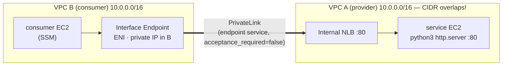

# Lab 3 — PrivateLink (share one service across VPCs, overlapping CIDR still works)

Test plan: `../README.md` (lab 3). Concept: workbook `01_Knowledge/Network/Cloud-Connectivity/`.

Exposes **one** service in VPC **A** (provider) behind an **internal NLB** via a **VPC Endpoint Service
(PrivateLink)**, and reaches it from VPC **B** (consumer) through an **interface VPC endpoint** — even
though **A and B use the SAME CIDR (`10.0.0.0/16`)**. It works because the consumer talks to the
endpoint **ENI** (a private IP inside B's own subnet); PrivateLink tunnels that to the NLB in A. No
route between the two `10.0.0.0/16` blocks is ever consulted, so the overlap is irrelevant — the exact
thing TGW/peering can't do.

## Architecture


## Structure (layered — each folder is its own state, like the eks env layers)
| Layer | Builds | Depends on |
|---|---|---|
| `1-vpc/` | VPC A + VPC B with **identical `10.0.0.0/16`**; one public subnet + IGW + RT each; provider-service SG + consumer-host SG | — |
| `2-provider/` | service EC2 (tiny HTTP via systemd) + internal **NLB** (TG + listener :80) + `aws_vpc_endpoint_service`; also the `net-lab-pl-ssm` IAM role/profile | 1-vpc |
| `3-consumer/` | **interface** `aws_vpc_endpoint` (`service_name` from 2-provider, `private_dns_enabled=false`) + its SG (80/443 from VPC B) | 1-vpc, 2-provider |
| `4-ec2/` | consumer test host in VPC B (`t4g.micro`, AL2023, SSM, no SSH) — curls the endpoint DNS name | 1-vpc, 2-provider, 3-consumer |

> The SSM IAM role/instance-profile (`net-lab-pl-ssm`) lives in `2-provider/` (its service EC2 is the
> first host that needs it) and is reused by the `4-ec2/` consumer host via remote state — one profile
> for the whole lab.

## Run
Prereq (once per account): create the state bucket via foundation — `(cd ../../foundation/00-tf-backend && tofu init && tofu apply)`
provisions **`network-iac-tfstate`** (alongside `eks-iac-tfstate`). State lives there, one key per layer
(`03-privatelink/<layer>/terraform.tfstate`).
```bash
cd ~/src/github/trongnvv/aws-iac/network/03-privatelink
./deploy.sh                       # applies 1-vpc → 2-provider → 3-consumer → 4-ec2, prints the test cmd
# or per layer:  (cd 1-vpc && tofu init && tofu apply)  … then 2-provider, 3-consumer, 4-ec2
```

## Test checklist (pass/fail)
Run top to bottom. Each check = one step + its PASS/FAIL. Tick the box when PASS. A FAIL points to the
Troubleshooting row below. First grab the IDs + DNS name from the layer outputs:
```bash
SVC_NAME=$(cd 2-provider && tofu output -raw endpoint_service_name)   # com.amazonaws.vpce.<region>.vpce-svc-xxxx
SVC_ID=$(cd 2-provider && tofu output -raw service_instance_id)       # provider EC2 (VPC A), for T4
EP_ID=$(cd 3-consumer && tofu output -raw endpoint_id)                # the interface endpoint (vpce-…)
EP_DNS=$(cd 3-consumer && tofu output -raw endpoint_dns_name)         # vpce-xxxx.vpce-svc-yyyy.<region>.vpce.amazonaws.com
CON_ID=$(cd 4-ec2 && tofu output -raw consumer_instance_id)          # consumer test host (VPC B)
# provider's private IP in VPC A — used in T4 to show L3 to it fails:
SVC_IP=$(aws ec2 describe-instances --instance-ids "$SVC_ID" \
  --query 'Reservations[].Instances[].PrivateIpAddress' --output text)
echo "service name=$SVC_NAME  endpoint=$EP_ID  dns=$EP_DNS  consumer=$CON_ID  provider_ip=$SVC_IP"
```

- [ ] **T0 — consumer test host registered in SSM** (wait ~1–2 min after apply)
  ```bash
  aws ssm describe-instance-information \
    --query "InstanceInformationList[?InstanceId=='$CON_ID'].{id:InstanceId,ping:PingStatus}" --output table
  ```
  **PASS:** one row, `PingStatus = Online`. **FAIL:** empty / not Online → TS "SSM".

- [ ] **T1 — endpoint service exists & Available on the provider side**
  ```bash
  aws ec2 describe-vpc-endpoint-service-configurations \
    --query "ServiceConfigurations[?ServiceName=='$SVC_NAME'].{name:ServiceName,state:ServiceState,accept:AcceptanceRequired}" \
    --output table
  ```
  **PASS:** one row, `ServiceState = Available` (and `AcceptanceRequired = false`). **FAIL:** empty / `Pending` → TS "endpoint service not Available".

- [ ] **T2 — interface endpoint is Available on the consumer side**
  ```bash
  aws ec2 describe-vpc-endpoints --vpc-endpoint-ids "$EP_ID" \
    --query 'VpcEndpoints[0].State' --output text          # expect: available
  ```
  **PASS:** prints `available`. **FAIL:** `pending` / `pendingAcceptance` / `failed` → TS "endpoint not Available".

- [ ] **T3 — service reachable ACROSS the overlap (the key PASS)** — consumer in `10.0.0.0/16` reaches the service in the other `10.0.0.0/16`
  ```bash
  aws ssm start-session --target "$CON_ID"
    curl -s http://$EP_DNS           # paste the $EP_DNS value; vpce-…vpce.amazonaws.com
    # → "hello from PrivateLink provider (VPC A) ip-10-0-0-x"
    exit
  ```
  **PASS:** returns the provider's proof page (`hello from PrivateLink provider (VPC A) …`) — works despite **both VPCs being `10.0.0.0/16`**. **FAIL:** hangs / empty / connection refused → TS "curl hangs" or "service not reachable".

- [ ] **T4 — prove it's NOT L3 routing** — the ONLY path is the endpoint; there is no route between the two VPCs, and a direct hit on the provider's private IP must fail while T3's endpoint curl succeeds
  ```bash
  # 4a) there is no peering / TGW between A and B (none should exist for this lab):
  aws ec2 describe-vpc-peering-connections \
    --query 'VpcPeeringConnections[].VpcPeeringConnectionId' --output text   # expect: empty
  # 4b) from the consumer, the provider's own private IP is unreachable (no route to VPC A):
  aws ssm start-session --target "$CON_ID"
    curl -s -m5 http://$SVC_IP || echo "UNREACHABLE (expected)"   # paste $SVC_IP; direct L3 must fail
    curl -s http://$EP_DNS                                        # paste $EP_DNS; endpoint still works
    exit
  ```
  **PASS:** 4a empty (no peering); 4b direct `http://$SVC_IP` times out → `UNREACHABLE (expected)`, yet the `$EP_DNS` curl still returns the proof page. Only the endpoint reaches the service — PrivateLink never consults a route between the overlapping CIDRs. **FAIL:** direct IP curl succeeds (means there's an L3 path, not isolated overlap) → TS "service not reachable" / review peering & routes.

**Result:** all boxes ticked = lab passes (PrivateLink reaches a service across identical `10.0.0.0/16` CIDRs via the interface endpoint, with no L3 route between the VPCs).

## Troubleshooting
| Symptom | Check (TS row) |
|---|---|
| **endpoint service not Available** (T1 empty / `Pending`) | `2-provider` must be applied — the `aws_vpc_endpoint_service` is created from the NLB ARN. `ServiceState` should go `Available` within a minute of apply. Confirm the NLB exists (`aws elbv2 describe-load-balancers --names net-lab-pl-nlb`). |
| **endpoint not Available** (T2 ≠ `available`) | Endpoint service must be up first (`2-provider`); with `acceptance_required=false` it auto-accepts. `pendingAcceptance` means someone set acceptance_required=true — accept it (`aws ec2 accept-vpc-endpoint-connections`). `failed` → re-check the `service_name` wired into `3-consumer` matches T1's. |
| **curl hangs / times out** (T3) | 1) endpoint SG allows 80 from VPC B (`3-consumer` `aws_security_group.endpoint`)? 2) using the **endpoint** DNS name `$EP_DNS`, **not** the service's own name (private DNS is off)? 3) endpoint `available` (T2)? |
| **service not reachable** — curl connects but 503 / empty / refused (T3), or direct IP unexpectedly works (T4) | Service behind the NLB — target health. The service SG must allow :80 from VPC A CIDR (`1-vpc`), the systemd unit `labhttp` must be running, and the **target group health check** must be healthy (`aws elbv2 describe-target-health --target-group-arn $(cd 2-provider && tofu output -raw ... )`). If T4's direct `$SVC_IP` curl *succeeds*, there's an unexpected L3 path (peering/route) — inspect `aws ec2 describe-vpc-peering-connections` and the VPC route tables. |
| wrong / no response | TG has no healthy target → NLB returns nothing. Give the service EC2 ~1 min for user_data, then re-check target health. |
| **SSM** — `start-session` fails / host not in SSM (T0) | Agent needs ~1–2 min; host needs public IP + IGW route (`1-vpc`) and the `net-lab-pl-ssm` profile (`2-provider`/`4-ec2`). `aws ssm describe-instance-information`. |

## Test EC2 recipe (reused by every lab)
Small, cheap, no SSH: `t4g.micro` + Amazon Linux 2023 (arm64) + the `net-lab-pl-ssm`
(`AmazonSSMManagedInstanceCore`) role in a **public** subnet (public IP + IGW) so the SSM agent reaches
AWS without a NAT/endpoints. Reach it with `aws ssm start-session`. The service traffic still goes
**private** via PrivateLink; the public IP is management-only. See `2-provider/ssm.tf` + `4-ec2/`.

## Teardown
```bash
./teardown.sh                     # destroys 4-ec2 → 3-consumer → 2-provider → 1-vpc
# cost-save mid-lab: (cd 4-ec2 && tofu destroy) && (cd 2-provider && tofu destroy)  # drop EC2 + NLB, keep VPCs
```

## Cost (while running)
Internal NLB ≈ $0.0225/hour + LCU · interface endpoint ≈ $0.01/AZ/hour (1 AZ) + data · 2× `t4g.micro`
≈ $0.017/hour · 2× public IPv4 ≈ $0.01/hour → **~$0.06/hour**. Billed hourly even idle → **destroy when
done**.

## Stretch (from `../README.md`)
- [ ] **Private DNS name:** flip `private_dns_enabled=true` on the interface endpoint (requires a
      verified domain on the endpoint service) → the endpoint resolver overrides the service's real
      domain to the endpoint's **private IP**, so the consumer curls the real service DNS name
      transparently instead of the generated `vpce-…` name.
- [ ] **Cross-zone LB:** put the consumer endpoint ENI in AZ-a and the service target in AZ-b, toggle
      NLB **cross-zone load balancing** on → a consumer in one AZ reaches a target in another; note the
      **cross-AZ data fee** that enabling cross-zone introduces.
