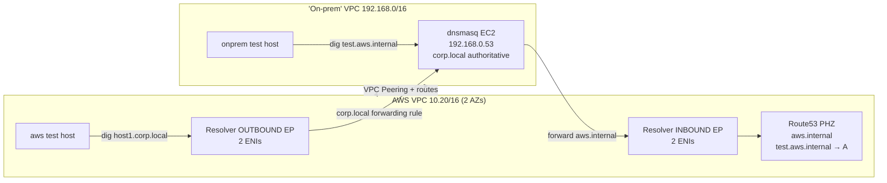

# Lab 4 — Route 53 Resolver (hybrid DNS)

Test plan: `../README.md` (lab 4). Concept: workbook `01_Knowledge/Network/Cloud-Connectivity/`.

Proves **two-way hybrid DNS** between AWS and a simulated on-prem — the glue that lets `.corp` and
`.aws` names resolve across the boundary:

- **AWS → on-prem:** a Route 53 Resolver **outbound** endpoint + a `corp.local` **forwarding rule**
  sends those queries to the on-prem DNS server. An AWS host can `dig host1.corp.local`.
- **on-prem → AWS:** a Route 53 Resolver **inbound** endpoint fronts a **private hosted zone**
  `aws.internal`. The on-prem dnsmasq forwards `aws.internal` to the inbound endpoint. An on-prem host
  can `dig test.aws.internal`.

Self-contained — it builds its own on-prem (a second VPC + a dnsmasq EC2), connected to the AWS VPC by
a **VPC peering** so the forwarded DNS packets have a path. (Does **not** depend on Lab 2.)

## Architecture


## Structure (layered — each folder is its own state, like the eks env layers)
| Layer | Builds | Depends on |
|---|---|---|
| `1-vpc/` | AWS VPC (`10.20/16`, 2 AZ subnets) + on-prem VPC (`192.168.0/16`, 1 subnet) + IGW/RT + **VPC peering + routes** + SGs (DNS udp/tcp 53 both CIDRs, ICMP, SSM egress) | — |
| `2-dns/` | PHZ `aws.internal` (+ `test.aws.internal` A) · **inbound** endpoint (2 IPs) · **outbound** endpoint · `corp.local` FORWARD rule → static on-prem IP `192.168.0.53` + VPC association | 1-vpc |
| `3-onprem-dns/` | dnsmasq EC2 at the **static** `192.168.0.53`; user_data: authoritative `corp.local`, forwards `aws.internal` → inbound IPs (templated from 2-dns). **Owns the shared SSM role** `net-lab-r53-ssm` | 1-vpc, 2-dns |
| `4-ec2/` | 2 SSM test hosts: one in the AWS VPC, one in the on-prem VPC (resolv.conf → dnsmasq) | 1-vpc, 3-onprem-dns |

## Run
Prereq (once per account): the state bucket `network-iac-tfstate` must exist — provision via foundation:
`(cd ../../foundation/00-tf-backend && tofu init && tofu apply)`.
```bash
cd ~/src/github/trongnvv/aws-iac/network/04-route53-resolver
./deploy.sh                       # applies 1-vpc → 2-dns → 3-onprem-dns → 4-ec2, prints host IPs
```
**Apply order matters — chicken-and-egg:** the outbound `corp.local` rule (2-dns) needs the on-prem
DNS server IP, and the on-prem dnsmasq (3) needs the inbound endpoint IPs. Resolved by **pinning the
on-prem DNS server to a static IP** (`192.168.0.53`, same value in `2-dns` and `3-onprem-dns` vars) so
2-dns can target it before the host exists; layer 3 then reads the inbound IPs from 2-dns's state.
Hence **2-dns before 3-onprem-dns** (`deploy.sh` enforces this). Resolver endpoints take ~5 min to
reach **Operational**.

## Test checklist (pass/fail)
Run top to bottom. Each check = one step + its PASS/FAIL. Tick the box when PASS. A FAIL points to the
Troubleshooting row below. **Resolver endpoints take ~5 min to reach Operational after apply — digs run
before that will SERVFAIL;** do T1 first and wait for both endpoints `OPERATIONAL`. First grab the IDs:
```bash
cd 4-ec2 && tofu output instances      # {aws,onprem} → {id, private_ip}
# export for the commands below (fill from the output):
AWS_ID=i-aws… ; ONPREM_ID=i-onprem…
# the dnsmasq (on-prem DNS) host lives in layer 3:
DNS_ID=$(cd 3-onprem-dns && tofu output -raw onprem_dns_instance_id)
```

- [ ] **T0 — both test hosts registered in SSM** (wait ~1–2 min after apply)
  ```bash
  aws ssm describe-instance-information \
    --query "InstanceInformationList[].{id:InstanceId,ping:PingStatus}" --output table
  ```
  **PASS:** the `aws` + `onprem` test hosts (and the dnsmasq host) show `PingStatus = Online`.
  **FAIL:** missing / not Online → TS "SSM".

- [ ] **T1 — resolver endpoints Operational** (both inbound + outbound; ~5 min after apply)
  ```bash
  aws route53resolver list-resolver-endpoints \
    --query 'ResolverEndpoints[].{name:Name,status:Status}' --output table
  ```
  **PASS:** both endpoints show `OPERATIONAL`. **FAIL:** stuck `CREATING` / other → TS "endpoint not Operational".

- [ ] **T2 — dnsmasq up on the on-prem DNS host** (authoritative for `corp.local`)
  ```bash
  aws ssm start-session --target "$DNS_ID"
    systemctl status dnsmasq            # expect: active (running)
    cat /etc/dnsmasq.d/corp-local.conf  # address=/host1.corp.local/192.168.0.80 + server=/aws.internal/<inbound-ip>
    exit
  ```
  **PASS:** `active (running)`; config has the `host1.corp.local` record + `server=/aws.internal/` lines.
  **FAIL:** inactive / empty config → TS "dnsmasq config".

- [ ] **T3 — AWS → on-prem resolution** (outbound endpoint + `corp.local` forwarding rule)
  ```bash
  aws ssm start-session --target "$AWS_ID"
    dig +short host1.corp.local        # expect 192.168.0.80
    exit
  ```
  **PASS:** returns `192.168.0.80`. **FAIL:** SERVFAIL / empty → TS "dig SERVFAIL" / "forwarding rule not associated".

- [ ] **T4 — on-prem → AWS resolution** (inbound endpoint + PHZ `aws.internal`)
  ```bash
  aws ssm start-session --target "$ONPREM_ID"
    dig +short test.aws.internal       # expect 10.20.99.99
    exit
  ```
  **PASS:** returns `10.20.99.99`. **FAIL:** SERVFAIL / empty → TS "dig SERVFAIL" / "dnsmasq config".

**Result:** all boxes ticked = lab passes (two-way hybrid DNS works — AWS resolves `.corp.local` via the
outbound endpoint, on-prem resolves `.aws.internal` via the inbound endpoint).

## Troubleshooting
| Symptom (TS) | Check |
|---|---|
| **endpoint not Operational** — stuck `CREATING` (T1) | Endpoints need ~5 min + 2 subnets in 2 AZs + the SG. `aws route53resolver list-resolver-endpoints`, or console Route 53 → Resolver → endpoint status. |
| **dig SERVFAIL** — `dig host1.corp.local` from AWS host (T3) | 1) `corp.local` rule **associated** to the AWS VPC (`2-dns` `aws_route53_resolver_rule_association`)? 2) outbound SG egress 53 to on-prem CIDR? 3) peering route `192.168.0/16 → pcx` present on the AWS RT? 4) dnsmasq up on `192.168.0.53`? 5) endpoints already `OPERATIONAL` (T1)? |
| **dig SERVFAIL** — `dig test.aws.internal` from on-prem host (T4) | 1) on-prem host resolv.conf points at `192.168.0.53`? 2) dnsmasq `server=/aws.internal/<inbound-ip>` lines correct (`cat /etc/dnsmasq.d/corp-local.conf`)? 3) inbound SG allows 53 from on-prem CIDR? 4) peering route `10.20/16 → pcx` on the on-prem RT? 5) endpoints `OPERATIONAL` (T1)? |
| **forwarding rule not associated** | `aws_route53_resolver_rule_association.corp_local` must bind the `corp.local` rule to the AWS VPC; without it AWS hosts fall back to the default resolver and NXDOMAIN on `corp.local`. |
| **dnsmasq config** — not answering / wrong record (T2) | SSM into the on-prem DNS host: `systemctl status dnsmasq`, `journalctl -u dnsmasq`, `ss -ulnp \| grep :53`. Re-check `/etc/dnsmasq.d/corp-local.conf` (templated at boot — has `address=/host1.corp.local/192.168.0.80` + `server=/aws.internal/<inbound-ip>`). |
| Rule target IP wrong | `var.onprem_dns_ip` in `2-dns` **must equal** the `3-onprem-dns` `private_ip`. Both default `192.168.0.53` — if you change one, change both. |
| **SSM** — `start-session` fails / host not in SSM (T0) | Agent needs ~1–2 min; host needs public IP + IGW route (`1-vpc`) and the `net-lab-r53-ssm` profile. `aws ssm describe-instance-information`. |

## Test EC2 recipe (reused by every lab)
Small, cheap, no SSH: `t4g.micro` + Amazon Linux 2023 (arm64) + `AmazonSSMManagedInstanceCore`
(`net-lab-r53-ssm`) in a **public** subnet (public IP + IGW) so the SSM agent reaches AWS without a
NAT/endpoints. Reach it with `aws ssm start-session`. `dig` comes from `dnf install -y bind-utils`
(in user_data). See `3-onprem-dns/` + `4-ec2/`.

## Teardown
```bash
./teardown.sh                     # destroys 4-ec2 → 3-onprem-dns → 2-dns → 1-vpc
# cost-save mid-lab: (cd 4-ec2 && tofu destroy) + (cd 3-onprem-dns && tofu destroy)  # drop EC2s;
#   but the resolver ENIs (2-dns) are the expensive part — destroy 2-dns to actually stop that bill.
```

## Cost (while running)
**Resolver endpoints are the pricey one:** ~**$0.125 / ENI-hour × 4 ENIs** (2 inbound + 2 outbound) ≈
**$0.50/hour**, plus per-query charges — far more than the EC2. Destroy promptly.
Plus: 3× `t4g.micro` (aws test + onprem test + dnsmasq) ≈ $0.075/h · 3× public IPv4 ≈ $0.015/h · peering
intra-region data is cheap. Rough total ≈ **$0.60/hour** — billed hourly even idle → **destroy when done**.

## Stretch
Two-way is already **core** here (AWS→on-prem and on-prem→AWS both wired).
- [ ] **Reverse DNS (PTR) both directions:** add a reverse zone on dnsmasq for `0.168.192.in-addr.arpa`
      (so `dig -x 192.168.0.80` → `host1.corp.local`) and a Route 53 reverse PHZ
      `20.10.in-addr.arpa` associated to the AWS VPC (so on-prem `dig -x 10.20.99.99` → `test.aws.internal`
      via the inbound endpoint). Verify PTR lookups resolve each way.
