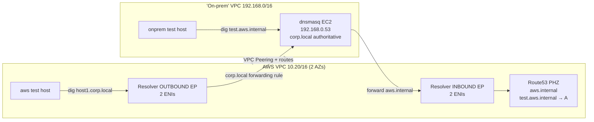

# Lab 4 — Route 53 Resolver (hybrid DNS)

Test plan: `../README.md` (lab 4). Concept: workbook `01_Knowledge/Network/Cloud-Connectivity/`.

Proves **two-way hybrid DNS** between AWS and a simulated on-prem — the glue that lets `.corp` and
`.aws` names resolve across the boundary:

- **AWS → on-prem:** a Route 53 Resolver **outbound** endpoint + a `corp.local` **forwarding rule**
  sends those queries to the on-prem DNS server. An AWS host can `dig host1.corp.local`.
- **on-prem → AWS:** a Route 53 Resolver **inbound** endpoint fronts a **private hosted zone**
  `aws.internal`. The on-prem dnsmasq forwards `aws.internal` to the inbound endpoint. An on-prem host
  can `dig test.aws.internal`.

Self-contained — it builds its own on-prem (a second VPC + a dnsmasq EC2), connected to the AWS VPC by
a **VPC peering** so the forwarded DNS packets have a path. (Does **not** depend on Lab 2.)

## Architecture


## Structure (layered — each folder is its own state, like the eks env layers)
| Layer | Builds | Depends on |
|---|---|---|
| `1-vpc/` | AWS VPC (`10.20/16`, 2 AZ subnets) + on-prem VPC (`192.168.0/16`, 1 subnet) + IGW/RT + **VPC peering + routes** + SGs (DNS udp/tcp 53 both CIDRs, ICMP, SSM egress) | — |
| `2-dns/` | PHZ `aws.internal` (+ `test.aws.internal` A) · **inbound** endpoint (2 IPs) · **outbound** endpoint · `corp.local` FORWARD rule → static on-prem IP `192.168.0.53` + VPC association | 1-vpc |
| `3-onprem-dns/` | dnsmasq EC2 at the **static** `192.168.0.53`; user_data: authoritative `corp.local`, forwards `aws.internal` → inbound IPs (templated from 2-dns). **Owns the shared SSM role** `net-lab-r53-ssm` | 1-vpc, 2-dns |
| `4-ec2/` | 2 SSM test hosts: one in the AWS VPC, one in the on-prem VPC (resolv.conf → dnsmasq) | 1-vpc, 3-onprem-dns |

## Run
Prereq (once per account): the state bucket `network-iac-tfstate` must exist — provision via foundation:
`(cd ../../foundation/00-tf-backend && tofu init && tofu apply)`.
```bash
cd ~/src/github/trongnvv/aws-iac/network/04-route53-resolver
./deploy.sh                       # applies 1-vpc → 2-dns → 3-onprem-dns → 4-ec2, prints host IPs
```
**Apply order matters — chicken-and-egg:** the outbound `corp.local` rule (2-dns) needs the on-prem
DNS server IP, and the on-prem dnsmasq (3) needs the inbound endpoint IPs. Resolved by **pinning the
on-prem DNS server to a static IP** (`192.168.0.53`, same value in `2-dns` and `3-onprem-dns` vars) so
2-dns can target it before the host exists; layer 3 then reads the inbound IPs from 2-dns's state.
Hence **2-dns before 3-onprem-dns** (`deploy.sh` enforces this). Resolver endpoints take ~5 min to
reach **Operational**.

## Test checklist (pass/fail)
Run top to bottom. Each check = one step + its PASS/FAIL. Tick the box when PASS. A FAIL points to the
Troubleshooting row below. **Resolver endpoints take ~5 min to reach Operational after apply — digs run
before that will SERVFAIL;** do T1 first and wait for both endpoints `OPERATIONAL`. First grab the IDs:
```bash
cd 4-ec2 && tofu output instances      # {aws,onprem} → {id, private_ip}
# export for the commands below (fill from the output):
AWS_ID=i-aws… ; ONPREM_ID=i-onprem…
# the dnsmasq (on-prem DNS) host lives in layer 3:
DNS_ID=$(cd 3-onprem-dns && tofu output -raw onprem_dns_instance_id)
```

- [ ] **T0 — both test hosts registered in SSM** (wait ~1–2 min after apply)
  ```bash
  aws ssm describe-instance-information \
    --query "InstanceInformationList[].{id:InstanceId,ping:PingStatus}" --output table
  ```
  **PASS:** the `aws` + `onprem` test hosts (and the dnsmasq host) show `PingStatus = Online`.
  **FAIL:** missing / not Online → TS "SSM".

- [ ] **T1 — resolver endpoints Operational** (both inbound + outbound; ~5 min after apply)
  ```bash
  aws route53resolver list-resolver-endpoints \
    --query 'ResolverEndpoints[].{name:Name,status:Status}' --output table
  ```
  **PASS:** both endpoints show `OPERATIONAL`. **FAIL:** stuck `CREATING` / other → TS "endpoint not Operational".

- [ ] **T2 — dnsmasq up on the on-prem DNS host** (authoritative for `corp.local`)
  ```bash
  aws ssm start-session --target "$DNS_ID"
    systemctl status dnsmasq            # expect: active (running)
    cat /etc/dnsmasq.d/corp-local.conf  # address=/host1.corp.local/192.168.0.80 + server=/aws.internal/<inbound-ip>
    exit
  ```
  **PASS:** `active (running)`; config has the `host1.corp.local` record + `server=/aws.internal/` lines.
  **FAIL:** inactive / empty config → TS "dnsmasq config".

- [ ] **T3 — AWS → on-prem resolution** (outbound endpoint + `corp.local` forwarding rule)
  ```bash
  aws ssm start-session --target "$AWS_ID"
    dig +short host1.corp.local        # expect 192.168.0.80
    exit
  ```
  **PASS:** returns `192.168.0.80`. **FAIL:** SERVFAIL / empty → TS "dig SERVFAIL" / "forwarding rule not associated".

- [ ] **T4 — on-prem → AWS resolution** (inbound endpoint + PHZ `aws.internal`)
  ```bash
  aws ssm start-session --target "$ONPREM_ID"
    dig +short test.aws.internal       # expect 10.20.99.99
    exit
  ```
  **PASS:** returns `10.20.99.99`. **FAIL:** SERVFAIL / empty → TS "dig SERVFAIL" / "dnsmasq config".

**Result:** all boxes ticked = lab passes (two-way hybrid DNS works — AWS resolves `.corp.local` via the
outbound endpoint, on-prem resolves `.aws.internal` via the inbound endpoint).

## Troubleshooting — debug flow
When a check fails, don't guess. DNS debugging has one golden rule: **split DNS from IP first** — a
`SERVFAIL`/empty answer is a *name* problem (a resolver rule, a forwarding config, a hosted-zone record);
a timeout with no answer at all is usually an *IP-reachability* problem (SG/route/peering on port 53).
So on any failing dig, decide the leg (AWS→on-prem T3, or on-prem→AWS T4), then walk that leg's flow
below. General method: vault `01_Knowledge/Network/Cloud-Connectivity/Debug-Strategy.md`.

Grab the IDs/IPs once (all flows reuse them):
```bash
AWS_ID=$(cd 4-ec2 && tofu output -json instances | python3 -c 'import json,sys;print(json.load(sys.stdin)["aws"]["id"])')
ONPREM_ID=$(cd 4-ec2 && tofu output -json instances | python3 -c 'import json,sys;print(json.load(sys.stdin)["onprem"]["id"])')
DNS_ID=$(cd 3-onprem-dns && tofu output -raw onprem_dns_instance_id)
DNS_IP=$(cd 3-onprem-dns && tofu output -raw onprem_dns_ip)        # 192.168.0.53
INBOUND_IPS=$(cd 2-dns && tofu output -json inbound_ips | python3 -c 'import json,sys;print(" ".join(json.load(sys.stdin)))')
AWS_CIDR=$(cd 1-vpc && tofu output -raw aws_cidr)                  # 10.20.0.0/16
ONPREM_CIDR=$(cd 1-vpc && tofu output -raw onprem_cidr)            # 192.168.0.0/16
echo "aws=$AWS_ID onprem=$ONPREM_ID dns=$DNS_ID/$DNS_IP inbound=[$INBOUND_IPS]"
```

### Step 0 — only for the "DNS packets can't reach the server" leg (not for name problems)
The analyzer is overkill for most DNS bugs (it proves L3/L4 reachability, not whether a rule forwards or a
zone has the record). Use it for exactly one thing: **can the resolver-endpoint subnet reach the on-prem DNS
host on port 53?** (the deepest step of the T3 flow). It confirms peering route + on-prem host SG in one shot.
```bash
analyze() {  # analyze <src-instance-id> <dst-instance-id> → L4/53 reachability + the blocking hop
  pid=$(aws ec2 create-network-insights-path --source "$1" --destination "$2" \
        --protocol udp --destination-port 53 \
        --query NetworkInsightsPath.NetworkInsightsPathId --output text)
  aid=$(aws ec2 start-network-insights-analysis --network-insights-path-id "$pid" \
        --query NetworkInsightsAnalysis.NetworkInsightsAnalysisId --output text)
  aws ec2 wait network-insights-analysis-available --network-insights-analysis-ids "$aid" 2>/dev/null
  aws ec2 describe-network-insights-analyses --network-insights-analysis-ids "$aid" \
    --query 'NetworkInsightsAnalyses[0].{Reachable:NetworkPathFound,Blocked:Explanations[0].ExplanationCode}' --output table
  aws ec2 delete-network-insights-path --network-insights-path-id "$pid" >/dev/null 2>&1   # cleanup ($0.10/analysis)
}
# proxy for "outbound endpoint → on-prem DNS": the AWS test host sits in the same VPC/subnet lane.
analyze "$AWS_ID" "$DNS_ID"
```
`Reachable=False` + `Blocked` (`ENI_SG_RULES_MISMATCH`, `NO_ROUTE_TO_DESTINATION`, …) = the packets don't
even arrive → fix the SG/route/peering it names. `Reachable=True` but dig still SERVFAILs = it's a **name**
problem (rule/forwarding/record), go back up the T3 flow.

### Flow 1 — resolver endpoints not Operational (T1)
```bash
aws route53resolver list-resolver-endpoints \
  --query 'ResolverEndpoints[].{name:Name,dir:Direction,status:Status}' --output table
```
**Look for:** both `net-lab-r53-inbound` (INBOUND) and `net-lab-r53-outbound` (OUTBOUND) = `OPERATIONAL`.
- Still `CREATING` and it's been **< ~5 min** → just wait; endpoints provision 2 ENIs each.
- Stuck past ~5 min / `ACTION_NEEDED` → each endpoint needs **2 IPs in 2 different AZs** and a usable SG on
  port 53. **Fix in `2-dns/dns.tf`:** the `ip_address` blocks must point at `aws_subnet_ids["a"]` **and**
  `["b"]` (two AZs), and `security_group_ids` must reference an SG that opens 53 (`aws_security_group.inbound`
  / `.outbound`). Subnets come from `1-vpc` — if a subnet's AZ is wrong, fix `1-vpc/vpc.tf`.

### Flow 2 — AWS → on-prem: `dig host1.corp.local` SERVFAIL (T3)
Query path: AWS host → VPC resolver → `corp.local` **rule** → **outbound** endpoint → (peering) → on-prem
dnsmasq. Walk it in order; stop at the first broken link.

1. **Is the `corp.local` rule associated to the AWS VPC?** Without the association, AWS hosts never use the
   rule and fall straight to NXDOMAIN/SERVFAIL on `corp.local`.
   ```bash
   RULE_ID=$(cd 2-dns && tofu output -raw corp_local_rule_id)
   aws route53resolver list-resolver-rule-associations \
     --query "ResolverRuleAssociations[?ResolverRuleId=='$RULE_ID'].{vpc:VPCId,status:Status}" --output table
   ```
   Expect one row, `Status=COMPLETE`, the AWS VPC id. Missing → **fix `2-dns/dns.tf`**
   `aws_route53_resolver_rule_association.corp_local`.
2. **Does the rule target the on-prem DNS IP on 53?**
   ```bash
   aws route53resolver get-resolver-rule --resolver-rule-id "$RULE_ID" \
     --query 'ResolverRule.{domain:DomainName,targets:TargetIps}' --output json
   ```
   Expect `domain=corp.local`, one target `Ip=192.168.0.53 Port=53`. Wrong IP → `var.onprem_dns_ip` in `2-dns`
   must equal the `3-onprem-dns` host IP (both default `192.168.0.53`; change one, change both).
3. **Outbound endpoint OPERATIONAL + its SG egresses 53 to the on-prem CIDR.** (Flow 1 for status.) The
   outbound SG has **egress-only** 53; it must allow the on-prem CIDR:
   ```bash
   aws ec2 describe-security-groups --filters Name=group-name,Values=net-lab-r53-outbound \
     --query 'SecurityGroups[0].IpPermissionsEgress[?FromPort==`53`].IpRanges[].CidrIp' --output text
   ```
   Must include `192.168.0.0/16`. Missing → **fix `2-dns/dns.tf`** `aws_security_group.outbound` egress.
4. **Can the outbound endpoint actually reach the on-prem DNS host at L4/53?** This is the peering-route +
   on-prem-host-SG leg — run **Step 0** `analyze "$AWS_ID" "$DNS_ID"`. If `Reachable=False`:
   - peering route on the AWS RT: `192.168.0.0/16 → pcx-…` (**fix `1-vpc/vpc.tf`** `aws_route.aws_to_onprem`);
   - the on-prem host's SG must allow **53 from the AWS CIDR** (the per-VPC `net-lab-r53-onprem` SG already
     opens 53 for both CIDRs — **fix `1-vpc/security.tf`** `aws_security_group.this` if edited).
5. **Does dnsmasq itself answer `corp.local`?** Prove it locally on the DNS host (removes AWS from the
   picture entirely):
   ```bash
   aws ssm start-session --target "$DNS_ID"
     dig @127.0.0.1 +short host1.corp.local     # expect 192.168.0.80
     exit
   ```
   Empty here → it's a dnsmasq problem, go to **Flow 4**.

### Flow 3 — on-prem → AWS: `dig test.aws.internal` SERVFAIL (T4)
Query path: on-prem host → dnsmasq → forwards `aws.internal` → **inbound** endpoint IPs → PHZ record.

1. **Does the on-prem host point at dnsmasq, and does dnsmasq forward `aws.internal` to the inbound IPs?**
   ```bash
   aws ssm start-session --target "$ONPREM_ID"
     cat /etc/resolv.conf                         # expect: nameserver 192.168.0.53
     exit
   aws ssm start-session --target "$DNS_ID"
     cat /etc/dnsmasq.d/*.conf                     # expect server=/aws.internal/<each inbound IP>
     exit
   ```
   resolv.conf wrong → **fix `4-ec2/data.tf`** (`local.user_data.onprem` writes the `nameserver`).
   `server=/aws.internal/` lines missing/wrong IPs → the inbound IPs weren't templated in; layer 3 reads them
   from `2-dns` state — re-apply `3-onprem-dns` (template is `3-onprem-dns/user_data.sh.tftpl`).
2. **Inbound endpoint OPERATIONAL + its SG allows 53 from the on-prem CIDR.** (Flow 1 for status.)
   ```bash
   aws ec2 describe-security-groups --filters Name=group-name,Values=net-lab-r53-inbound \
     --query 'SecurityGroups[0].IpPermissions[?FromPort==`53`].IpRanges[].CidrIp' --output text
   ```
   Must include `192.168.0.0/16`. Missing → **fix `2-dns/dns.tf`** `aws_security_group.inbound` ingress.
   Also needs the peering return route `10.20.0.0/16 → pcx` on the on-prem RT (**`1-vpc/vpc.tf`**
   `aws_route.onprem_to_aws`).
3. **PHZ `aws.internal` associated to the AWS VPC and holds the record?**
   ```bash
   ZONE_ID=$(cd 2-dns && tofu output -raw phz_zone_id)
   aws route53 list-resource-record-sets --hosted-zone-id "$ZONE_ID" \
     --query "ResourceRecordSets[?Name=='test.aws.internal.'].ResourceRecords[].Value" --output text
   ```
   Expect `10.20.99.99`. Zone not resolving at all → the PHZ `vpc {}` block must include the AWS VPC
   (**fix `2-dns/dns.tf`** `aws_route53_zone.aws_internal`). Record missing → `aws_route53_record.test`.

### Flow 4 — dnsmasq not answering (T2, or reached from Flow 2 step 5)
```bash
aws ssm start-session --target "$DNS_ID"
  systemctl status dnsmasq                  # expect: active (running)
  journalctl -u dnsmasq --no-pager | tail   # config errors show here (bad server= line, bind failure)
  ss -ulnp | grep :53                        # dnsmasq must be LISTENing on udp/53
  dig @127.0.0.1 +short host1.corp.local     # local proof it answers corp.local → 192.168.0.80
  exit
```
Inactive / failed to start → read `journalctl` for the bad line, then re-check `/etc/dnsmasq.d/corp-local.conf`
(rendered at boot from `3-onprem-dns/user_data.sh.tftpl` — has `address=/host1.corp.local/192.168.0.80` plus a
`server=/aws.internal/<inbound-ip>` per inbound IP). Config only re-renders on a fresh boot, so a template fix
means re-apply/replace the `3-onprem-dns` instance.

### Quick table (symptom → first move)
| Symptom | First move |
|---|---|
| `start-session` fails / host not in SSM (T0) | wait ~1–2 min; `aws ssm describe-instance-information` → PingStatus Online? Else check public IP + IGW route (`1-vpc`) + the `net-lab-r53-ssm` profile. Plugin missing → `brew install --cask session-manager-plugin`. |
| endpoint stuck `CREATING`/`ACTION_NEEDED` (T1) | Flow 1 (wait ~5 min, else 2 AZ subnets + SG on 53 in `2-dns/dns.tf`) |
| `dig host1.corp.local` SERVFAIL/empty from AWS (T3) | Flow 2 (rule assoc → target IP → outbound SG/status → `analyze` the 53 leg → dnsmasq answers locally) |
| `dig test.aws.internal` SERVFAIL/empty from on-prem (T4) | Flow 3 (resolv.conf + dnsmasq forward → inbound SG/status + return route → PHZ assoc + record) |
| dnsmasq inactive / wrong record (T2) | Flow 4 (`systemctl status` + `journalctl` + `dig @127.0.0.1`) |
| dig reaches server but still SERVFAIL | name problem, not IP — re-walk the rule/forward/record steps, skip the `analyze`/SG steps |
| `2-dns`/`3`/`4` apply: remote state empty | run earlier layers first (`./deploy.sh` enforces 1→2→3→4) |

## Test EC2 recipe (reused by every lab)
Small, cheap, no SSH: `t4g.micro` + Amazon Linux 2023 (arm64) + `AmazonSSMManagedInstanceCore`
(`net-lab-r53-ssm`) in a **public** subnet (public IP + IGW) so the SSM agent reaches AWS without a
NAT/endpoints. Reach it with `aws ssm start-session`. `dig` comes from `dnf install -y bind-utils`
(in user_data). See `3-onprem-dns/` + `4-ec2/`.

## Teardown
```bash
./teardown.sh                     # destroys 4-ec2 → 3-onprem-dns → 2-dns → 1-vpc
# cost-save mid-lab: (cd 4-ec2 && tofu destroy) + (cd 3-onprem-dns && tofu destroy)  # drop EC2s;
#   but the resolver ENIs (2-dns) are the expensive part — destroy 2-dns to actually stop that bill.
```

## Cost (while running)
**Resolver endpoints are the pricey one:** ~**$0.125 / ENI-hour × 4 ENIs** (2 inbound + 2 outbound) ≈
**$0.50/hour**, plus per-query charges — far more than the EC2. Destroy promptly.
Plus: 3× `t4g.micro` (aws test + onprem test + dnsmasq) ≈ $0.075/h · 3× public IPv4 ≈ $0.015/h · peering
intra-region data is cheap. Rough total ≈ **$0.60/hour** — billed hourly even idle → **destroy when done**.

## Stretch
Two-way is already **core** here (AWS→on-prem and on-prem→AWS both wired).
- [ ] **Reverse DNS (PTR) both directions:** add a reverse zone on dnsmasq for `0.168.192.in-addr.arpa`
      (so `dig -x 192.168.0.80` → `host1.corp.local`) and a Route 53 reverse PHZ
      `20.10.in-addr.arpa` associated to the AWS VPC (so on-prem `dig -x 10.20.99.99` → `test.aws.internal`
      via the inbound endpoint). Verify PTR lookups resolve each way.
