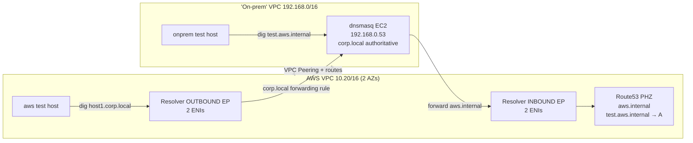

# Lab 4 — Route 53 Resolver (hybrid DNS)

Test plan: `../README.md` (lab 4). Concept: workbook `01_Knowledge/Network/Cloud-Connectivity/`.

Proves **two-way hybrid DNS** between AWS and a simulated on-prem — the glue that lets `.corp` and
`.aws` names resolve across the boundary:

- **AWS → on-prem:** a Route 53 Resolver **outbound** endpoint + a `corp.local` **forwarding rule**
  sends those queries to the on-prem DNS server. An AWS host can `dig host1.corp.local`.
- **on-prem → AWS:** a Route 53 Resolver **inbound** endpoint fronts a **private hosted zone**
  `aws.internal`. The on-prem dnsmasq forwards `aws.internal` to the inbound endpoint. An on-prem host
  can `dig test.aws.internal`.

Self-contained — it builds its own on-prem (a second VPC + a dnsmasq EC2), connected to the AWS VPC by
a **VPC peering** so the forwarded DNS packets have a path. (Does **not** depend on Lab 2.)

## Architecture


## Structure (layered — each folder is its own state, like the eks env layers)
| Layer | Builds | Depends on |
|---|---|---|
| `1-vpc/` | AWS VPC (`10.20/16`, 2 AZ subnets) + on-prem VPC (`192.168.0/16`, 1 subnet) + IGW/RT + **VPC peering + routes** + SGs (DNS udp/tcp 53 both CIDRs, ICMP, SSM egress) | — |
| `2-dns/` | PHZ `aws.internal` (+ `test.aws.internal` A) · **inbound** endpoint (2 IPs) · **outbound** endpoint · `corp.local` FORWARD rule → static on-prem IP `192.168.0.53` + VPC association | 1-vpc |
| `3-onprem-dns/` | dnsmasq EC2 at the **static** `192.168.0.53`; user_data: authoritative `corp.local`, forwards `aws.internal` → inbound IPs (templated from 2-dns). **Owns the shared SSM role** `net-lab-r53-ssm` | 1-vpc, 2-dns |
| `4-ec2/` | 2 SSM test hosts: one in the AWS VPC, one in the on-prem VPC (resolv.conf → dnsmasq) | 1-vpc, 3-onprem-dns |

## Run
Prereq (once per account): the state bucket `network-iac-tfstate` must exist — provision via foundation:
`(cd ../../foundation/00-tf-backend && tofu init && tofu apply)`.
```bash
cd ~/src/github/trongnvv/aws-iac/network/04-route53-resolver
./deploy.sh                       # applies 1-vpc → 2-dns → 3-onprem-dns → 4-ec2, prints host IPs
```
**Apply order matters — chicken-and-egg:** the outbound `corp.local` rule (2-dns) needs the on-prem
DNS server IP, and the on-prem dnsmasq (3) needs the inbound endpoint IPs. Resolved by **pinning the
on-prem DNS server to a static IP** (`192.168.0.53`, same value in `2-dns` and `3-onprem-dns` vars) so
2-dns can target it before the host exists; layer 3 then reads the inbound IPs from 2-dns's state.
Hence **2-dns before 3-onprem-dns** (`deploy.sh` enforces this). Resolver endpoints take ~5 min to
reach **Operational**.

## Test checklist (pass/fail)
Run top to bottom. Each check = one step + its PASS/FAIL. Tick the box when PASS. A FAIL points to the
Troubleshooting row below. **Resolver endpoints take ~5 min to reach Operational after apply — digs run
before that will SERVFAIL;** do T1 first and wait for both endpoints `OPERATIONAL`. First grab the IDs:
```bash
cd 4-ec2 && tofu output instances      # {aws,onprem} → {id, private_ip}
# export for the commands below (fill from the output):
AWS_ID=i-aws… ; ONPREM_ID=i-onprem…
# the dnsmasq (on-prem DNS) host lives in layer 3:
DNS_ID=$(cd 3-onprem-dns && tofu output -raw onprem_dns_instance_id)
```

- [ ] **T0 — both test hosts registered in SSM** (wait ~1–2 min after apply)
  ```bash
  aws ssm describe-instance-information \
    --query "InstanceInformationList[].{id:InstanceId,ping:PingStatus}" --output table
  ```
  **PASS:** the `aws` + `onprem` test hosts (and the dnsmasq host) show `PingStatus = Online`.
  **FAIL:** missing / not Online → TS "SSM".

- [ ] **T1 — resolver endpoints Operational** (both inbound + outbound; ~5 min after apply)
  ```bash
  aws route53resolver list-resolver-endpoints \
    --query 'ResolverEndpoints[].{name:Name,status:Status}' --output table
  ```
  **PASS:** both endpoints show `OPERATIONAL`. **FAIL:** stuck `CREATING` / other → TS "endpoint not Operational".

- [ ] **T2 — dnsmasq up on the on-prem DNS host** (authoritative for `corp.local`)
  ```bash
  aws ssm start-session --target "$DNS_ID"
    systemctl status dnsmasq            # expect: active (running)
    cat /etc/dnsmasq.d/corp-local.conf  # address=/host1.corp.local/192.168.0.80 + server=/aws.internal/<inbound-ip>
    exit
  ```
  **PASS:** `active (running)`; config has the `host1.corp.local` record + `server=/aws.internal/` lines.
  **FAIL:** inactive / empty config → TS "dnsmasq config".

- [ ] **T3 — AWS → on-prem resolution** (outbound endpoint + `corp.local` forwarding rule)
  ```bash
  aws ssm start-session --target "$AWS_ID"
    dig +short host1.corp.local        # expect 192.168.0.80
    exit
  ```
  **PASS:** returns `192.168.0.80`. **FAIL:** SERVFAIL / empty → TS "dig SERVFAIL" / "forwarding rule not associated".

- [ ] **T4 — on-prem → AWS resolution** (inbound endpoint + PHZ `aws.internal`)
  ```bash
  aws ssm start-session --target "$ONPREM_ID"
    dig +short test.aws.internal       # expect 10.20.99.99
    exit
  ```
  **PASS:** returns `10.20.99.99`. **FAIL:** SERVFAIL / empty → TS "dig SERVFAIL" / "dnsmasq config".

**Result:** all boxes ticked = lab passes (two-way hybrid DNS works — AWS resolves `.corp.local` via the
outbound endpoint, on-prem resolves `.aws.internal` via the inbound endpoint).

## Troubleshooting — debug flow
*Written in Simplified Technical English (ASD-STE100): one instruction per sentence, active voice, present tense.*

A check can fail. Do not guess. First split DNS from IP. A `SERVFAIL` or empty answer is a *name* problem (a
resolver rule, a forwarding config, a hosted-zone record). A timeout with no answer is an *IP-reachability*
problem (an SG, a route, or peering on port 53). On a failed dig, decide the leg first. The leg is AWS→on-prem
(T3) or on-prem→AWS (T4). Then go to the flow for that leg. For the general method, read the vault file
`01_Knowledge/Network/Cloud-Connectivity/Debug-Strategy.md`.

### Step 0 — prove the port 53 leg can reach the DNS host (only the IP problem, not the name problem)
Use VPC Reachability Analyzer for one question only. Can the resolver-endpoint subnet reach the on-prem DNS
host on UDP 53? It confirms the peering route and the on-prem host SG in one shot. The `analyze()` helper is in
the vault file (see above); pass `--protocol udp --destination-port 53`. The AWS test host shares the subnet
lane of the outbound endpoint, so use it as the source:
```bash
analyze "$AWS_ID" "$DNS_ID"
```
`Reachable=False` names the hop (for example `ENI_SG_RULES_MISMATCH`, `NO_ROUTE_TO_DESTINATION`). Fix that hop.
`Reachable=True` but dig still SERVFAILs = a **name** problem. Go back up the leg's flow.

### Flow 1 — resolver endpoints not Operational (T1)
Read the endpoint status. Both `net-lab-r53-inbound` and `net-lab-r53-outbound` must show `OPERATIONAL`.
A status of `CREATING` under ~5 minutes is normal; just wait, because each endpoint provisions 2 ENIs.
A status stuck past ~5 minutes or `ACTION_NEEDED` means a config fault. Each endpoint needs 2 IPs in 2 different
AZs and an SG that opens 53. Edit `2-dns/dns.tf`. Point the `ip_address` blocks at `aws_subnet_ids["a"]` and
`["b"]`. Reference an SG that opens 53 (`aws_security_group.inbound` / `.outbound`). If a subnet AZ is wrong,
edit `1-vpc/vpc.tf`.
```bash
aws route53resolver list-resolver-endpoints --query 'ResolverEndpoints[].{name:Name,dir:Direction,status:Status}' --output table
```

### Flow 2 — AWS → on-prem: `dig host1.corp.local` SERVFAIL (T3)
The path is: AWS host → VPC resolver → `corp.local` rule → outbound endpoint → peering → on-prem dnsmasq.
Check the links in order. Stop at the first broken link.
1. **Rule association** — the `corp.local` rule must associate to the AWS VPC with `Status=COMPLETE`. Without
   it, AWS hosts never use the rule and fall to SERVFAIL. If it is missing, edit `2-dns/dns.tf`
   (`aws_route53_resolver_rule_association.corp_local`).
2. **Rule target** — the rule must target `192.168.0.53` on port 53. If the IP is wrong, set `var.onprem_dns_ip`
   in `2-dns` equal to the `3-onprem-dns` host IP (both default `192.168.0.53`).
3. **Outbound SG** — the outbound SG egress must allow 53 to `192.168.0.0/16`. If it does not, edit `2-dns/dns.tf`
   (`aws_security_group.outbound`). For endpoint status, go to Flow 1.
4. **L4 reach** — run Step 0 `analyze "$AWS_ID" "$DNS_ID"`. On `Reachable=False`, add the peering route
   `192.168.0.0/16 → pcx-…` in `1-vpc/vpc.tf` (`aws_route.aws_to_onprem`). The on-prem host SG must allow 53
   from the AWS CIDR; if edited, fix `1-vpc/security.tf` (`aws_security_group.this`).
5. **dnsmasq** — prove dnsmasq answers locally. If it returns empty, go to Flow 4.
```bash
aws route53resolver get-resolver-rule --resolver-rule-id "$RULE_ID" --query 'ResolverRule.{domain:DomainName,targets:TargetIps}' --output json
```

### Flow 3 — on-prem → AWS: `dig test.aws.internal` SERVFAIL (T4)
The path is: on-prem host → dnsmasq → forwards `aws.internal` → inbound endpoint IPs → PHZ record.
Check the links in order. Stop at the first broken link.
1. **resolv.conf + forward** — the on-prem host `/etc/resolv.conf` must read `nameserver 192.168.0.53`, and
   dnsmasq must hold a `server=/aws.internal/<inbound-ip>` line per inbound IP. If resolv.conf is wrong, edit
   `4-ec2/data.tf` (`local.user_data.onprem`). If the `server=` lines are missing or wrong, re-apply
   `3-onprem-dns`; it templates the inbound IPs from `2-dns` state.
2. **Inbound SG + return route** — the inbound SG ingress must allow 53 from `192.168.0.0/16`. If it does not,
   edit `2-dns/dns.tf` (`aws_security_group.inbound`). The on-prem RT also needs `10.20.0.0/16 → pcx` in
   `1-vpc/vpc.tf` (`aws_route.onprem_to_aws`). For endpoint status, go to Flow 1.
3. **PHZ** — the PHZ `aws.internal` must associate to the AWS VPC and hold the `test.aws.internal` record
   (`10.20.99.99`). If the zone does not resolve, add the AWS VPC to the `vpc {}` block in `2-dns/dns.tf`
   (`aws_route53_zone.aws_internal`). If the record is missing, add `aws_route53_record.test`.
```bash
aws route53resolver list-resolver-rule-associations --query "ResolverRuleAssociations[?ResolverRuleId=='$RULE_ID'].{vpc:VPCId,status:Status}" --output table
```

### Flow 4 — dnsmasq not answering (T2, or from Flow 2 step 5)
Open a session to the DNS host. Check that dnsmasq is `active (running)`. Read `journalctl -u dnsmasq` for a bad
`server=` line or a bind failure. Confirm dnsmasq LISTENs on UDP 53. Run `dig @127.0.0.1 +short
host1.corp.local` to prove it answers `corp.local` locally (expect `192.168.0.80`). dnsmasq renders
`/etc/dnsmasq.d/corp-local.conf` at boot from `3-onprem-dns/user_data.sh.tftpl`. The config re-renders on a
fresh boot only, so a template fix needs a re-apply or replace of the `3-onprem-dns` instance.
```bash
aws ssm start-session --target "$DNS_ID"
```

### Quick table (symptom → first action)
| Symptom | First action |
|---|---|
| `start-session` fails, or the host is not in SSM (T0) | Wait ~1–2 minutes. Run `aws ssm describe-instance-information`. The host must show `PingStatus=Online`. If not, check the public IP, the IGW route (`1-vpc`), and the `net-lab-r53-ssm` profile. If the plugin is absent, run `brew install --cask session-manager-plugin`. |
| An endpoint is stuck `CREATING` or `ACTION_NEEDED` (T1) | Go to Flow 1 (wait ~5 min, else 2 AZ subnets + an SG on 53 in `2-dns/dns.tf`). |
| `dig host1.corp.local` SERVFAILs from AWS (T3) | Go to Flow 2 (rule association → target IP → outbound SG/status → `analyze` the 53 leg → dnsmasq answers locally). |
| `dig test.aws.internal` SERVFAILs from on-prem (T4) | Go to Flow 3 (resolv.conf + forward → inbound SG/status + return route → PHZ association + record). |
| dnsmasq is inactive, or the record is wrong (T2) | Go to Flow 4. |
| A dig reaches the server but still SERVFAILs | It is a name problem, not an IP problem. Re-walk the rule/forward/record steps. Skip the `analyze`/SG steps. |
| `2-dns`/`3`/`4` apply: remote state empty | Run the earlier layers first (`./deploy.sh` enforces 1→2→3→4). |

## Test EC2 recipe (reused by every lab)
Small, cheap, no SSH: `t4g.micro` + Amazon Linux 2023 (arm64) + `AmazonSSMManagedInstanceCore`
(`net-lab-r53-ssm`) in a **public** subnet (public IP + IGW) so the SSM agent reaches AWS without a
NAT/endpoints. Reach it with `aws ssm start-session`. `dig` comes from `dnf install -y bind-utils`
(in user_data). See `3-onprem-dns/` + `4-ec2/`.

## Teardown
```bash
./teardown.sh                     # destroys 4-ec2 → 3-onprem-dns → 2-dns → 1-vpc
# cost-save mid-lab: (cd 4-ec2 && tofu destroy) + (cd 3-onprem-dns && tofu destroy)  # drop EC2s;
#   but the resolver ENIs (2-dns) are the expensive part — destroy 2-dns to actually stop that bill.
```

## Cost (while running)
**Resolver endpoints are the pricey one:** ~**$0.125 / ENI-hour × 4 ENIs** (2 inbound + 2 outbound) ≈
**$0.50/hour**, plus per-query charges — far more than the EC2. Destroy promptly.
Plus: 3× `t4g.micro` (aws test + onprem test + dnsmasq) ≈ $0.075/h · 3× public IPv4 ≈ $0.015/h · peering
intra-region data is cheap. Rough total ≈ **$0.60/hour** — billed hourly even idle → **destroy when done**.

## Stretch
Two-way is already **core** here (AWS→on-prem and on-prem→AWS both wired).
- [ ] **Reverse DNS (PTR) both directions:** add a reverse zone on dnsmasq for `0.168.192.in-addr.arpa`
      (so `dig -x 192.168.0.80` → `host1.corp.local`) and a Route 53 reverse PHZ
      `20.10.in-addr.arpa` associated to the AWS VPC (so on-prem `dig -x 10.20.99.99` → `test.aws.internal`
      via the inbound endpoint). Verify PTR lookups resolve each way.
