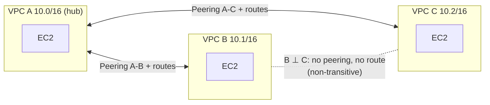

# Lab 5 — VPC Peering vs TGW (non-transitive + trade-offs)

Test plan: `../README.md` (lab 5). Concept: workbook `01_Knowledge/Network/Cloud-Connectivity/`.

Wires **3 VPCs** — `A` (hub), `B`, `C` — with **two peering connections** (A↔B and A↔C) and proves
the defining limit of VPC peering: it is **non-transitive**. A reaches both B and C; B and C each reach
A; but **B cannot reach C** even though both peer with A — there is no B↔C peering and no route, and A
will not forward a packet across a second peering. Contrast Lab 1's TGW, which **is** transitive.

## Architecture


## Structure (layered — each folder is its own state, like the eks env layers)
| Layer | Builds | Depends on |
|---|---|---|
| `1-vpc/` | 3 VPCs (A/B/C) + public subnet + IGW + RT + SG (ICMP from `10/8`) | — |
| `2-peering/` | 2 peering connections (A↔B, A↔C, `auto_accept`) + routes **A→B, A→C, B→A, C→A** (no B↔C) | 1-vpc |
| `3-ssm/` | IAM role + instance profile `net-lab-peer-ssm` (Session Manager) | — |
| `4-ec2/` | 3 test hosts (`t4g.micro`, AL2023 arm64, SSM, no SSH) | 1-vpc, 3-ssm |

> **Why no B↔C route:** that omission *is* the experiment. Same account + region, so peering
> `auto_accept = true` (no separate accepter resource / cross-account handshake needed).

## Run
Prereq (once per account): create the state bucket via foundation — `(cd ../../foundation/00-tf-backend && tofu init && tofu apply)`
provisions **`network-iac-tfstate`** (alongside `eks-iac-tfstate`). State lives there, one key per layer.
```bash
cd ~/src/github/trongnvv/aws-iac/network/05-peering
./deploy.sh                       # applies 1-vpc → 2-peering → 3-ssm → 4-ec2, prints instance IPs
# or per layer:  (cd 1-vpc && tofu init && tofu apply)  … then 2-peering, 3-ssm, 4-ec2
```

## Test checklist (pass/fail)
Run top to bottom. Each check = one step + its PASS/FAIL. Tick the box when PASS. A FAIL points to the
Troubleshooting row below. First grab the IDs + private IPs:
```bash
cd 4-ec2 && tofu output instances      # {a,b,c} → {id, private_ip}
# export for the commands below (fill from the output):
A_ID=i-a… ; B_ID=i-b… ; C_ID=i-c…
A_IP=10.0.0.x ; B_IP=10.1.0.x ; C_IP=10.2.0.x
```

- [ ] **T0 — all 3 hosts registered in SSM** (wait ~1–2 min after apply)
  ```bash
  aws ssm describe-instance-information \
    --query "InstanceInformationList[].{id:InstanceId,ping:PingStatus}" --output table
  ```
  **PASS:** 3 instances, `PingStatus = Online`. **FAIL:** fewer than 3 / not Online → TS "SSM".

- [ ] **T1 — A → B reachable** (the A↔B peering works)
  ```bash
  aws ssm start-session --target "$A_ID"
    ping -c3 $B_IP        # expect replies
    exit
  ```
  **PASS:** `0% packet loss`. **FAIL:** timeout → TS "all pings fail".

- [ ] **T2 — A → C reachable** (the A↔C peering works)
  ```bash
  aws ssm start-session --target "$A_ID"
    ping -c3 $C_IP        # expect replies
    exit
  ```
  **PASS:** `0% packet loss`. **FAIL:** timeout → TS "all pings fail".

- [ ] **T3 — spokes → A reachable** (B→A and C→A — routes exist on both sides)
  ```bash
  aws ssm start-session --target "$B_ID"
    ping -c3 $A_IP        # expect replies
    exit
  aws ssm start-session --target "$C_ID"
    ping -c3 $A_IP        # expect replies
    exit
  ```
  **PASS:** both `0% loss`. **FAIL:** one-way only (A→spoke OK but spoke→A fails) → TS "one-way".

- [ ] **T4 — B → C BLOCKED (the non-transitivity proof)** — B must NOT reach C through A
  ```bash
  aws ssm start-session --target "$B_ID"
    ping -c3 -W2 $C_IP    # expect 100% loss / timeout
    exit
  ```
  **PASS:** `100% packet loss` (times out) — no route B→C, A won't relay across a second peering.
  **FAIL:** gets replies → TS "B→C works".

- [ ] **T5 — C → B BLOCKED (symmetric)** — C must NOT reach B either
  ```bash
  aws ssm start-session --target "$C_ID"
    ping -c3 -W2 $B_IP    # expect 100% loss
    exit
  ```
  **PASS:** `100% packet loss`. **FAIL:** replies → TS "B→C works".

- [ ] **T6 — route tables confirm the design** (cross-check, console or CLI)
  ```bash
  # A's RT = routes to BOTH B (10.1/16) and C (10.2/16); B's RT = ONLY A (10.0/16);
  # C's RT = ONLY A (10.0/16). No B↔C route anywhere.
  for v in a b c; do
    RT=$(cd 1-vpc && tofu output -json route_table_ids | python3 -c "import json,sys;print(json.load(sys.stdin)['$v'])")
    echo "== VPC $v (rtb $RT) =="
    aws ec2 describe-route-tables --route-table-ids "$RT" \
      --query 'RouteTables[].Routes[?VpcPeeringConnectionId!=`null`].DestinationCidrBlock' --output text
  done
  ```
  **PASS:** A → `10.1.0.0/16 10.2.0.0/16`; B → `10.0.0.0/16` only; C → `10.0.0.0/16` only.
  **FAIL:** a peering route for `10.2/16` in B's RT (or `10.1/16` in C's RT) → TS "B→C works".

**Result:** all boxes ticked = lab passes (A reaches both peers, B↔C blocked → VPC peering is
**non-transitive**, confirmed by the route tables).

## Troubleshooting — debug flow
*Written in Simplified Technical English (ASD-STE100): one instruction per sentence, active voice, present tense.*

A check can fail. Do not guess. First use VPC Reachability Analyzer. It finds the hop that blocks the path.
Then go to the flow for that hop. For the general method, read the vault file
`01_Knowledge/Network/Cloud-Connectivity/Debug-Strategy.md`.

### Step 0 — find the hop that blocks (you do not need SSH or ping)
Use VPC Reachability Analyzer. It reads the live config and names the hop that blocks the path.
The `analyze()` helper is in the vault file (see above). Run it between two instances:
```bash
analyze "$A_ID" "$B_ID"
```
`Reachable` shows `True` or `False`. `Blocked` gives the hop (for example `ENI_SG_RULES_MISMATCH`,
`NO_ROUTE_TO_DESTINATION`, `NO_MATCHING_ROUTE_FOR_VPC_PEERING`). Go to the flow for that hop.
For a check that must stay blocked, run `analyze "$B_ID" "$C_ID"` instead.

### Flow A — a ping must work but it fails (T1/T2); the analyzer shows `Reachable=False`
Check the hops in this order. Stop at the first hop that is wrong.
1. **Peering** — the peering connection must be `active`. If it is `pending-acceptance` or `failed`, edit `2-peering/peering.tf` (`auto_accept = true`, same account and region).
2. **Routes on both sides** — peering needs a route on each side (A→peer *and* peer→A). A's table must contain the peer CIDR via the `pcx`. The peer's table must contain `10.0.0.0/16` via the `pcx`. If one side is absent, go to Flow C.
3. **SG** — the SG must permit ICMP from `10.0.0.0/8`. If it does not, edit `1-vpc/security.tf`.

Standalone check for one hop:
```bash
aws ec2 describe-vpc-peering-connections --vpc-peering-connection-ids <pcx> --query 'VpcPeeringConnections[0].Status.Code'
```

### Flow B — B reaches C but it must not (T4/T5); the non-transitivity leaks
Read the B and C route tables. Each one must contain only `10.0.0.0/16` (the hub A). A `10.2.0.0/16` route in B,
or a `10.1.0.0/16` route in C, is wrong: a peer route leaked. Peering is non-transitive, so no B↔C `pcx` exists
for that route. Remove the stray route. Also confirm that only two peerings exist: A↔B and A↔C. A third B↔C
peering means someone added one. To correct it, edit `2-peering/peering.tf`. Keep only `a_b` and `a_c` with routes
A→B, A→C, B→A, C→A.
```bash
aws ec2 describe-vpc-peering-connections --filters Name=status-code,Values=active --query 'VpcPeeringConnections[].VpcPeeringConnectionId'
```

### Flow C — the path works in one direction only (T3); a return route is missing
Peering is symmetric at the connection level. The gap is a missing route on the return side. Read both route
tables of the pair. The side that cannot originate traffic lacks its peer CIDR → `pcx` route. Add the missing
route in `2-peering/peering.tf`. The lab needs all four routes: A→B, A→C, B→A, C→A.
```bash
aws ec2 describe-route-tables --route-table-ids <rt> --query 'RouteTables[0].Routes'
```

### Quick table (symptom → first action)
| Symptom | First action |
|---|---|
| `start-session` fails, or the host is not in SSM | Wait 1–2 minutes. Run `aws ssm describe-instance-information`. The host must show `PingStatus=Online`. If not, check the public IP and IGW route (`1-vpc`) and the `AmazonSSMManagedInstanceCore` profile (`3-ssm`/`4-ec2`). If the plugin is absent, run `brew install --cask session-manager-plugin`. |
| A→B or A→C ping fails | Go to Flow A (analyzer → peering active → routes on both sides → SG ICMP). |
| B reaches C but it must not | Go to Flow B (a stray peer route, or a third B↔C peering). |
| The path works in one direction only | Go to Flow C (a return-side route is missing). |
| `2-peering` apply: remote state empty | run `1-vpc` first (`./deploy.sh` does the order) |

## Test EC2 recipe (reused by every lab)
Small, cheap, no SSH: `t4g.micro` + Amazon Linux 2023 (arm64) + `AmazonSSMManagedInstanceCore` role in
a **public** subnet (public IP + IGW) so the SSM agent reaches AWS without a NAT/endpoints. Reach it
with `aws ssm start-session`. Cross-VPC traffic still goes **private** via the peering; the public IP is
management-only. See `3-ssm/` + `4-ec2/`.

## Teardown
```bash
./teardown.sh                     # destroys 4-ec2 → 3-ssm → 2-peering → 1-vpc
# cost-save mid-lab: (cd 4-ec2 && tofu destroy)  # drop the EC2s; peerings/VPCs are free to leave up
```

## Cost (while running)
VPC peering has **no hourly charge** — you pay only for the EC2s and data. 3× `t4g.micro` ≈ $0.025/h ·
3× public IPv4 ≈ $0.015/h → **~$0.04/hour** (plus **$0.01/GB** for any cross-AZ peering data; same-AZ
peering traffic is **free**). This is the **cheapest lab** — no TGW attachment-hours, no NAT. Still,
destroy the EC2s when done.

## Stretch (measured) — Peering vs TGW
- **Latency + cost:** ping both ways and compare the data-plane economics:
  - **Peering** — same-AZ traffic **free**, cross-AZ **$0.01/GB**; no per-hour charge.
  - **TGW** — **$0.05/attachment-hour** × attachments + **$0.02/GB** processing.
  → Peering wins for a handful (<5–10) of VPCs; TGW wins once the mesh (N·(N-1)/2 peerings) and
    route-table sprawl make peering unmanageable, or when you need transitivity/central egress.
- **MTU (jumbo frames):** intra-region VPC peering supports **9001** (jumbo); over **TGW** the max is
  **8500**; over a **VPN** it drops to **~1500** (IPsec overhead). Verify with the DF bit:
  ```bash
  ping -M do -s 8973 <peer-ip>   # 8973 payload + 28 ICMP/IP hdr = 9001 → OK on peering
  ping -M do -s 8973 <peer-ip>   # over TGW: fragmentation-needed (exceeds 8500)
  ```
