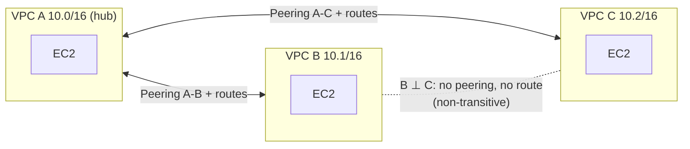

# Lab 5 — VPC Peering vs TGW (non-transitive + trade-offs)

Test plan: `../README.md` (lab 5). Concept: workbook `01_Knowledge/Network/Cloud-Connectivity/`.

Wires **3 VPCs** — `A` (hub), `B`, `C` — with **two peering connections** (A↔B and A↔C) and proves
the defining limit of VPC peering: it is **non-transitive**. A reaches both B and C; B and C each reach
A; but **B cannot reach C** even though both peer with A — there is no B↔C peering and no route, and A
will not forward a packet across a second peering. Contrast Lab 1's TGW, which **is** transitive.

## Architecture


## Structure (layered — each folder is its own state, like the eks env layers)
| Layer | Builds | Depends on |
|---|---|---|
| `1-vpc/` | 3 VPCs (A/B/C) + public subnet + IGW + RT + SG (ICMP from `10/8`) | — |
| `2-peering/` | 2 peering connections (A↔B, A↔C, `auto_accept`) + routes **A→B, A→C, B→A, C→A** (no B↔C) | 1-vpc |
| `3-ssm/` | IAM role + instance profile `net-lab-peer-ssm` (Session Manager) | — |
| `4-ec2/` | 3 test hosts (`t4g.micro`, AL2023 arm64, SSM, no SSH) | 1-vpc, 3-ssm |

> **Why no B↔C route:** that omission *is* the experiment. Same account + region, so peering
> `auto_accept = true` (no separate accepter resource / cross-account handshake needed).

## Run
Prereq (once per account): create the state bucket via foundation — `(cd ../../foundation/00-tf-backend && tofu init && tofu apply)`
provisions **`network-iac-tfstate`** (alongside `eks-iac-tfstate`). State lives there, one key per layer.
```bash
cd ~/src/github/trongnvv/aws-iac/network/05-peering
./deploy.sh                       # applies 1-vpc → 2-peering → 3-ssm → 4-ec2, prints instance IPs
# or per layer:  (cd 1-vpc && tofu init && tofu apply)  … then 2-peering, 3-ssm, 4-ec2
```

## Test checklist (pass/fail)
Run top to bottom. Each check = one step + its PASS/FAIL. Tick the box when PASS. A FAIL points to the
Troubleshooting row below. First grab the IDs + private IPs:
```bash
cd 4-ec2 && tofu output instances      # {a,b,c} → {id, private_ip}
# export for the commands below (fill from the output):
A_ID=i-a… ; B_ID=i-b… ; C_ID=i-c…
A_IP=10.0.0.x ; B_IP=10.1.0.x ; C_IP=10.2.0.x
```

- [ ] **T0 — all 3 hosts registered in SSM** (wait ~1–2 min after apply)
  ```bash
  aws ssm describe-instance-information \
    --query "InstanceInformationList[].{id:InstanceId,ping:PingStatus}" --output table
  ```
  **PASS:** 3 instances, `PingStatus = Online`. **FAIL:** fewer than 3 / not Online → TS "SSM".

- [ ] **T1 — A → B reachable** (the A↔B peering works)
  ```bash
  aws ssm start-session --target "$A_ID"
    ping -c3 $B_IP        # expect replies
    exit
  ```
  **PASS:** `0% packet loss`. **FAIL:** timeout → TS "all pings fail".

- [ ] **T2 — A → C reachable** (the A↔C peering works)
  ```bash
  aws ssm start-session --target "$A_ID"
    ping -c3 $C_IP        # expect replies
    exit
  ```
  **PASS:** `0% packet loss`. **FAIL:** timeout → TS "all pings fail".

- [ ] **T3 — spokes → A reachable** (B→A and C→A — routes exist on both sides)
  ```bash
  aws ssm start-session --target "$B_ID"
    ping -c3 $A_IP        # expect replies
    exit
  aws ssm start-session --target "$C_ID"
    ping -c3 $A_IP        # expect replies
    exit
  ```
  **PASS:** both `0% loss`. **FAIL:** one-way only (A→spoke OK but spoke→A fails) → TS "one-way".

- [ ] **T4 — B → C BLOCKED (the non-transitivity proof)** — B must NOT reach C through A
  ```bash
  aws ssm start-session --target "$B_ID"
    ping -c3 -W2 $C_IP    # expect 100% loss / timeout
    exit
  ```
  **PASS:** `100% packet loss` (times out) — no route B→C, A won't relay across a second peering.
  **FAIL:** gets replies → TS "B→C works".

- [ ] **T5 — C → B BLOCKED (symmetric)** — C must NOT reach B either
  ```bash
  aws ssm start-session --target "$C_ID"
    ping -c3 -W2 $B_IP    # expect 100% loss
    exit
  ```
  **PASS:** `100% packet loss`. **FAIL:** replies → TS "B→C works".

- [ ] **T6 — route tables confirm the design** (cross-check, console or CLI)
  ```bash
  # A's RT = routes to BOTH B (10.1/16) and C (10.2/16); B's RT = ONLY A (10.0/16);
  # C's RT = ONLY A (10.0/16). No B↔C route anywhere.
  for v in a b c; do
    RT=$(cd 1-vpc && tofu output -json route_table_ids | python3 -c "import json,sys;print(json.load(sys.stdin)['$v'])")
    echo "== VPC $v (rtb $RT) =="
    aws ec2 describe-route-tables --route-table-ids "$RT" \
      --query 'RouteTables[].Routes[?VpcPeeringConnectionId!=`null`].DestinationCidrBlock' --output text
  done
  ```
  **PASS:** A → `10.1.0.0/16 10.2.0.0/16`; B → `10.0.0.0/16` only; C → `10.0.0.0/16` only.
  **FAIL:** a peering route for `10.2/16` in B's RT (or `10.1/16` in C's RT) → TS "B→C works".

**Result:** all boxes ticked = lab passes (A reaches both peers, B↔C blocked → VPC peering is
**non-transitive**, confirmed by the route tables).

## Troubleshooting
| Symptom (TS) | Check |
|---|---|
| **SSM** — `start-session` fails / instance not in SSM | Agent needs ~1–2 min; instance must have public IP + IGW route (`1-vpc`) and the `AmazonSSMManagedInstanceCore` profile (`3-ssm`, `4-ec2`). `aws ssm describe-instance-information`. |
| **all pings fail** — pings time out (even A→B / A→C) | 1) SG allows ICMP from `10.0.0.0/8`? 2) Route present on **both** sides of the peering (A has B's CIDR *and* B has A's CIDR)? 3) Peering status `active`? |
| **one-way** — A→peer works but peer→A fails (or vice-versa) | A route is missing on one side — peering needs a route in **each** VPC's RT pointing the peer CIDR at the `pcx` (A→B, A→C, B→A, C→A). |
| **B→C works** (should NOT) | A stray route exists — a B route table has `10.2/16 → pcx` (or C's RT has `10.1/16 → pcx`), or a third `b-c` peering was added. The lab must have **only** A→B, A→C, B→A, C→A (`2-peering/peering.tf`). |
| `2-peering` apply: remote state empty | run `1-vpc` first (`./deploy.sh` does the order). |

## Test EC2 recipe (reused by every lab)
Small, cheap, no SSH: `t4g.micro` + Amazon Linux 2023 (arm64) + `AmazonSSMManagedInstanceCore` role in
a **public** subnet (public IP + IGW) so the SSM agent reaches AWS without a NAT/endpoints. Reach it
with `aws ssm start-session`. Cross-VPC traffic still goes **private** via the peering; the public IP is
management-only. See `3-ssm/` + `4-ec2/`.

## Teardown
```bash
./teardown.sh                     # destroys 4-ec2 → 3-ssm → 2-peering → 1-vpc
# cost-save mid-lab: (cd 4-ec2 && tofu destroy)  # drop the EC2s; peerings/VPCs are free to leave up
```

## Cost (while running)
VPC peering has **no hourly charge** — you pay only for the EC2s and data. 3× `t4g.micro` ≈ $0.025/h ·
3× public IPv4 ≈ $0.015/h → **~$0.04/hour** (plus **$0.01/GB** for any cross-AZ peering data; same-AZ
peering traffic is **free**). This is the **cheapest lab** — no TGW attachment-hours, no NAT. Still,
destroy the EC2s when done.

## Stretch (measured) — Peering vs TGW
- **Latency + cost:** ping both ways and compare the data-plane economics:
  - **Peering** — same-AZ traffic **free**, cross-AZ **$0.01/GB**; no per-hour charge.
  - **TGW** — **$0.05/attachment-hour** × attachments + **$0.02/GB** processing.
  → Peering wins for a handful (<5–10) of VPCs; TGW wins once the mesh (N·(N-1)/2 peerings) and
    route-table sprawl make peering unmanageable, or when you need transitivity/central egress.
- **MTU (jumbo frames):** intra-region VPC peering supports **9001** (jumbo); over **TGW** the max is
  **8500**; over a **VPN** it drops to **~1500** (IPsec overhead). Verify with the DF bit:
  ```bash
  ping -M do -s 8973 <peer-ip>   # 8973 payload + 28 ICMP/IP hdr = 9001 → OK on peering
  ping -M do -s 8973 <peer-ip>   # over TGW: fragmentation-needed (exceeds 8500)
  ```
