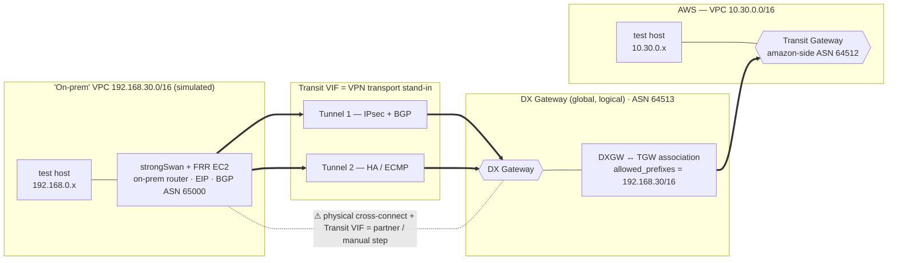

# Lab 6 — Direct Connect → Transit Gateway (private dedicated link to on-prem)

Test plan: `../README.md` (lab 6). Concept: workbook `01_Knowledge/Network/Cloud-Connectivity/`.

A **private, dedicated** path to on-prem (vs lab 2's VPN over the public internet): consistent latency,
higher bandwidth, lower egress cost. But a real DX needs a **physical cross-connect at a DX location via
a partner**, so `aws_dx_connection` + the Transit VIF **can't be fully provisioned by IaC**. This lab
builds the two halves that **can** be code:

- **As-code (real):** `aws_dx_gateway` + **`aws_dx_gateway_association`** to the TGW with
  **`allowed_prefixes`** (the on-prem CIDR). This is the DX **control plane** a real Transit VIF plugs into.
- **Transport stand-in:** a Site-to-Site VPN into the **same TGW** (customer gateway = a strongSwan EC2
  running IPsec + BGP) — exactly like lab 2 — carries the actual packets, standing in for the physical
  Transit VIF. Once the tunnels are UP and BGP is established you SSM into either side and ping across.

The on-prem side is a VPC (`192.168.30.0/16`) whose **strongSwan + FRR** EC2 plays the on-prem router /
Customer Gateway. Self-contained (its own TGW + VPCs), independent of labs 1 and 2.

> 🖐️ **The one manual/physical step:** request a **connection** (or hosted connection) from a DX partner,
> then create the **Transit VIF** on it (BGP to the DX Gateway built in `3-dxgw`). Documented, not
> automated — see the **⚠️ Verify live** section.

## Architecture


## Structure (layered — each folder is its own state, like the eks env layers)
| Layer | Builds | Depends on |
|---|---|---|
| `1-vpc/` | 2 VPCs (`aws` 10.30/16 + `onprem` 192.168.30/16) + public subnet + IGW + RT + SGs (ICMP both sides; a strongSwan SG opening IKE/NAT-T/ESP) | — |
| `2-tgw/` | Transit Gateway (amazon ASN 64512, ECMP on) + aws VPC attachment + 1 route table + route `aws → 192.168.30/16 → TGW` | 1-vpc |
| `3-dxgw/` | **the DX-as-code half** — `aws_dx_gateway` (amazon-side ASN 64513) + `aws_dx_gateway_association` to the TGW with `allowed_prefixes = [onprem CIDR]` | 1-vpc, 2-tgw |
| `4-vpn/` | **the transport stand-in** — EIP for the appliance + `aws_customer_gateway` (BGP ASN 65000) + `aws_vpn_connection` to the TGW (2 tunnels, dynamic/BGP) + TGW RT assoc/propagation for the VPN attachment | 1-vpc, 2-tgw |
| `5-strongswan/` | the on-prem router appliance (`t4g.micro` AL2023, `source_dest_check=false`) running **strongSwan** (2 IPsec tunnels via VTI + fwmark) + **FRR** (BGP) from templated user_data; SSM IAM role/profile (`net-lab-dx-ssm`); EIP assoc; route `onprem → 10.30/16 → strongSwan ENI` | 1-vpc, 4-vpn |
| `6-ec2/` | 2 test hosts (`t4g.micro`, AL2023, SSM, no SSH) — one in each VPC | 1-vpc, 5-strongswan |

> `3-dxgw` is the **new** layer vs lab 2; `4-vpn` / `5-strongswan` / `6-ec2` are lab 2's `3-vpn` /
> `4-strongswan` / `5-ec2` almost verbatim (state keys → `06-direct-connect/…`, role → `net-lab-dx-ssm`,
> CIDRs → this lab's). The IPsec/BGP config in `5-strongswan/user_data.sh.tftpl` is templated from the
> `aws_vpn_connection` attributes (tunnel outside/inside addresses, PSKs, both BGP ASNs). It was **built
> blind** — see the **⚠️ Verify live** section before trusting it end-to-end.

## Run
Prereq (once per account): create the state bucket via foundation — `(cd ../../foundation/00-tf-backend && tofu init && tofu apply)`
provisions **`network-iac-tfstate`**. State lives there, one key per layer (`06-direct-connect/<layer>/…`).
```bash
cd ~/src/github/trongnvv/aws-iac/network/06-direct-connect
./deploy.sh                       # applies 1-vpc → 2-tgw → 3-dxgw → 4-vpn → 5-strongswan → 6-ec2, prints IPs
# or per layer:  (cd 1-vpc && tofu init && tofu apply)  … then 2-tgw, 3-dxgw, 4-vpn, 5-strongswan, 6-ec2
```

## Test checklist (pass/fail)
Run top to bottom. Each check = one step + its PASS/FAIL. Tick the box when PASS. A FAIL points to the
Troubleshooting row below. Tunnels take ~1–2 min to come UP and BGP ~30s more to establish. First
auto-export the IDs + private IPs from the tofu output (no manual fill), plus the appliance + VPN +
DXGW ids:
```bash
eval "$(cd 6-ec2 && tofu output -json instances | python3 -c '
import json,sys
d=json.load(sys.stdin)
for k,p in {"aws":"AWS","onprem":"ON"}.items():
    v=d[k]; print(p+"_ID="+v["id"]+"; "+p+"_IP="+v["private_ip"])
')"
SS_ID=$(cd 5-strongswan && tofu output -raw strongswan_instance_id)
VPN_ID=$(cd 4-vpn && tofu output -raw vpn_connection_id)
TGW_RT=$(cd 2-tgw && tofu output -raw tgw_route_table_id)
DXGW_ID=$(cd 3-dxgw && tofu output -raw dx_gateway_id)
echo "aws=$AWS_ID/$AWS_IP  onprem=$ON_ID/$ON_IP  strongswan=$SS_ID  dxgw=$DXGW_ID"   # sanity-check
```

- [ ] **T0 — all 3 hosts registered in SSM** (aws test host + onprem test host + strongSwan; wait ~1–2 min after apply)
  ```bash
  aws ssm describe-instance-information \
    --query "InstanceInformationList[].{id:InstanceId,ping:PingStatus}" --output table
  ```
  **PASS:** all 3 instances present, `PingStatus = Online`. **FAIL:** fewer than 3 / not Online → TS "SSM not registering".

- [ ] **T1 — DX Gateway + DXGW↔TGW association present and `associated`** (the DX-as-code half)
  ```bash
  aws directconnect describe-direct-connect-gateway-associations \
    --direct-connect-gateway-id "$DXGW_ID" \
    --query 'directConnectGatewayAssociations[].{state:associationState,gw:associatedGateway.id,prefixes:allowedPrefixesToDirectConnectGateway[].cidr}' \
    --output table
  # want: associationState=associated, associatedGateway.id = the TGW, allowed prefix 192.168.30.0/16
  ```
  **PASS:** one association, `associationState = associated`, gateway = the TGW, allowed prefix `192.168.30.0/16`. **FAIL:** missing / stuck `associating` → TS "DXGW association not associated".

- [ ] **T2 — VPN tunnels UP** (the transport stand-in — at least 1, ideally both)
  ```bash
  aws ec2 describe-vpn-connections --vpn-connection-ids "$VPN_ID" \
    --query 'VpnConnections[].VgwTelemetry[].{outside:OutsideIpAddress,status:Status,routes:AcceptedRouteCount}' \
    --output table
  # want: Status=UP, AcceptedRouteCount >= 1 (BGP learned 192.168.30/16)
  ```
  **PASS:** ≥1 tunnel `Status=UP` (ideally both), `AcceptedRouteCount >= 1`. **FAIL:** all DOWN → TS "Tunnel DOWN".

- [ ] **T3 — BGP established on the strongSwan appliance** *(needs the built-blind appliance config — see ⚠️ Verify live)*
  ```bash
  aws ssm start-session --target "$SS_ID"
    sudo swanctl --list-sas                  # both children INSTALLED (IPsec up first)
    sudo vtysh -c 'show bgp summary'         # each neighbor State/PfxRcd = a number (Established), not Active/Connect
    sudo vtysh -c 'show ip route bgp'        # learned 10.30.0.0/16 via the vgw inside addrs
    exit
  ```
  **PASS:** neighbors show a numeric `PfxRcd` (Established) and received prefixes `> 0` (10.30/16 learned). **FAIL:** neighbor stuck `Active`/`Connect`, PfxRcd=0 → TS "BGP not established".

- [ ] **T4 — aws → on-prem reachable** (cloud → on-prem over the DX/VPN path)
  ```bash
  aws ssm start-session --target "$AWS_ID"
    ping -c3 $ON_IP        # expect replies from 192.168.0.x
    exit
  ```
  **PASS:** `0% packet loss`. **FAIL:** timeout → if the reverse (T5) works it's one-way → TS "ping one-way"; if both fail → TS "ping fails (tunnels+BGP UP)".

- [ ] **T5 — on-prem → aws reachable** (on-prem → cloud via strongSwan ENI → tunnel)
  ```bash
  aws ssm start-session --target "$ON_ID"
    ping -c3 $AWS_IP       # expect replies from 10.30.0.x
    exit
  ```
  **PASS:** `0% packet loss`. **FAIL:** timeout → if T4 works it's one-way → TS "ping one-way"; else → TS "ping fails (tunnels+BGP UP)".

- [ ] **T6 — on-prem CIDR learned via BGP on the TGW** (route propagated, not static)
  ```bash
  aws ec2 search-transit-gateway-routes --transit-gateway-route-table-id "$TGW_RT" \
    --filters Name=state,Values=active \
    --query 'Routes[].{cidr:DestinationCidrBlock,type:Type,state:State}' --output table
  # want: 192.168.30.0/16 present, Type=propagated (from the VPN attachment via BGP)
  ```
  **PASS:** `192.168.30.0/16` present with `Type=propagated`. **FAIL:** missing / only static → TS "on-prem CIDR not propagated".

**Result:** all boxes ticked = lab passes (DX Gateway + DXGW↔TGW association in place, IPsec tunnels UP,
BGP established, bidirectional reachability on-prem ↔ cloud, on-prem route learned over BGP). The
**physical cross-connect + Transit VIF** is the documented manual step — see ⚠️ Verify live.

## Troubleshooting — debug flow
*Written in Simplified Technical English (ASD-STE100): one instruction per sentence, active voice, present tense.*

A check can fail. Do not guess. Walk the data path layer by layer. For the pure-IP hops (SG, route, TGW
propagation) use VPC Reachability Analyzer first. It names the hop that blocks the path. The IPsec/BGP
layer (T2/T3) and the DX control plane (T1) sit below the analyzer's view. Those flows use the CLI or SSM
into the appliance instead. For the general method, read the vault file
`01_Knowledge/Network/Cloud-Connectivity/Debug-Strategy.md`.

### Step 0 — find the hop that blocks (you do not need SSH or ping)
Use VPC Reachability Analyzer for the IP-forwarding failures (T4/T5). It reads the live config and names
the hop that blocks the path. The `analyze()` helper is in the vault file (see above). Run it between two
instances:
```bash
analyze "$AWS_ID" "$ON_ID"
```
`Reachable` shows `True` or `False`. `Blocked` gives the hop (for example `ENI_SG_RULES_MISMATCH`,
`NO_ROUTE_TO_DESTINATION`, `TGW_ROUTE_TABLE_...`). The analyzer does not see inside the IPsec tunnel or
the DX control plane. If it shows `Reachable=True` but the ping still fails, go to Flow B or Flow C.
Otherwise go to the flow for that hop.

### Flow A — the DXGW association is not `associated` (T1)
The DX-as-code half is not wired. This blocks nothing in the VPN stand-in data path. But the DX control
plane that a real Transit VIF uses is not in place. Read the association. Check the hops in this order.
1. **State** — `associating` is transient; wait a few minutes. If the state is `disassociated` or absent, apply `3-dxgw` (`aws_dx_gateway_association.tgw`). The `stateChangeError` field gives the reason.
2. **associated_gateway_id** — the id must equal the TGW (`cd 2-tgw && tofu output -raw tgw_id`). A DX Gateway associates with one TGW. A stale id blocks it.
3. **allowed_prefixes** — the list must contain `192.168.30.0/16`. If the list is empty, edit `3-dxgw` (`allowed_prefixes`). This is the prefix the DX Gateway advertises to on-prem over a Transit VIF.
4. **🖐 physical port / Transit VIF** — on a live DX the association carries traffic only after a Transit VIF exists and its BGP to the DX Gateway is up. This is the manual partner step (see ⚠️ Verify live). In this lab the packets ride the VPN stand-in, so T4/T5 pass without it.

Standalone check:
```bash
aws directconnect describe-direct-connect-gateway-associations --direct-connect-gateway-id "$DXGW_ID" --query 'directConnectGatewayAssociations[].{state:associationState,err:stateChangeError,gw:associatedGateway.id}' --output table
```

### Flow B — a tunnel is DOWN (T2); `VgwTelemetry Status=DOWN`
IPsec did not come up, so BGP and ping cannot either. Walk the IKE/ESP path. Check the hops in this order.
1. **Appliance IPsec state** — SSM into the appliance. Run `sudo swanctl --list-sas`. Both children must be `INSTALLED`. If nothing lists or the state is `CONNECTING`, IKE is not completing. Read `sudo journalctl -u strongswan -n50` for the reason (proposal mismatch, auth failure).
2. **Customer gateway IP** — the CGW in `4-vpn` dials back to the EIP. The CGW `IpAddress` must equal `$SS_EIP`. If it does not match, associate the EIP in `5-strongswan` (`aws_eip_association`).
3. **PSK match** — run `sudo swanctl --list-conns` on the appliance. Compare the secret against the `4-vpn` outputs `tunnel1_psk` / `tunnel2_psk`. An auth-failure in the log means a PSK or `id-aws` mismatch. Fix how `5-strongswan/user_data.sh.tftpl` writes `ipsec.secrets`.
4. **SG lets IKE/ESP in** — the appliance SG must allow UDP 500, UDP 4500, and protocol 50 (ESP) from AWS's two tunnel outside IPs. If it does not, edit `1-vpc/security.tf` (`aws_security_group.strongswan`).

Standalone check:
```bash
aws ec2 describe-vpn-connections --vpn-connection-ids "$VPN_ID" --query 'VpnConnections[].VgwTelemetry[].{Status:Status,Msg:StatusMessage}' --output table
```

### Flow C — BGP is not established (T3); a neighbor is stuck `Active`/`Connect`, `PfxRcd=0`
IPsec is UP (Flow B passes). BGP rides inside the tunnel and does not peer. This is the built-blind FRR
config in `5-strongswan/user_data.sh.tftpl`. It is the most likely thing to need live tuning. SSM into the
appliance. Check the hops in this order.
1. **VTIs up with the inside /30** — each VTI must have its cgw inside address (`169.254.x.x`). If one is missing, the `ip link add … type vti key N` and fwmark pairing failed (the crux hop).
2. **Neighbor address** — the neighbor must be the vgw inside address of each tunnel (`tunnel1_vgw_inside` / `tunnel2_vgw_inside` from `4-vpn`), not the cgw side.
3. **ASN pairing** — FRR must peer as on-prem 65000 (`onprem_bgp_asn`) to amazon 64512 (`amazon_side_asn`). A wrong remote-as leaves the neighbor `Active`.
4. **ebgp-requires-policy** — the FRR config must contain `no bgp ebgp-requires-policy`. FRR 9 filters all routes without it. Fix the FRR block in `5-strongswan/user_data.sh.tftpl`.

Standalone check (on the appliance):
```bash
sudo vtysh -c 'show bgp summary'
```

### Flow D — a ping fails one or both ways (T4/T5); the tunnels and BGP are UP
Run `analyze` from Step 0 both ways to find the blamed hop. Then confirm that hop. If the analyzer shows
`Reachable=True` but the ping still times out, the break is inside the tunnel (Flow B/C) or in appliance
forwarding (step 5). The analyzer cannot see those. Check the hops in this order.
1. **SG** — the SG must permit ICMP from both `10.0.0.0/8` and `192.168.0.0/16`. If it does not, edit `1-vpc/security.tf` (`aws_security_group.this` + `.strongswan`). (`ENI_SG_RULES_MISMATCH` points here.)
2. **VPC route out** — the aws RT needs `192.168.30.0/16 → tgw-…`. The onprem RT needs `10.30.0.0/16 → the strongSwan ENI`. If a route is absent, apply `2-tgw` (aws side) or `5-strongswan` (onprem → ENI route). (`NO_ROUTE_TO_DESTINATION`.)
3. **TGW propagation** — go to Flow E. A missing `192.168.30/16` propagation blocks aws → onprem at the TGW.
4. **Return route** — a one-way result means the reverse path is broken. Check the reverse route, the reverse SG, and the reverse propagation.
5. **Appliance forwarding** — the analyzer cannot see this. On the appliance, set `source_dest_check=false` (`5-strongswan`, `aws_instance.strongswan`) and `net.ipv4.ip_forward = 1`.

Standalone check for one hop:
```bash
aws ec2 describe-route-tables --route-table-ids <rt> --query 'RouteTables[0].Routes'
```

### Flow E — the on-prem CIDR is not propagated (T6); `192.168.30/16` is missing from the TGW RT
Read the TGW route table. The route `192.168.30.0/16` must be present with `Type=propagated` (learned over
BGP from the VPN attachment). Check the hops in this order.
1. **BGP established first** — the route is learned, not static. If BGP is down, fix it first (T3/Flow C).
2. **VPN attachment** — the attachment must be associated and propagated to this RT (`4-vpn`, `aws_ec2_transit_gateway_route_table_association.vpn` + `...propagation.vpn`).
3. **FRR advertises the CIDR** — the FRR config must contain `network 192.168.30.0/16` (`5-strongswan/user_data.sh.tftpl`).
4. **Dynamic VPN** — the `aws_vpn_connection` must be dynamic (`static_routes_only = false`, `4-vpn/vpn.tf`), not static.

Standalone check:
```bash
aws ec2 search-transit-gateway-routes --transit-gateway-route-table-id "$TGW_RT" --filters Name=state,Values=active --query 'Routes[].{cidr:DestinationCidrBlock,type:Type}' --output table
```

### Flow F — a ping works small but stalls on large payloads (MSS/MTU)
This is not a reachability break. It is PMTUD. The VPN path is about 1500, but IPsec overhead cuts the
effective MSS to about 1379. The VTI MTU is 1419 in user_data. Add MSS clamping in
`5-strongswan/user_data.sh.tftpl`. Then re-test with `ping -M do -s <size>` on a live tunnel. A real DX
Transit VIF is about 1500 or jumbo and does not need this. The clamp is an artefact of the VPN stand-in.

### Quick table (symptom → first move)
| Symptom | First move |
|---|---|
| `start-session` fails / not in SSM | wait ~1–2 min; `aws ssm describe-instance-information` → all 3 `PingStatus=Online`? Else check IGW route (`1-vpc`) + the `AmazonSSMManagedInstanceCore` profile (`net-lab-dx-ssm`, `5-strongswan`). Plugin missing → `brew install --cask session-manager-plugin`. |
| DXGW association not `associated` (T1) | Flow A (state → associated_gateway_id == TGW → allowed_prefixes → the manual Transit VIF step) |
| tunnel `Status=DOWN` (T2) | Flow B (appliance IPsec → CGW IP == EIP → PSK → SG UDP 500/4500 + ESP) |
| BGP neighbor `Active`/`Connect`, `PfxRcd=0` (T3) | Flow C (VTI /30 → vgw inside peer → ASN 65000↔64512 → `ebgp-requires-policy`) — built-blind FRR config |
| ping times out, tunnels+BGP UP (T4/T5) | Flow D (analyzer → SG → VPC route → TGW propagation → return route → appliance forwarding) |
| ping one-way only | Flow D step 4 (the reverse path: return route / return SG / reverse propagation) |
| `192.168.30/16` not in TGW RT (T6) | Flow E (BGP up first → VPN attachment propagation → FRR advertises → dynamic VPN) |
| large pings stall, small OK | Flow F (MSS/MTU clamping) |
| `3-dxgw`/`4-vpn`/`5-strongswan` apply: remote state empty | run the earlier layer first (`./deploy.sh` does the order). |

## Test EC2 recipe (reused by every lab)
Small, cheap, no SSH: `t4g.micro` + Amazon Linux 2023 (arm64) + `AmazonSSMManagedInstanceCore` role
(here `net-lab-dx-ssm`, created in `5-strongswan`) in a **public** subnet (public IP + IGW) so the SSM
agent reaches AWS without a NAT/endpoints. Reach it with `aws ssm start-session`. Cross-site traffic
goes **private** over the DX/VPN path; the public IP is management-only. See `5-strongswan/` + `6-ec2/`.
The strongSwan appliance uses the same base image + profile, plus `source_dest_check=false` and
strongSwan/FRR from the AL2023 repos.

## Teardown
```bash
./teardown.sh                     # destroys 6-ec2 → 5-strongswan → 4-vpn → 3-dxgw → 2-tgw → 1-vpc
# cost-save mid-lab: (cd 6-ec2 && tofu destroy) + (cd 5-strongswan && tofu destroy)
#   drops the EC2s; the VPN connection itself still bills until 4-vpn is destroyed.
# Order matters: the DXGW↔TGW association (3-dxgw) must be destroyed before the TGW (2-tgw).
```

## Cost (while running)
VPN connection (the stand-in) ≈ **$0.05/hour** + TGW attachments ≈ $0.05/attachment-hour × 2 (aws VPC +
VPN) + data · 2× `t4g.micro` test + 1× strongSwan ≈ $0.025/h × 3 · EIP (strongSwan) + 3× public IPv4 ≈
$0.005/h × 4 → **~$0.25/hour**. The **DX Gateway + DXGW↔TGW association carry no hourly charge** (there
is no physical port in this lab); a real DX **port** (and data) is the cost you avoid here. Billed hourly
even idle → **destroy when done**.

## ⚠️ Verify live (built blind)
This lab's AWS resource wiring (VPC/TGW/DXGW/CGW/VPN/routes/EC2) is standard and `tofu validate`-clean,
but two parts can only be confirmed on a real deploy: the **appliance config** (best-effort, WILL likely
need live tuning) and the **DX control plane** (the manual physical step). Confirm these before trusting
it end to end:

- **🖐 the physical cross-connect + Transit VIF (the one manual step)** — request a DX **connection** (or
  hosted connection) from a partner at a DX location; once the port is up, create a **Transit VIF** on it
  and associate it with the DX Gateway (`net-lab-dx`), BGP-peering the customer router (ASN 65000) to the
  DX Gateway (ASN 64513). Only then does on-prem reach the TGW **over DX**; until then the VPN stand-in
  (`4-vpn`/`5-strongswan`) carries the packets. This cannot be provisioned by IaC — it is the lab's
  documented manual boundary.
- **DXGW↔TGW association = `associated`** — `aws directconnect describe-direct-connect-gateway-associations`
  should show `associationState=associated`, the TGW as the associated gateway, and `192.168.30.0/16` in
  `allowedPrefixesToDirectConnectGateway`. `associating` is transient; a stuck/`disassociated` state →
  Flow A.
- **strongSwan swanctl.conf** — AL2023 ships strongSwan 5.9 with the swanctl/vici backend (not legacy
  `ipsec.conf`). Verify the service unit name (`strongswan` vs `strongswan-swanctl`), that
  `swanctl --load-all` actually loads both connections, and that the **PSK `id-aws`** matching (keyed by
  the tunnel outside IP) is accepted by AWS. Proposals (`aes128-sha1-modp1024`) match AWS defaults but
  AWS now offers stronger — confirm the negotiated proposal in `swanctl --list-sas`.
- **Route-based VTI + fwmark** — the `ip link add … type vti key N` + `mark_in/mark_out=N` pairing is the
  crux. If encrypted traffic doesn't flow, check `ip -s xfrm state`, the fwmark on the VTI, and
  `disable_policy`. This is the single most likely thing to need hand-tuning.
- **BGP established** — FRR 9 syntax (`no bgp ebgp-requires-policy`, `timers 10 30`); confirm neighbors
  reach **Established** and that `192.168.30/16` is advertised out and `10.30/16` learned in.
- **ping both ways** — the end-to-end proof; depends on forwarding + `source_dest_check=false` + the two
  VPC routes + TGW propagation all being correct together.
- **MSS/MTU & PMTUD** — VTI MTU is pre-set to 1419 and MSS clamping is noted but **not applied** in
  user_data; apply + measure with `ping -M do -s <size>` on a live tunnel. (Artefact of the VPN stand-in;
  a real DX Transit VIF would not need it.)

### Stretch (from the plan — do after Core passes live)
- [ ] **VIF types:** Private VIF → VGW (single VPC) vs **Transit VIF** → DXGW → TGW (multi-VPC, this lab)
      vs Public VIF (S3/DDB). Note which object each terminates on.
- [ ] **Encryption:** DX is **not encrypted** by default → **MACsec** (on supported ports) or
      **VPN-over-DX** (an IPsec VPN whose tunnel outside IPs route over a Public VIF).
- [ ] **Resilience:** 2 connections / 2 DX locations; DX primary + **VPN backup** (lower BGP local-pref on
      the VPN path so DX is preferred and the VPN only takes over on failure).
