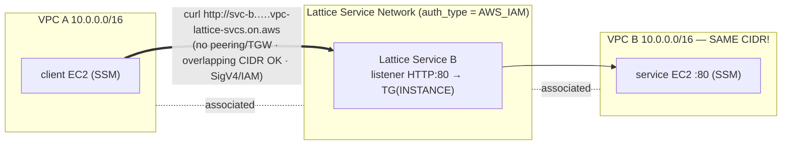

# Lab 6 — VPC Lattice (L7 service-to-service across VPCs)

Test plan: `../README.md` (lab 6). Concept: workbook `01_Knowledge/Network/Cloud-Connectivity/`.

Different from every other lab here: connectivity is **L7 (HTTP), not L3 routing**. No route tables,
no CIDR planning. A client in **VPC A** calls a service in **VPC B** by its **Lattice DNS name** — and
it works even though **both VPCs use the same CIDR `10.0.0.0/16`** and have **no peering / no TGW**.
Lattice handles service discovery, L7 routing (path/header), and **IAM auth** between services.

## Architecture


## Structure (layered — each folder is its own state, like the eks env layers)
| Layer | Builds | Depends on |
|---|---|---|
| `1-vpc/` | VPC **A** + **B**, both `10.0.0.0/16` (**overlapping**), public subnet + IGW (SSM only) + RT + SG | — |
| `2-service-network/` | `aws_vpclattice_service_network` (`AWS_IAM`) + allow-all network auth policy + **associate both VPCs** (SG allows HTTP) | 1-vpc |
| `3-service/` | IAM/SSM profile (`net-lab-lattice-ssm`) · service EC2 in B (tiny HTTP via user_data) · target group (`INSTANCE`) + attach instance · Lattice **service** + **listener** (HTTP:80 → TG) + per-service auth policy + **service↔network association** | 1-vpc, 2-service-network |
| `4-ec2/` | client EC2 in A (SSM) that curls the Lattice DNS name | 1-vpc, 3-service |

> `net-lab-lattice-ssm` IAM role/profile is created in `3-service` (first layer with an EC2) and reused
> by `4-ec2` via remote state — unique per lab so labs coexist.

## Run
Prereq (once per account): create the state bucket via foundation — `(cd ../../foundation/00-tf-backend && tofu init && tofu apply)`
provisions **`network-iac-tfstate`**. State lives there, one key per layer (`06-lattice/<layer>/…`).
```bash
cd ~/src/github/trongnvv/aws-iac/network/06-lattice
./deploy.sh                       # 1-vpc → 2-service-network → 3-service → 4-ec2, prints the DNS name
# or per layer:  (cd 1-vpc && tofu init && tofu apply)  … then 2-service-network, 3-service, 4-ec2
```

## Test checklist (pass/fail)
Run top to bottom. Each check = one step + its PASS/FAIL. Tick the box when PASS. A FAIL points to the
Troubleshooting row below. Hosts are SSM-managed (wait ~1–2 min after apply for the agent to register,
and ~1–2 min for the TG target + service to go **Active/Healthy**). First grab the IDs + DNS name:
```bash
CLIENT_ID=$(cd 4-ec2 && tofu output -raw client_instance_id)      # client EC2 in VPC A
DNS=$(cd 4-ec2 && tofu output -raw service_dns_name)              # Lattice service DNS name
SN_ID=$(cd 2-service-network && tofu output -raw service_network_id)
echo "client=$CLIENT_ID  dns=$DNS  net=$SN_ID"
```

- [ ] **T0 — client test host (VPC A) registered in SSM** (wait ~1–2 min after apply)
  ```bash
  aws ssm describe-instance-information \
    --query "InstanceInformationList[?InstanceId=='$CLIENT_ID'].{id:InstanceId,ping:PingStatus}" --output table
  ```
  **PASS:** the client shows `PingStatus = Online`. **FAIL:** not listed / not Online → TS "SSM".

- [ ] **T1 — service network has BOTH VPCs associated** (A and B, overlapping CIDRs, both ACTIVE)
  ```bash
  aws vpc-lattice list-service-network-vpc-associations \
    --service-network-identifier "$SN_ID" \
    --query "items[].{vpc:vpcId,status:status}" --output table
  ```
  **PASS:** exactly **2** associations, both `status = ACTIVE`. **FAIL:** fewer than 2 / any not ACTIVE → TS "VPC association not complete".

- [ ] **T2 — the Lattice service is ACTIVE and associated to the network**
  ```bash
  SVC_ID=$(cd 3-service && tofu output -raw service_id)
  aws vpc-lattice get-service --service-identifier "$SVC_ID" \
    --query "{name:name,status:status}" --output table
  aws vpc-lattice list-service-network-service-associations \
    --service-network-identifier "$SN_ID" \
    --query "items[].{svc:serviceName,status:status}" --output table
  ```
  **PASS:** `get-service` status `ACTIVE` **and** the service-network-service association `ACTIVE`. **FAIL:** service not ACTIVE → TS "service not Active"; no association → TS "curl fails".

- [ ] **T3 — L7 reachability across the overlap (the key proof)** — client in VPC A `10.0/16` curls the
      service in VPC B `10.0/16` with **no peering / no TGW**
  ```bash
  aws ssm start-session --target "$CLIENT_ID"        # client is in VPC A (10.0.0.0/16)
    curl -s http://$DNS                               # paste the real DNS if $DNS isn't set in-session
    exit
  ```
  **PASS:** returns `hello from service B (VPC B, CIDR 10.0.0.0/16) - default` — reached VPC B **despite
  both VPCs being `10.0.0.0/16` and no route between them** (the DNS name resolves to a **link-local**
  Lattice address, so overlapping CIDR is irrelevant). This is the whole point: L7 service connectivity
  decoupled from L3. **FAIL:** hang / `000` / connection refused → TS "curl fails".

  > ⚠️ **Built-blind nuance (confirm on first apply):** the auth policy here is **allow-all**
  > (`Principal: "*"`, action `vpc-lattice-svcs:Invoke`) on a service whose `auth_type = AWS_IAM`.
  > A `Principal: "*"` policy **permits anonymous (unsigned) requests**, so a plain `curl` should work.
  > If a plain `curl` returns **403** even with allow-all, then `AWS_IAM` is enforcing **SigV4-signed**
  > requests regardless of `Principal: "*"` — in that case the client must sign with its instance role
  > (e.g. `curl --aws-sigv4 "aws:amz:$AWS_REGION:vpc-lattice-svcs" --user "$AK:$SK" -H "x-amz-security-token: $TOKEN" http://$DNS`,
  > creds from IMDS). Flag which behavior you actually observe.

- [ ] **T4 (auth enforcement — do once the allow-all base is green)** — tighten the per-service auth
      policy so only an authorized principal may invoke; an unauthorized call must return **403**
  ```bash
  # After editing aws_vpclattice_auth_policy.service so Principal = the SERVICE EC2's role ARN
  # (NOT the client's), i.e. the client is unauthorized, and re-applying 3-service:
  aws ssm start-session --target "$CLIENT_ID"
    curl -s -o /dev/null -w "%{http_code}\n" http://$DNS    # expect 403 (client not allowed)
    exit
  # Then widen the policy back to allow the client's role and repeat → expect 200 + the proof page.
  ```
  **PASS:** unauthorized principal → **403**; allowed principal → **200** + proof page. **FAIL:** still
  200 after tightening (policy not enforced) or 403 with the correct principal → TS "auth 403".

  > ⚠️ **Built-blind:** with `auth_type = AWS_IAM`, an **Allow with a specific `Principal`** generally
  > requires the caller to send **SigV4-signed** requests (unsigned/anonymous is only matched by
  > `Principal: "*"`). So the positive (allowed) case in T4 likely needs a SigV4 `curl` as shown in T3,
  > not a plain one. Confirm the exact behavior live and record it here.

The client (VPC A, `10.0/16`) reaching the service (VPC B, same `10.0/16`) with **no route between
them** is the core result. Cross-check in console: VPC → Lattice → Service networks → the network has
**both** VPC associations (Active) and the **service** associated; the service's target group shows the
instance **Healthy**.

**Result:** T0–T3 ticked = lab passes (L7 service-to-service across overlapping CIDRs, no peering/TGW).
T4 ticked = IAM auth enforcement proven (zero-trust at the Lattice edge).

## Troubleshooting
| Symptom (TS row) | Check |
|---|---|
| **curl fails** — `curl` hangs / `000` / no route to host (T3) | Service not attached to the network? Need `aws_vpclattice_service_network_service_association` (3-service) → verify in **T2**. VPC A association **Active** (2-service-network) → verify in **T1**. |
| **curl fails** — resolves but connection refused / 000 (T3) | Target group target not **Healthy** — service EC2's `python3 -m http.server 80` up? SG in VPC B allows HTTP:80 to the instance (health check + data path)? Give user_data ~1 min. |
| **service not Active** — service stuck not **ACTIVE** (T2) | Listener missing/misconfigured, or no healthy target in the TG. A service needs a listener + a reachable target to serve. `aws vpc-lattice get-service`. |
| **VPC association not complete** — fewer than 2 / not ACTIVE (T1) | `aws_vpclattice_service_network_vpc_association` still creating, or the SG referenced doesn't allow the traffic. Associations can take ~1 min. Re-run T1. |
| **auth 403** — 403 on curl (T3/T4) | Auth. Network `auth_type=AWS_IAM` + policy must Allow `vpc-lattice-svcs:Invoke`; same for the per-service policy. Base lab = allow-all (`Principal:"*"`) so an **unsigned** curl works. A 403 on the base lab means a policy got tightened (T4), **or** `AWS_IAM` requires **SigV4-signed** requests even with `Principal:"*"` (built-blind — see T3/T4 notes). For T4: an allowed `Principal` almost certainly needs a SigV4-signed curl, not a plain one. |
| **SSM** — `start-session` fails / not in SSM (T0) | Agent needs ~1–2 min; host needs public IP + IGW route (`1-vpc`) and the `net-lab-lattice-ssm` profile. `aws ssm describe-instance-information`. |
| `3-service`/`4-ec2` apply: remote state empty | Run earlier layers first (`./deploy.sh` does the order). |

## Test EC2 recipe (reused by every lab)
Small, cheap, no SSH: `t4g.micro` + Amazon Linux 2023 (arm64) + `net-lab-lattice-ssm`
(`AmazonSSMManagedInstanceCore`) role in a **public** subnet (public IP + IGW) so the SSM agent reaches
AWS without a NAT/endpoints. Reach it with `aws ssm start-session`. Lattice data-plane traffic goes to
the **link-local** Lattice endpoint inside the VPC, not out the IGW; the public IP is management-only.
See `3-service/` (service + profile) + `4-ec2/` (client).

## Teardown
```bash
./teardown.sh                     # destroys 4-ec2 → 3-service → 2-service-network → 1-vpc
# cost-save mid-lab: (cd 4-ec2 && tofu destroy) ; (cd 3-service && tofu destroy)  # drop EC2 + service
```

## Cost (while running)
VPC Lattice: **~$0.025/hour per service** + **per-request** (~$0.10 per 1M requests, first 300k/mo free
tier aside) + **data processed** (~$0.01/GB). One service here → the hourly service charge dominates at
lab scale. Plus 2× `t4g.micro` ≈ $0.017/h + 2× public IPv4 ≈ $0.01/h → **~$0.05/hour** all-in. Billed
hourly even idle → **destroy when done**.

## ⚠️ Verify live (built blind — no `tofu apply` was run)
These `aws_vpclattice_*` args are best-effort from the provider schema; confirm on first apply:
- **`aws_vpclattice_target_group` `config` block** — assumed `port` / `protocol` (`HTTP`) /
  `protocol_version` (`HTTP1`) / `vpc_identifier`, with a nested `health_check { matcher { value } }`.
  Health-check sub-args (`path`, `port`, `protocol`, `enabled`) may differ slightly in casing/nesting.
- **`aws_vpclattice_target_group_attachment`** — assumed a `target { id, port }` block. Confirm it's a
  block (not `target_group_identifier` + flat attrs).
- **`aws_vpclattice_listener` `default_action`** — assumed `forward { target_groups { target_group_identifier, weight } }`.
- **`aws_vpclattice_service.dns_entry[0].domain_name`** — assumed that's the computed DNS attribute
  (it's a list/`dns_entry` block in the schema). If apply errors, use `tofu state show` to find the
  real attribute name.
- **`aws_vpclattice_auth_policy`** — assumed `resource_identifier` = the **ARN** of the network/service
  and action `vpc-lattice-svcs:Invoke`. Confirm the arg name (`resource_identifier`).
- **VPC association SG semantics** — assumed the association SG gates traffic entering Lattice from the
  VPC. If health checks fail, widen the VPC-B instance SG to also allow the Lattice managed prefix.

## Stretch (from the plan)
- [ ] **Path/header routing:** add `aws_vpclattice_listener_rule` to the HTTP listener routing `/v1`
      vs `/v2` (or a header) to different target groups. The service EC2 already serves distinct
      `/v1` and `/v2` bodies, so one listener fans L7 traffic to two backends — the thing TGW/PrivateLink
      (L3/L4) cannot do.
- [ ] **Auth policy (IAM) → 403:** promoted into the checklist as **T4** — tighten the per-service
      `aws_vpclattice_auth_policy` so `Principal` is a specific role ARN (the service EC2's role, not the
      client's); an unauthorized client then returns **403**. Zero-trust service-to-service at the
      Lattice edge. Do it once T0–T3 are green.
- [ ] **vs PrivateLink/TGW — the trade:** Lattice = managed **L7** mesh-lite (discovery + path/header
      routing + per-request IAM auth), priced **per-request + data + per-service-hour**, newer/less
      battle-tested. **PrivateLink** = L4, expose **one** service via an endpoint ENI, no routing.
      **TGW** = **L3** bulk routing between many VPCs, CIDRs must not overlap. Pick Lattice when you
      want app-layer service-to-service with auth and don't want to manage CIDRs; TGW when you need raw
      inter-VPC routing at scale; PrivateLink when you expose a single service to consumers.
