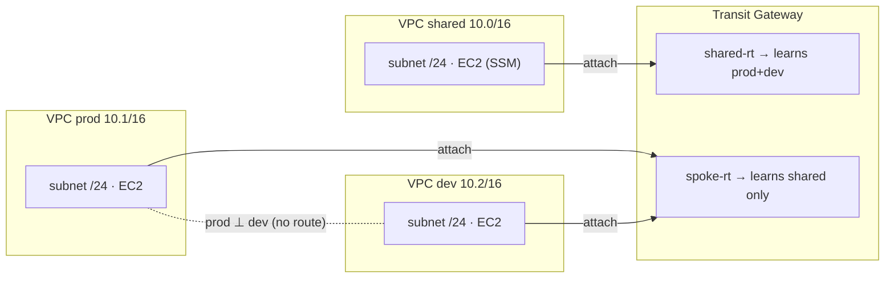
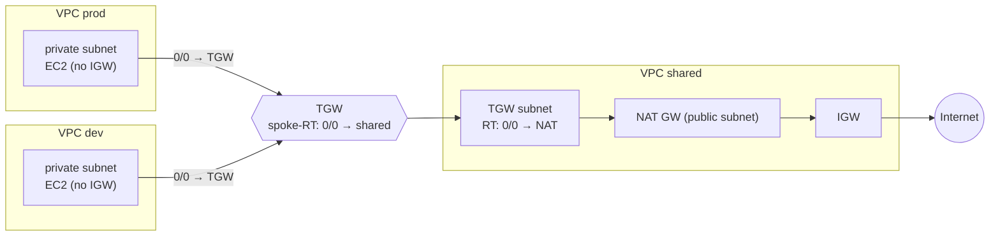
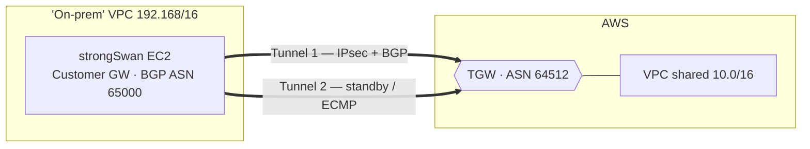
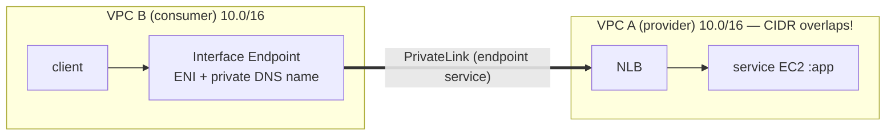
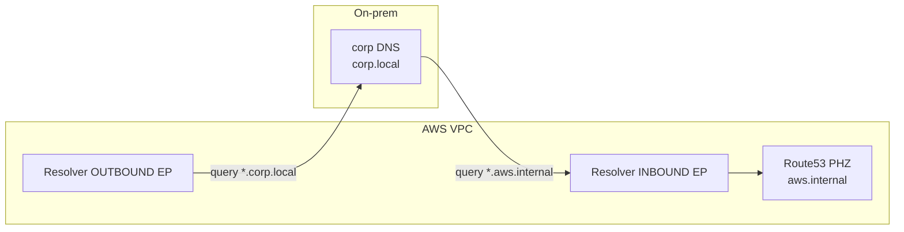
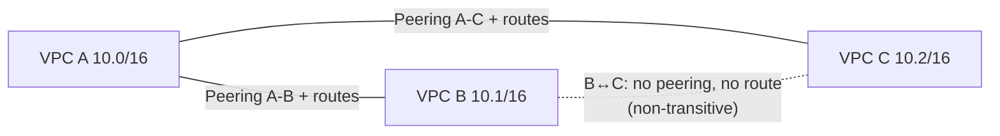
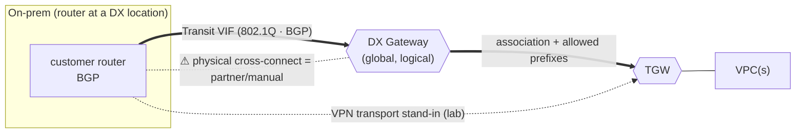
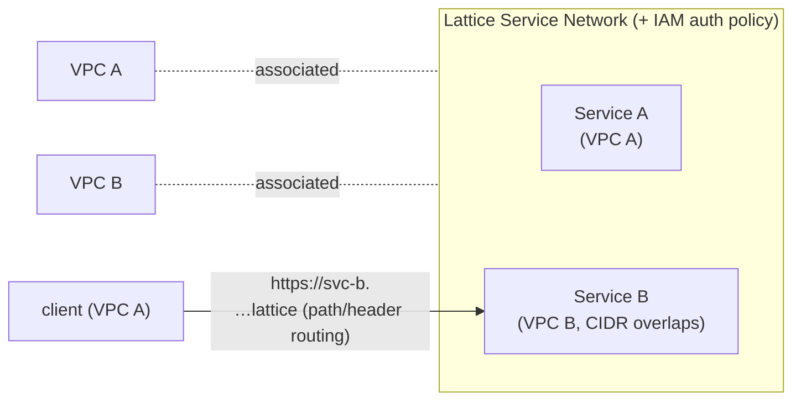

# Network connectivity — test plan

> Code: `~/src/github/trongnvv/aws-iac/network/` (OpenTofu · provider profile `default`).
> Concept / trade-offs / decision map: workbook `01_Knowledge/Network/Cloud-Connectivity/Concept.md`.

Priority order — **most necessary first**. Each lab has **Core** (must pass to call it done) and
**Stretch** (senior-grade: failure modes, scale, edge cases, measured trade-offs). Do Core first,
Stretch if time. No real DC/DX → **on-prem is simulated by a separate VPC + an EC2 running
strongSwan/libreswan** as the Customer Gateway. Write the per-lab note after finishing.

**Per-lab convention:** each lab is **layered** IaC (numbered subfolders — e.g. `1-vpc/ 2-tgw/ 3-ssm/
4-ec2/` — each its own state, + `deploy.sh`/`teardown.sh`), and its README carries an **architecture
diagram + test scenario + troubleshooting + the test-EC2 recipe** (`t4g.micro` + SSM, no SSH).

| # | Lab | Solves (traffic) | Core goal | On-prem sim |
|---|---|---|---|---|
| **1** | TGW hub + segmentation (+ optional egress) | **AWS↔AWS** — many VPCs (>10), hub + segment prod/dev · *opt:* **AWS→Internet** central egress | 3 VPCs via TGW; prod↔shared, dev↔shared, **prod⊥dev** · opt. one NAT in shared | — |
| **2** | Site-to-Site VPN → TGW | **AWS↔on-prem** — hybrid over public Internet, encrypted | on-prem ↔ VPC over IPsec + BGP | VPC + strongSwan |
| **3** | PrivateLink | **AWS↔3rd-party/vendor** — overlapping CIDR / expose one app only | share one service; overlapping CIDR still works | — |
| **4** | Route 53 Resolver | **AWS↔on-prem** — hybrid DNS (the glue: `.corp` ↔ `.aws`) | two-way hybrid DNS | reuse lab-2 on-prem |
| **5** | VPC Peering vs TGW | **AWS↔AWS** — few VPCs (<5–10), the cheap alternative to TGW | non-transitive + measured trade-offs | — |
| **6** | Direct Connect → TGW | **AWS↔on-prem** — private dedicated link (DX Gateway + Transit VIF → TGW); the physical cross-connect is the one partner/manual step | DX Gateway + TGW association + allowed-prefixes; VPN as transport stand-in for the physical port | VPC + strongSwan (stand-in) |
| **7** | VPC Lattice | **AWS↔AWS (L7, service-to-service)** — app-layer connectivity across VPCs/accounts, no routing/CIDR coupling | service network + 2 services across VPCs; overlapping CIDR OK; path/header routing + IAM auth | — |

> **Direct Connect note:** a real DX needs a physical cross-connect at a DX location via a partner, so
> `aws_dx_connection` + the VIF can't be fully provisioned by IaC. Lab 6 builds the **as-code** half
> (DX Gateway + DXGW↔TGW association + routing) and uses a **Site-to-Site VPN as the transport
> stand-in** (the documented "DX + VPN" pattern) so the data path actually works; the physical port is
> documented as the one manual step.
>
> **Out of scope (noted for completeness):** User↔AWS remote access (WFH) = **AWS Client VPN** (OpenVPN)
> or **AWS Verified Access** (zero-trust / identity-based). These labs cover the AWS↔AWS (L3 + L7),
> AWS↔on-prem (VPN + DX), and AWS↔vendor traffic classes end-to-end.

## How the labs differ (side by side)

The biggest practical difference is **what routing you have to wire** — some need route tables both
ways, some need none at all. Read this column first.

| Lab | Layer | **Routing you create** | Transitive | Overlapping CIDR | Encryption | Key thing it proves |
|---|---|---|---|---|---|---|
| **1 TGW** | L3 | **TGW route tables** (assoc + propagation) + VPC route `10/8 → TGW` | ✅ (by design) | ❌ breaks silently | ❌ (AWS backbone) | hub-and-spoke + segment (prod ⊥ dev) |
| **2 VPN** | L3 | **none static — BGP** advertises/learns routes dynamically | ✅ via TGW | ❌ | ✅ IPsec | hybrid on-prem + BGP (failover, ECMP) |
| **3 PrivateLink** | L4 | **none** — traffic goes to the endpoint **ENI**, not routed between VPCs | n/a (one service) | ✅ works fine | TLS to the service | share one service across overlapping CIDRs |
| **4 Resolver** | DNS | peering route only for the **DNS query leg** (53) — not for data | n/a | — (keep CIDRs distinct) | — | two-way hybrid DNS (`.corp` ↔ `.aws`) |
| **5 Peering** | L3 | **a route in each RT, both ways, per pair** (no auto-propagation) | ❌ non-transitive | ❌ | ❌ | non-transitivity — the cheap few-VPC option |
| **6 Direct Connect** | L3 | **BGP** over the Transit VIF + DXGW↔TGW association (allowed prefixes); physical port is manual | ✅ via TGW | ❌ | ❌ by default (add MACsec / VPN-over-DX) | private dedicated link to on-prem (DX Gateway, Transit VIF) |
| **7 Lattice** | L7 | **none** — no route tables, no CIDR planning; reach by Lattice **DNS name** | n/a (service mesh) | ✅ irrelevant | mTLS + IAM auth | L7 service-to-service, auth, overlap OK |

**Read:** TGW/Peering are the "**you own the routes**" labs (Peering = manual both-ways per pair, non-transitive;
TGW = route tables + propagation, transitive). VPN and Direct Connect hand routing to **BGP**. PrivateLink, Lattice and the
DNS data-plane need **no route at all** — that's why they shrug off overlapping CIDRs. Full trade-off /
decision map: vault `Concept.md`.

## Recommended learning order (easy → hard)

Folder numbers above are **stable architecture IDs** (by traffic class), not the order to learn in.
For a smooth difficulty ramp, do them in this sequence — the lab number stays the same, only the order
you tackle them changes:

1. **Lab 5 — Peering** · *easy* — plain L3 routing between VPCs; non-transitivity; baseline latency/MTU.
2. **Lab 3 — PrivateLink** · *easy–med* — share one service (L4); overlapping CIDR; no routing to reason about.
3. **Lab 1 — TGW hub + egress** · *med* — hub-and-spoke, route tables + propagation, segmentation, central NAT.
4. **Lab 7 — Lattice** · *med–high* — step up to L7; service network + IAM auth; forget CIDR/routes.
5. **Lab 2 — VPN → TGW** · *hard* — simulated on-prem (strongSwan) + IPsec + **BGP** — the deepest debug.
6. **Lab 6 — Direct Connect → TGW** · *hard* — **reuses lab 2's BGP/TGW muscle** + DX Gateway/Transit VIF;
   the physical port is the one manual step, VPN is the transport stand-in — so do it right after lab 2.
7. **Lab 4 — Route 53 Resolver** · *synthesis* — two-way hybrid DNS; self-contained, but it lands best once
   the hybrid-connectivity idea (lab 2/6) is in your head.

> ✅ Lab 1 done. Suggested next by this ramp: **Lab 5 → Lab 3** (quick wins), then **Lab 7**, then the
> hybrid trio **2 → 6 → 4**.

---

## Lab 1 — TGW hub + segmentation  (`01-tgw-hub/`)

- **Core:** 3 VPC + TGW + 2 TGW route tables. `shared` reaches prod + dev; `prod`/`dev` reach shared
  but **not each other**. Prove by SSM + ping (shared→both OK; prod→dev times out).
- **Stretch:**
  - [ ] **Blackhole route** on the spoke route table to *actively drop* prod↔dev, and compare with the
        implicit no-route case (blackhole = explicit + auditable + overrides a propagated route).

### Lab 1 · optional — centralized egress (layer `5-egress/`, `enable_egress=true`)
Folded into lab 1 (not a separate lab). Off by default (segmentation stays NAT-free). The shared VPC
is **egress-ready** — its TGW attachment sits in a dedicated subnet — so turning this on only adds a
NAT + routes + spoke private subnets, no rework.

- **Enable:** `(cd 01-tgw-hub/5-egress && tofu apply -var enable_egress=true)`.
- **What:** spokes get a **private subnet (no IGW)**; `0/0 → TGW → shared's NAT → IGW`. One NAT serves
  all VPCs (the enterprise pattern — vs a NAT per VPC).
- **Verify:** SSM into a spoke **private** host (its agent reaches AWS *through* the central NAT) →
  `curl -s https://checkip.amazonaws.com` returns the **shared VPC's NAT EIP** (`tofu output nat_public_ip`).
- Note: NAT Gateway ≈ $0.045/hour + data — `(cd 5-egress && tofu destroy)` after.

## Lab 2 — Site-to-Site VPN → TGW

- **Core:** "on-prem" VPC + strongSwan EC2 as Customer Gateway; IPsec VPN + **BGP** into the TGW;
  ping on-prem ↔ cloud VPC both ways.
- **Stretch:**
  - [ ] **BGP failover/convergence:** drop tunnel 1 (stop IPsec/BGP) → measure time to fail over to tunnel 2.
  - [ ] **ECMP:** enable ECMP on the TGW → confirm traffic load-balances across both tunnels.
  - [ ] **MTU / PMTUD:** `ping -M do -s <size>` (DF bit) to find the working MSS; VPN path ≈ **1500**
        (IPsec overhead → effective MSS ≈ 1379) → add **MSS clamping**; confirm no fragmentation.

## Lab 3 — PrivateLink

- **Core:** NLB-backed service in VPC A → interface endpoint in VPC B; **overlapping CIDR still works**
  (traffic is to the endpoint ENI, not routed between CIDRs).
- **Stretch:**
  - [ ] **Private DNS name:** enable it → the endpoint resolver overrides the service's domain to the
        endpoint's **private IP** (consumer uses the real service DNS name transparently).
  - [ ] **Cross-zone LB:** consumer in AZ-a reaches a target in AZ-b (toggle NLB cross-zone; note the
        cross-AZ data fee).

## Lab 4 — Route 53 Resolver (hybrid DNS)

- **Core:** inbound + outbound endpoints + resolver rules.
- **Stretch:**
  - [ ] **Two-way:** AWS→on-prem resolve `*.corp.local` via the **outbound** endpoint; on-prem→AWS
        resolve `*.aws.internal` via the **inbound** endpoint → Route 53 private hosted zone.
  - [ ] **Reverse DNS (PTR):** verify PTR lookups of internal IPs both directions.

## Lab 5 — VPC Peering vs TGW (trade-offs & limits)

- **Core:** 2 VPCs peered; show **non-transitive** (A↔B, A↔C, but B can't reach C via A).
- **Stretch (measured):**
  - [ ] **Latency + cost:** ping latency + data cost — Peering (**same-AZ free, cross-AZ $0.01/GB**) vs
        TGW (**$0.05/attachment-hour + $0.02/GB** processing).
  - [ ] **MTU:** jumbo **9001** on Peering (intra-region) vs **8500** max over TGW vs **~1500** over VPN.

## Lab 6 — Direct Connect → TGW (private dedicated link)

A **private, dedicated** path to on-prem (vs lab 2's VPN over the public internet): consistent latency,
higher bandwidth, lower egress cost — but a **physical cross-connect at a DX location via a partner**,
so it can't be fully provisioned by IaC.
- **Core (as-code):** `aws_dx_gateway` + **DXGW↔TGW association** with **allowed prefixes**; the TGW +
  VPC side. This is the real, runnable half. Because no physical port exists in the lab, a **Site-to-Site
  VPN is wired as the transport stand-in** (the documented "DX + VPN" topology) so the data path works
  end to end — SSM in and ping across, same as lab 2.
- 🖐️ **The one manual/physical step:** request a **connection** (or hosted connection) from a DX partner,
  then create the **Transit VIF** on it (BGP to the DX Gateway). Documented, not automated.
- **Stretch:**
  - [ ] **VIF types:** Private VIF → VGW (single VPC) vs **Transit VIF** → DXGW → TGW (multi-VPC) vs Public VIF (S3/DDB).
  - [ ] **Encryption:** DX is **not encrypted** by default → MACsec (on supported ports) or **VPN-over-DX**.
  - [ ] **Resilience:** 2 connections / 2 DX locations; DX primary + **VPN backup** (lower BGP local-pref).

## Lab 7 — VPC Lattice (L7 service-to-service)

Different from everything above: **L7 (HTTP/gRPC), not L3 routing**. No route tables, no CIDR planning —
a client reaches a service by its Lattice DNS name; Lattice handles discovery, routing (path/header),
and **IAM-based auth** between services. Overlapping CIDRs are a non-issue (it's not routed at L3).
- **Core:** one **service network**; associate VPC A + VPC B to it; register **Service A** (target =
  EC2/ALB in VPC A) and **Service B** in VPC B. A client in VPC A calls Service B by its Lattice DNS
  name and gets a response — **even with overlapping CIDRs**, no peering/TGW.
- **Stretch:**
  - [ ] **Path/header routing:** one listener → rules routing `/v1` vs `/v2` (or a header) to different
        target groups (the L7 feature TGW/PrivateLink can't do).
  - [ ] **Auth policy (IAM):** attach a service auth policy that only allows a specific principal/VPC →
        a call from an unauthorized client gets **403** (zero-trust service-to-service).
  - [ ] **vs PrivateLink/TGW:** note the trade — Lattice = managed L7 mesh-lite, per-request + data cost,
        newer; PrivateLink = L4 one-service expose; TGW = L3 bulk routing.

---

## Direct Connect — concept-only (no physical port to lab)
Theory + console walkthrough; closest simulation is VPN-over-TGW (lab 2). VIF map → see the Concept doc.

**Why this order:** TGW is the real-world backbone (#1, with centralized egress as its optional add-on)
→ VPN to on-prem is the most common hybrid need (#2) → PrivateLink solves share-a-service +
overlapping-CIDR (#3) → hybrid DNS comes with on-prem (#4) → Peering as the cheap few-VPC alternative
to TGW (#5) → VPC Lattice last: the L7/service-mesh angle on AWS↔AWS, newer and app-layer rather than
routing (#6).
