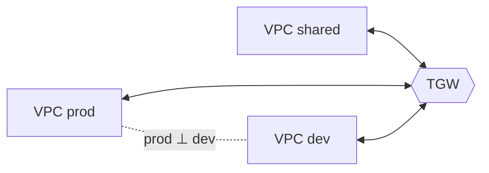
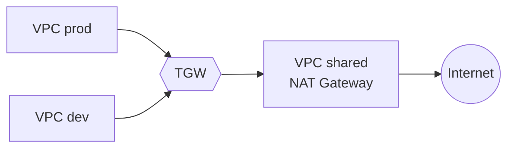
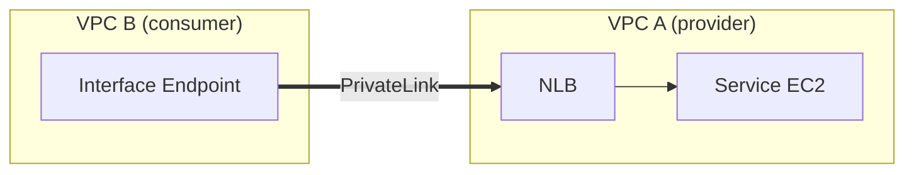
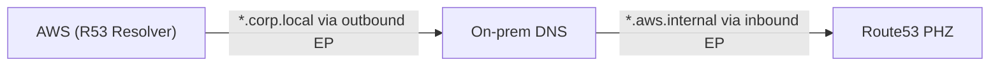
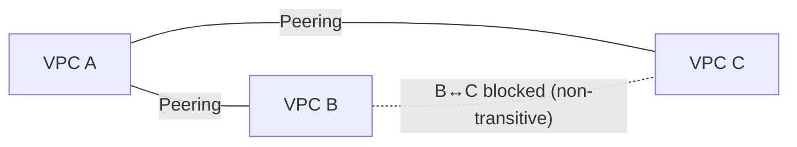

# Network connectivity — test plan

> Code: `~/src/github/trongnvv/aws-iac/network/` (OpenTofu · provider profile `default`).
> Concept / trade-offs / decision map: workbook `01_Knowledge/Network/Cloud-Connectivity/Concept.md`.

Priority order — **most necessary first**. Each lab has **Core** (must pass to call it done) and
**Stretch** (senior-grade: failure modes, scale, edge cases, measured trade-offs). Do Core first,
Stretch if time. No real DC/DX → **on-prem is simulated by a separate VPC + an EC2 running
strongSwan/libreswan** as the Customer Gateway. Write the per-lab note after finishing.

**Per-lab convention:** each lab is **layered** IaC (numbered subfolders — e.g. `1-vpc/ 2-tgw/ 3-ssm/
4-ec2/` — each its own state, + `deploy.sh`/`teardown.sh`), and its README carries an **architecture
diagram + test scenario + troubleshooting + the test-EC2 recipe** (`t4g.micro` + SSM, no SSH).

| # | Lab | Solves (traffic) | Core goal | On-prem sim |
|---|---|---|---|---|
| **1** | TGW hub + segmentation | **AWS↔AWS** — many VPCs (>10), hub + segment prod/dev | 3 VPCs via TGW; prod↔shared, dev↔shared, **prod⊥dev** | — |
| **1b** | Centralized egress | **AWS→Internet** — one shared egress for all VPCs | spokes reach internet via **one NAT in shared** (not NAT per VPC) | — |
| **2** | Site-to-Site VPN → TGW | **AWS↔on-prem** — hybrid over public Internet, encrypted | on-prem ↔ VPC over IPsec + BGP | VPC + strongSwan |
| **3** | PrivateLink | **AWS↔3rd-party/vendor** — overlapping CIDR / expose one app only | share one service; overlapping CIDR still works | — |
| **4** | Route 53 Resolver | **AWS↔on-prem** — hybrid DNS (the glue: `.corp` ↔ `.aws`) | two-way hybrid DNS | reuse lab-2 on-prem |
| **5** | VPC Peering vs TGW | **AWS↔AWS** — few VPCs (<5–10), the cheap alternative to TGW | non-transitive + measured trade-offs | — |

> **Out of scope (noted for completeness):** User↔AWS remote access (WFH) = **AWS Client VPN** (OpenVPN)
> or **AWS Verified Access** (zero-trust / identity-based); **Direct Connect** = concept-only (no physical
> port). These 5 labs cover the AWS↔AWS, AWS↔on-prem, and AWS↔vendor traffic classes end-to-end.

---

## Lab 1 — TGW hub + segmentation  (`01-tgw-hub/`)

- **Core:** 3 VPC + TGW + 2 TGW route tables. `shared` reaches prod + dev; `prod`/`dev` reach shared
  but **not each other**. Prove by SSM + ping (shared→both OK; prod→dev times out).
- **Stretch:**
  - [ ] **Blackhole route** on the spoke route table to *actively drop* prod↔dev, and compare with the
        implicit no-route case (blackhole = explicit + auditable + overrides a propagated route).

## Lab 1b — Centralized egress (one NAT in shared)

- **Core:** spokes get `0.0.0.0/0 → TGW → shared VPC → NAT Gateway → IGW`. Single NAT serves all VPCs
  (the real enterprise pattern — cost vs a NAT per VPC). Verify: from prod/dev the internet works and
  the **public egress IP = shared VPC's NAT EIP**.
- Note: NAT Gateway ≈ $0.045/hour + data — destroy after.

## Lab 2 — Site-to-Site VPN → TGW

- **Core:** "on-prem" VPC + strongSwan EC2 as Customer Gateway; IPsec VPN + **BGP** into the TGW;
  ping on-prem ↔ cloud VPC both ways.
- **Stretch:**
  - [ ] **BGP failover/convergence:** drop tunnel 1 (stop IPsec/BGP) → measure time to fail over to tunnel 2.
  - [ ] **ECMP:** enable ECMP on the TGW → confirm traffic load-balances across both tunnels.
  - [ ] **MTU / PMTUD:** `ping -M do -s <size>` (DF bit) to find the working MSS; VPN path ≈ **1500**
        (IPsec overhead → effective MSS ≈ 1379) → add **MSS clamping**; confirm no fragmentation.

## Lab 3 — PrivateLink

- **Core:** NLB-backed service in VPC A → interface endpoint in VPC B; **overlapping CIDR still works**
  (traffic is to the endpoint ENI, not routed between CIDRs).
- **Stretch:**
  - [ ] **Private DNS name:** enable it → the endpoint resolver overrides the service's domain to the
        endpoint's **private IP** (consumer uses the real service DNS name transparently).
  - [ ] **Cross-zone LB:** consumer in AZ-a reaches a target in AZ-b (toggle NLB cross-zone; note the
        cross-AZ data fee).

## Lab 4 — Route 53 Resolver (hybrid DNS)

- **Core:** inbound + outbound endpoints + resolver rules.
- **Stretch:**
  - [ ] **Two-way:** AWS→on-prem resolve `*.corp.local` via the **outbound** endpoint; on-prem→AWS
        resolve `*.aws.internal` via the **inbound** endpoint → Route 53 private hosted zone.
  - [ ] **Reverse DNS (PTR):** verify PTR lookups of internal IPs both directions.

## Lab 5 — VPC Peering vs TGW (trade-offs & limits)

- **Core:** 2 VPCs peered; show **non-transitive** (A↔B, A↔C, but B can't reach C via A).
- **Stretch (measured):**
  - [ ] **Latency + cost:** ping latency + data cost — Peering (**same-AZ free, cross-AZ $0.01/GB**) vs
        TGW (**$0.05/attachment-hour + $0.02/GB** processing).
  - [ ] **MTU:** jumbo **9001** on Peering (intra-region) vs **8500** max over TGW vs **~1500** over VPN.

---

## Direct Connect — concept-only (no physical port to lab)
Theory + console walkthrough; closest simulation is VPN-over-TGW (lab 2). VIF map → see the Concept doc.

**Why this order:** TGW is the real-world backbone (#1) → centralized egress is the first thing you add
on top (#1b) → VPN to on-prem is the most common hybrid need (#2) → PrivateLink solves share-a-service +
overlapping-CIDR (#3) → hybrid DNS comes with on-prem (#4) → Peering last since TGW supersedes most of it (#5).
