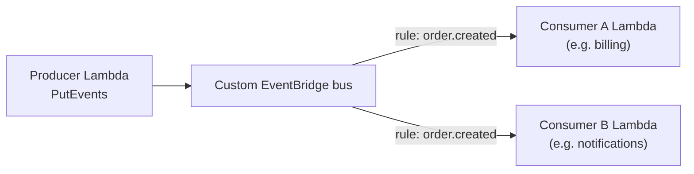
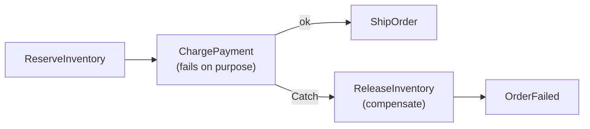
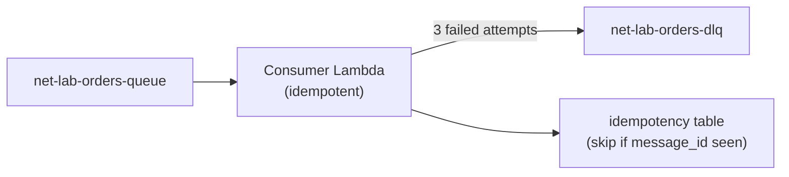
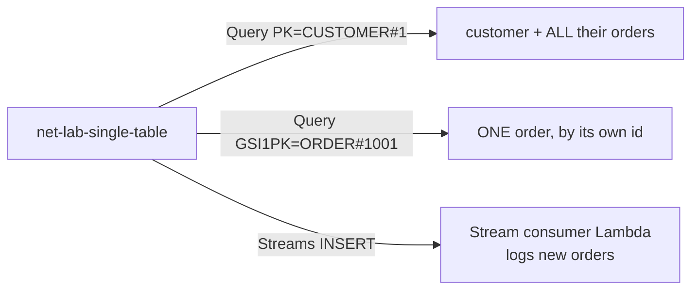
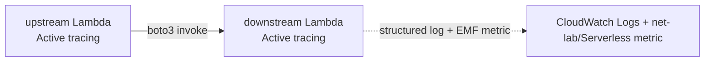
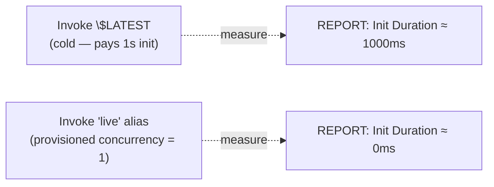
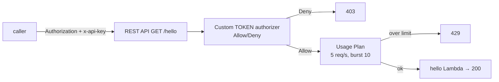
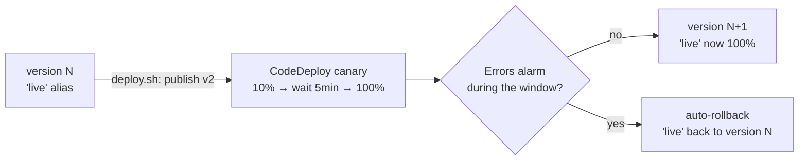

# Serverless — senior-grade test plan

> Code: `~/src/github/trongnvv/aws-iac/serverless/` (OpenTofu · provider profile `default`).
> Concept / trade-offs: workbook `01_Knowledge/AWS/Senior-Guides/` (add a `Serverless.md` as labs land).

Priority order — **what actually separates senior from mid-level serverless work**, not a tour of
every Lambda feature. Each lab has **Core** (must pass) and **Stretch** (failure modes, cost/latency
trade-offs, measured not assumed). Write the per-lab note after finishing.

**Per-lab convention:** same as `../network/` — **layered** IaC (numbered subfolders, each its own
state), `deploy.sh`/`teardown.sh`, README with architecture diagram + test scenario + the test
recipe. State bucket `serverless-iac-tfstate` (mirrors `network-iac-tfstate`).

| # | Lab | Senior differentiator | Core goal |
|---|---|---|---|
| **1** | Event-driven (EventBridge) | Decoupling by default — producers never know consumers exist | custom bus + 2+ independent consumers (fan-out) off one event, schema registry |
| **2** | Step Functions — Saga / compensation | Distributed "transactions" without a real transaction — senior teams design the undo path, not just the happy path | multi-step workflow with a deliberate failure step + compensating actions that undo prior steps |
| **3** | Async resilience (SQS + DLQ) | Most outages in serverless are a poison-pill message, not a Lambda bug | Lambda consumer + DLQ + **idempotent** processing (replay-safe) + batch item failure reporting |
| **4** | DynamoDB single-table design | Mid-level thinks in tables; senior thinks in **access patterns** | one table, 2+ entity types, 1 GSI, DynamoDB Streams → Lambda reacting to changes |
| **5** | Observability (X-Ray + structured logs) | "It broke in prod" means nothing without a trace across Lambda→SQS→Lambda | X-Ray trace spanning 2+ services, Lambda Powertools structured JSON logs + embedded metrics |
| **6** | Lambda performance (cold start, SnapStart/provisioned concurrency) | Senior work is justified by **measured** latency/cost, not defaults | same function cold vs warm vs provisioned-concurrency, p99 latency measured each way |
| **7** | API security (custom authorizer + throttling) | API Gateway wide open behind IAM alone is a junior mistake | Lambda/JWT authorizer + per-client usage plan (rate limit) + a 403 proven from an unauthorized caller |
| **8** | Progressive delivery (alias + CodeDeploy canary) | Shipping serverless straight to 100% traffic is how a bad deploy becomes an outage | Lambda alias + CodeDeploy canary (10% → 100%) + auto-rollback on a CloudWatch alarm |

**Read:** 1–4 are the data/orchestration half (how senior serverless systems are *shaped*); 5–8 are
the operational half (how they're *run safely*). Do 1–4 first — the later labs assume you already
have an event/queue/table to observe, secure, and deploy safely.

## Status
All 8 labs have IaC built and `tofu validate`-clean. None have been `tofu apply`'d yet — same
convention as `../network/`: write + validate first, deploy when you're actually ready to run it,
`./teardown.sh` right after.

| Lab | Core built |
|---|---|
| 1 — Event-driven | ✅ bus, producer, 2 fan-out consumers |
| 2 — Step Functions Saga | ✅ reserve → charge (fails on purpose) → compensate (release) → fail |
| 3 — Async resilience | ✅ SQS + DLQ (maxReceiveCount 3), idempotent consumer, batch item failure reporting |
| 4 — DynamoDB single-table | ✅ 1 table, 2 entity types, GSI1, Streams → Lambda |
| 5 — Observability | ✅ X-Ray trace across 2 Lambdas, structured logs, EMF metric |
| 6 — Lambda performance | ✅ provisioned-concurrency alias vs \$LATEST, compare Init Duration |
| 7 — API security | ✅ custom (TOKEN) authorizer + per-client usage plan/throttling on a REST API |
| 8 — Progressive delivery | ✅ Lambda alias + CodeDeploy canary (10%/5min) + Errors-alarm auto-rollback |

---

## Lab 1 — Event-driven (EventBridge)

- **Core:** a producer Lambda puts an event on a **custom bus**; two independent consumer Lambdas,
  each with its own rule matching the same `detail-type`, both fire — prove fan-out, prove the
  producer has zero knowledge of either consumer (add a 3rd consumer later with no producer change).
- **Stretch:**
  - [ ] **Schema registry:** EventBridge schema discovery on the bus → generate a typed binding,
        show a malformed event's schema violation.
  - [ ] **Archive + replay:** enable an event archive on the bus, replay a window of past events
        into a *new* consumer added after the fact.

## Lab 2 — Step Functions Saga / compensation

- **Core:** `ChargePayment` always raises — the state machine's `Catch` routes to
  `ReleaseInventory` (undoes `ReserveInventory`) then `OrderFailed`, instead of leaving a dangling
  reservation. Flip `charge_payment`'s handler to not raise and the happy path (`ShipOrder`) runs
  instead — same state machine, no redeploy needed to prove both branches conceptually.
- **Stretch:**
  - [ ] Make `ChargePayment` fail probabilistically (not always) and run several executions —
        watch the Step Functions console show both branches across runs.
  - [ ] Add a second compensating step (e.g. `CancelShippingLabel`) to the `Catch` chain.

## Lab 3 — Async resilience (SQS + DLQ)

- **Core:** send a normal message and a `"poison": true` message. The poison one fails every
  attempt, retries 3 times (`maxReceiveCount`), then lands in the DLQ — the good message processes
  once and is recorded in the idempotency table; redelivering it is a no-op.
- **Stretch:**
  - [ ] Send a batch where only some messages are poison — confirm only those come back
        (`ReportBatchItemFailures`), not the whole batch.
  - [ ] Pull a message off the DLQ and manually redrive it back to the main queue.

## Lab 4 — DynamoDB single-table design

- **Core:** write a customer item and an order item under the same `PK`; prove both access
  patterns (base table query for "customer + orders", GSI1 query for "order by its own id"); the
  stream consumer logs the order INSERT without any application code polling the table.
- **Stretch:**
  - [ ] Add a third entity type (e.g. `REVIEW#<id>`) under the same `PK` with zero schema change.
  - [ ] Have the stream consumer write an aggregate (e.g. order count) back to the customer item.

## Lab 5 — Observability (X-Ray + structured logs + EMF)

- **Core:** invoking `upstream` produces ONE X-Ray trace spanning both functions (no X-Ray SDK
  import needed — Lambda's runtime auto-instruments a traced boto3 call); `downstream` emits a
  structured JSON log line and an EMF line that CloudWatch turns into the `ProcessingTimeMs`
  metric with no extra `PutMetricData` call.
- **Stretch:**
  - [ ] Add a CloudWatch alarm on `ProcessingTimeMs` p99.
  - [ ] Use CloudWatch Logs Insights to query the structured logs by `request_id` across both functions.

## Lab 6 — Lambda performance (provisioned concurrency)

- **Core:** the function's global-scope `time.sleep(1)` stands in for a heavy import/init cost.
  Invoking `$LATEST` right after deploy pays it inline (visible as `Init Duration` in the
  CloudWatch REPORT line); invoking the `live` alias (provisioned concurrency) doesn't, because
  AWS already ran that init ahead of time.
- **Stretch:**
  - [ ] Graph p50/p99 `Duration` (not `Init Duration`) across 20 invokes each way.
  - [ ] Try `aws_lambda_function.snap_start` (where the runtime supports it) as a third comparison point.

## Lab 7 — API security (authorizer + usage plan)

- **Core:** a missing/wrong `Authorization` header gets **403** from the custom authorizer before
  the backend Lambda ever runs; a correct token + valid `x-api-key` gets **200**; bursting past
  the usage plan's rate limit gets **429** — two independent controls (authn/authz vs throttling),
  proven separately.
- **Stretch:**
  - [ ] Add a second API key on a *different* usage plan (looser limit) — same authorizer, two
        different throttling tiers.
  - [ ] Swap the hand-rolled token check for a real JWT verify (Cognito User Pool authorizer).

## Lab 8 — Progressive delivery (alias + CodeDeploy canary)

- **Core:** Terraform wires the static infra (versioned function, `live` alias, CodeDeploy
  app/deployment group with `LambdaCanary10Percent5Minutes`, an Errors alarm wired as the
  rollback trigger); `deploy.sh` does the imperative part a real pipeline would — publish a new
  version, build the AppSpec, call `aws deploy create-deployment` — so the alias shifts 10% → 100%
  over 5 minutes instead of jumping straight to all traffic.
- **Stretch:**
  - [ ] Run the rollback demo for real: `tofu apply -var version_label=v3 -var fail=true`, deploy
        it, then invoke the alias a few times during the canary window — the Errors alarm trips
        and CodeDeploy rolls `live` back to the previous version automatically.
  - [ ] Compare `LambdaCanary10Percent5Minutes` against `LambdaLinear10PercentEvery1Minute` —
        canary (one jump then hold) vs linear (steady ramp) traffic-shift shapes.
